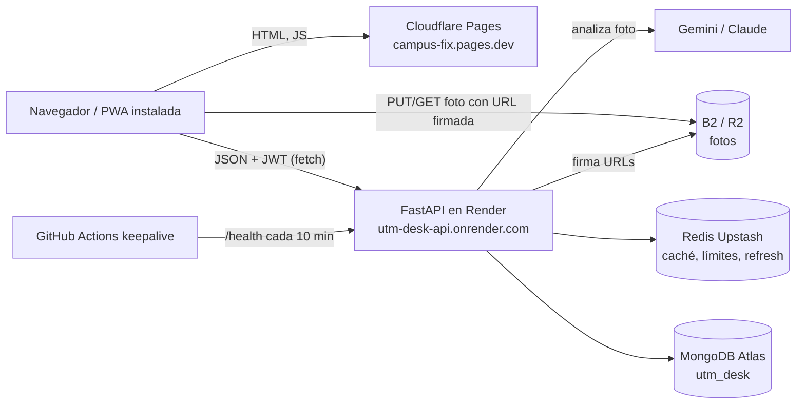
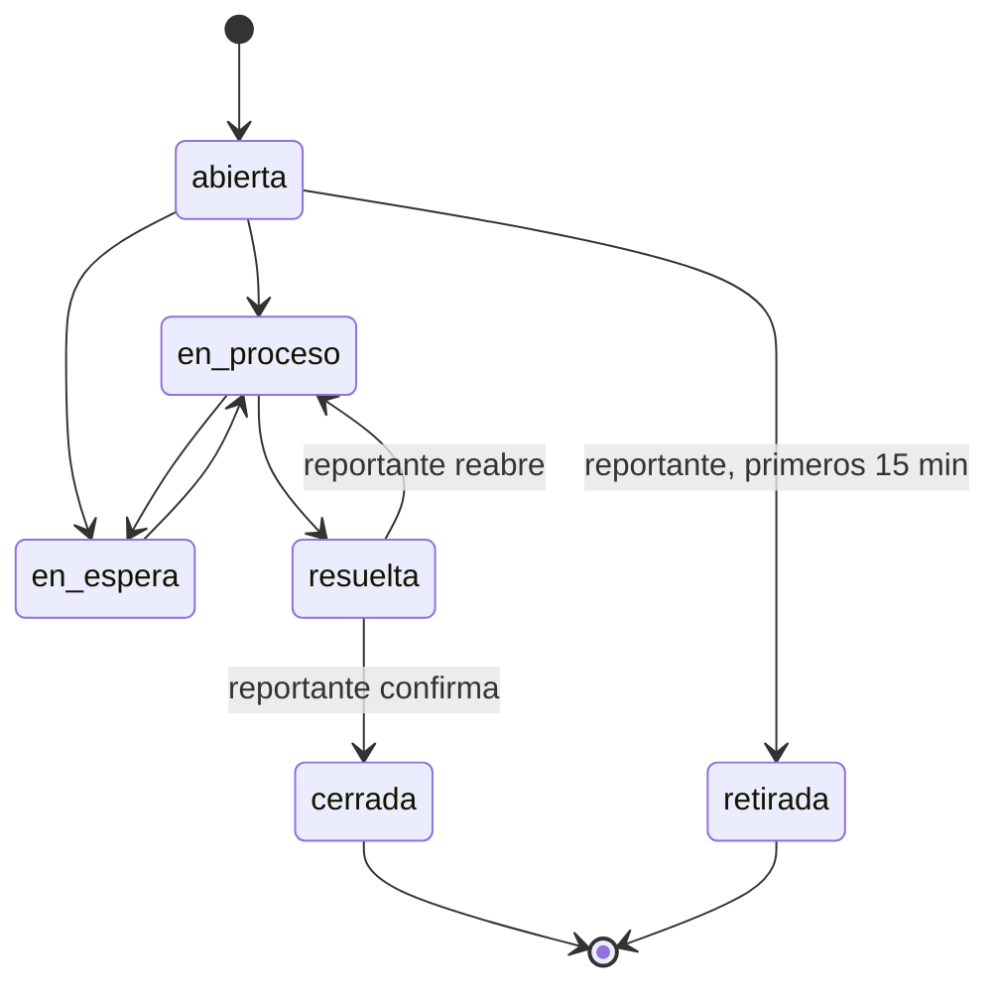

# Campus Fix (UTM Desk): arquitectura, carpetas, flujo de trabajo y CORS

Documento de referencia del sistema completo. Para las reglas detalladas de cada tema ver `docs/reglas/`
(API, base de datos, Git, front-back, UX) y `CONTRIBUTING.md`.

---

## 1. Qué es

Mesa de ayuda del campus: cualquier persona reporta una falla (con foto y ubicación), un técnico la atiende
y el reportante confirma que quedó resuelta. Cada cambio de estado lo ven todos los roles casi al instante.

| Pieza | Tecnología | Dónde corre |
|---|---|---|
| Frontend (PWA) | React 19 + Vite + TypeScript, TanStack Query, zustand | Cloudflare Pages → https://campus-fix.pages.dev |
| Backend (API) | Python 3 + FastAPI | Render (Docker, plan gratuito) → https://utm-desk-api.onrender.com |
| Base de datos | MongoDB Atlas (M0), base `utm_desk` | Atlas |
| Caché / límites | Redis (Upstash) | Upstash |
| Fotos | Almacenamiento S3 compatible (Backblaze B2 / Cloudflare R2) | B2 / R2 |
| IA de fotos | Gemini (o Claude) | API externa |
| Código | GitHub `canulcua123-source/campus-fix` | GitHub + GitHub Actions |

---

## 2. Arquitectura



### 2.1 Capas del backend (puertos y adaptadores, ver `docs/adr/001-puertos-adaptadores.md`)

```
Petición HTTP
   │
   ▼
routers/        ← endpoints: reciben la petición, revisan permisos y responden
   │
   ├─► schemas/     ← validan la forma de los datos (Pydantic)
   ├─► core/security.py ← quién es el usuario, qué permisos y qué alcance tiene
   ├─► dominio/     ← reglas puras del negocio (estados, folio, tags), sin base de datos
   ├─► services/    ← lógica más grande: duplicados, IA, métricas
   └─► adaptadores/ ← conexión a servicios externos (almacenamiento de fotos)
   │
   ▼
core/db.py  ← conexión compartida a MongoDB y Redis
```

### 2.2 Capas del frontend

```
pages/          ← pantallas (Reportar, Bandeja, Tablero, CentroControl…)
   │
components/     ← piezas reutilizables (TarjetaIncidencia, Timeline, FormSeguimiento…)
   │
api/hooks/      ← "ganchos" de TanStack Query: piden datos y los refrescan solos
   │
api/*.ts        ← una función por endpoint de la API
   │
api/client.ts   ← fetch central: pone el token, renueva la sesión, maneja errores
   │
schemas/        ← validan con Zod que lo que responde la API tenga la forma esperada
```

`api/frescura.ts` decide qué listas se recargan después de cada cambio (por ejemplo, al cambiar un estado
se refrescan detalle, bandeja, tablero y dashboard). Además las listas se consultan solas cada 30–60 s y
al volver a la pestaña. `auth/sincronizar.ts` revisa `/auth/me` cada 60 s para que el menú siga el rol
actual sin cerrar sesión.

---

## 3. Estructura de carpetas

```
utm-desk/
├── backend/                     API en Python (FastAPI)
│   ├── Dockerfile               imagen que despliega Render
│   ├── app/
│   │   ├── main.py              arranque de la app, CORS, middlewares, registro de routers
│   │   ├── core/                infraestructura compartida
│   │   │   ├── config.py        variables de entorno (CORS_ORIGINS, JWT, Mongo, Redis…)
│   │   │   ├── db.py            conexión a MongoDB y Redis
│   │   │   ├── security.py      JWT, permisos, filtro_alcance / filtro_visibilidad
│   │   │   ├── refresh_tokens.py sesiones largas (cookie HttpOnly)
│   │   │   ├── auditoria.py     escribe la bitácora de acciones administrativas
│   │   │   ├── limiter.py       límite de peticiones por minuto
│   │   │   ├── cache*.py        caché en Redis
│   │   │   ├── storage.py       URLs firmadas para fotos
│   │   │   ├── imagen.py        validación de imágenes
│   │   │   ├── ubicacion.py     edificios / aulas
│   │   │   ├── errores.py       formato único de errores
│   │   │   └── serial.py        conversión de documentos Mongo a JSON
│   │   ├── dominio/             reglas de negocio puras
│   │   │   ├── estados.py       transiciones permitidas de una incidencia
│   │   │   ├── folio.py         formato INC-AAAA-MMDD-CAT-NNNN
│   │   │   ├── categorias.py, detalle.py, tags.py
│   │   │   └── puertos.py       interfaces de los adaptadores
│   │   ├── routers/             endpoints
│   │   │   ├── auth.py          login, refresh, logout, /auth/me
│   │   │   ├── incidencias.py   crear, listar, buscar, asignar, seguimiento, confirmar, retirar
│   │   │   ├── usuarios.py, roles.py, categorias.py, aulas.py
│   │   │   ├── analitica.py     dashboard
│   │   │   ├── ia.py            sugerencias de IA sobre la foto
│   │   │   ├── config.py        configuración de IA
│   │   │   ├── auditoria.py     consulta de la bitácora (solo superadmin)
│   │   │   └── sistema.py       Centro de control (solo superadmin)
│   │   ├── schemas/             modelos Pydantic de entrada/salida
│   │   ├── services/
│   │   │   ├── duplicados.py    huellas de fotos y detección de reportes repetidos
│   │   │   ├── ia.py, ia_eventos.py, metricas_ia.py, config_ia.py
│   │   │   └── vision/          proveedores de IA (gemini.py, claude.py), cupos, prompt, decisión
│   │   └── adaptadores/
│   │       └── storage_b2.py    cliente S3 para B2 / R2
│   ├── scripts/                 init_db.py (índices y datos base), respaldo.sh, QR de aulas, etc.
│   └── tests/                   unit/, e2e/, eval_ia/, fakes/ (pytest)
│
├── frontend/                    PWA en React
│   ├── functions/api/[[path]].ts  Pages Function: proxy /api/* → Render (ver §6.3)
│   ├── public/                  íconos, _headers (seguridad y caché), _redirects (SPA)
│   ├── src/
│   │   ├── main.tsx, App.tsx    arranque y rutas
│   │   ├── pages/               pantallas
│   │   ├── components/          componentes (ui/, admin/, graficas/)
│   │   ├── api/                 client.ts, una función por endpoint, hooks/, frescura.ts
│   │   ├── auth/                store.ts (sesión), usePermiso, RequirePermiso, sincronizar.ts
│   │   ├── schemas/             validación Zod de respuestas
│   │   ├── lib/                 utilidades (imagen, fechas, estados, csv, tags…)
│   │   ├── proxy/               lógica del proxy, probada con vitest
│   │   └── test/                configuración de pruebas y mocks (msw)
│   └── vite.config.ts, vitest.config.ts
│
├── docs/
│   ├── ARQUITECTURA.md          este documento
│   ├── reglas/                  reglas del equipo: API, BASE-DE-DATOS, GIT, FRONT-BACK, UX-UI
│   ├── bd/                      índices, aulas/QR, categorías dinámicas, respaldo
│   ├── adr/                     decisiones de arquitectura
│   ├── infra/b2-cors.json       CORS del bucket de fotos
│   └── revision-acceso/         qué pantalla ve cada rol
├── postman/                     colección de la API (se corre en CI)
├── scripts/github/              crear issues/ramas, proteger ramas, revisar reglas de BD
├── .github/workflows/           CI/CD (ver §5)
├── render.yaml                  despliegue del backend en Render
├── docker-compose.yml           Mongo + Redis para desarrollo local
├── CONTRIBUTING.md, AGENTS.md, CLAUDE.md
└── README.md
```

---

## 4. Datos (MongoDB `utm_desk`)

| Colección | Qué guarda |
|---|---|
| `incidencias_campus` | Cada reporte: folio, estado, prioridad, ubicación, técnico, bitácora de seguimiento, fotos |
| `usuarios` | Cuentas, contraseña cifrada, rol, área/edificio, activo |
| `roles` | Permisos de cada rol |
| `categorias` | Categorías y sus campos específicos |
| `aulas` | Edificios, pisos y aulas |
| `auditoria` | Quién hizo qué (solo superadmin) |
| `configuracion_ia` | Ajustes de la IA |
| `ia_eventos` | Cada sugerencia de IA y si se aceptó (base de Métricas IA) |
| `huellas_reportes` | Huella de cada foto (SHA-256 exacto + dHash parecido), ventana de 24 h |
| `coincidencias_duplicados` | Cuando una foto nueva se parece a una existente |
| `adhesiones_reportes` | Cuando alguien se une a un reporte existente en lugar de crear otro |

### 4.1 Ciclo de vida de una incidencia (`dominio/estados.py`)



### 4.2 Roles

| Rol | Quién es | Ve / hace |
|---|---|---|
| `superadmin` | El desarrollador / dueño | Todo. Únicos permisos: `sistema:administrar` (Centro de control, Auditoría, Métricas IA), `roles:gestionar`, `configuracion:gestionar`. Puede limitar al admin |
| `admin` | Administrador de la escuela (no técnico) | Operación diaria: incidencias, usuarios no privilegiados, categorías, edificios, dashboard |
| `tecnico` | Personal de mantenimiento / TI | "Mis incidencias" de su área y sus propios reportes; registra seguimiento |
| `reportante` | Alumnos y personal | Reporta, ve sus reportes, confirma o reabre, retira en 15 min |

---

## 5. Flujo de trabajo (Git y CI/CD)

### 5.1 Ramas

```
main  ← producción. Solo recibe PR desde dev (merge commit).
 ▲
dev   ← integración. Solo recibe PR desde ramas <tipo>/<issue>-<slug> (squash).
 ▲
feat/123-algo, fix/45-otro, docs/…  ← una rama por issue
```

Pasos para cada cambio:

1. Crear issue en GitHub.
2. Rama desde `dev`: `<tipo>/<issue>-<slug>` (tipos: feat, fix, docs, test, chore, refactor, ci).
3. Commits en Conventional Commits, asunto en minúscula: `fix(api): corrige búsqueda por folio`.
4. PR a `dev` con `Closes #<issue>` en el cuerpo → CI verde → **squash merge**.
5. PR de release `dev → main` → CI verde → **merge commit**.
6. El push a `main` despliega solo (ver §5.3).

No se hace back-merge de `main` a `dev`: `dev` rechaza merge commits y el código queda idéntico.

### 5.2 Workflows de GitHub Actions (`.github/workflows/`)

| Workflow | Cuándo | Qué revisa |
|---|---|---|
| `branch-flow.yml` | Cada PR | `main` solo desde `dev`; `dev` solo desde ramas con nombre válido |
| `pr-rules.yml` | Cada PR | Título en Conventional Commits; `Closes #N` (excepto release); aviso si la rama va atrás |
| `ci.yml` | PR a dev/main y push a dev | Detecta qué cambió y corre: backend (`ruff` + `pytest`), frontend (`lint` + `vitest` + `build`), Postman. Resumen en `ci-ok` |
| `seguridad.yml` | PR a dev/main | `gitleaks` (secretos filtrados) y reglas de base de datos |
| `keepalive.yml` | Cada 10 min | Llama `/health` para que Render no se duerma |

### 5.3 Despliegue

| Qué | Disparador | Configuración |
|---|---|---|
| Backend | Push a `main` → Render reconstruye el Docker | `render.yaml` (`autoDeploy: true`, `healthCheckPath: /health`). Secretos en el panel de Render |
| Frontend | Push a `main` → Cloudflare Pages ejecuta `npm run build` | Variables en Pages: `VITE_API_URL`, `API_ORIGIN` |

### 5.4 Desarrollo local

```bash
docker compose up -d                 # Mongo 7 + Redis
cd backend && uvicorn app.main:app --reload    # API en :8000
cd frontend && npm run dev           # PWA en :5173 (VITE_API_URL=http://localhost:8000)
```

---

## 6. CORS y sesión

La PWA (`campus-fix.pages.dev`) y la API (`utm-desk-api.onrender.com`) son **orígenes distintos**, así que
el navegador solo deja que la PWA llame a la API si ésta responde con las cabeceras CORS correctas.

### 6.1 CORS de la API (`backend/app/main.py`)

```python
app.add_middleware(
    CORSMiddleware,
    allow_origins=settings.cors_lista,      # CORS_ORIGINS en Render, separado por comas
    allow_credentials=True,                 # permite la cookie HttpOnly de refresh
    allow_methods=["GET", "POST", "PATCH", "DELETE", "OPTIONS"],
    allow_headers=["Authorization", "Content-Type", "Idempotency-Key"],
    max_age=600,                            # el navegador recuerda el permiso 10 min
)
```

- `CORS_ORIGINS` **no admite `*`**: `core/config.py` lo rechaza al arrancar.
- Valor local por defecto: `http://localhost:5173`.
- Además, login/refresh/logout validan el `Origin` contra CSRF (`routers/auth.py::_validar_origen_csrf`).

Verificado en producción (30-oct-2026):

| Origin de la petición | Respuesta del preflight |
|---|---|
| `https://campus-fix.pages.dev` | 200 + `Access-Control-Allow-Origin: https://campus-fix.pages.dev` |
| cualquier otro dominio | 400, sin `Access-Control-Allow-Origin` (bloqueado) |

### 6.2 CORS del almacenamiento de fotos (`docs/infra/b2-cors.json`)

Las fotos se suben **directo del navegador al bucket** con una URL firmada que entrega la API; por eso el
bucket tiene su propio CORS: orígenes `https://campus-fix.pages.dev` y `http://localhost:5173`, operaciones
PUT/GET/HEAD, cabecera `content-type`. Si se agrega un dominio nuevo hay que actualizar **a la vez**
`CORS_ORIGINS` en Render y este archivo.

### 6.3 Sesión y proxy `/api`

- **Access token** (JWT, 15 min) en memoria; viaja en `Authorization: Bearer`.
- **Refresh token** (7 días) en cookie HttpOnly; `api/client.ts` llama `/auth/refresh` con `credentials: 'include'`.
- `frontend/functions/api/[[path]].ts` es un proxy same-origin `/api/*` → Render para que la cookie sea de
  primera parte (Safari/iOS bloquea cookies de terceros).

Estado actual en producción:

- El build de producción llama **directo** a `https://utm-desk-api.onrender.com` (no usa `/api`).
- `https://campus-fix.pages.dev/api/health` responde **502** ("No fue posible contactar la API"): falta o es
  incorrecta la variable `API_ORIGIN` en Cloudflare Pages.
- Por eso `render.yaml` usa `REFRESH_COOKIE_SAMESITE=none` + `Secure` (cookie de terceros). En iPhone/Safari
  la sesión puede vencerse antes.
- Para activar el proxy: poner `API_ORIGIN=https://utm-desk-api.onrender.com` y `VITE_API_URL=/api` en Pages,
  redesplegar y cambiar `REFRESH_COOKIE_SAMESITE` a `lax` en Render.

### 6.4 Cabeceras de seguridad de la PWA (`frontend/public/_headers`)

`X-Frame-Options: DENY`, `nosniff`, HSTS, `Permissions-Policy: camera=(self)`. `sw.js`, `manifest` e
`index.html` sin caché (las actualizaciones de la PWA llegan al instante); `/assets/*` inmutables.

---

## 7. Recorrido de una petición (ejemplo: técnico marca "resuelta")

1. Pantalla `DetalleIncidencia` → `FormSeguimiento` → hook `useSeguimiento` (`api/hooks/incidencias.ts`).
2. `api/client.ts` hace `PATCH /incidencias/{id}/seguimiento` con el JWT.
3. Navegador hace el preflight CORS; la API lo acepta para `campus-fix.pages.dev`.
4. `routers/incidencias.py` revisa permiso `seguimiento:registrar` y alcance (`core/security.py`).
5. `dominio/estados.py` valida `en_proceso → resuelta`.
6. Se guarda en `incidencias_campus` (estado + entrada en la bitácora).
7. La respuesta vuelve; `api/frescura.ts` invalida detalle, bandeja, tablero y dashboard.
8. Los demás usuarios lo ven en su siguiente consulta automática (≤ 30–60 s) o al volver a la pestaña.
