# Backlog de UTM Desk · Tareas para el equipo

> Fuente única: `scripts/github/tareas.json`. Este documento y los issues de GitHub (`scripts/github/crear-issues.py`) se generan de ahí: si cambias una tarea, cambia el JSON y vuelve a generar. Repositorio: `canulcua123-source/campus-fix`.

## Reglas del proyecto (resumen)

- **Lee antes de programar** (personas e IA): [`AGENTS.md`](../AGENTS.md), [`CONTRIBUTING.md`](../CONTRIBUTING.md) y [`docs/reglas/`](reglas/README.md) — [BASE-DE-DATOS](reglas/BASE-DE-DATOS.md), [API](reglas/API.md), [CREAR-API](reglas/CREAR-API.md), [FRONT-BACK](reglas/FRONT-BACK.md), [UX-UI](reglas/UX-UI.md).
- Rama `<tipo>/<número del issue>-slug` (ej. `feat/12-login`, la exige el CI) desde `dev` actualizado; nunca commits directos a `dev`/`main`; PR → `dev` con `Closes #N`; squash merge.
- 1 PR = 1 tarea, ≤ ~400 líneas; rebase sobre `origin/dev` **cada día** y antes de pedir revisión.
- Ninguna IA se conecta a Atlas ni a entornos remotos; solo la BD local de Docker. Nada de borrados masivos.
- Cambios de contrato: **primero backend** (Pydantic + OpenAPI + Postman), después frontend (Zod + UI) en otro PR.
- `backend/scripts/init_db.py` solo lo edita el DBA. `requirements*.txt`, `package.json` y `package-lock.json`: un cambio por PR y vía su propietario; nunca dos PR abiertos que toquen el mismo lockfile o `init_db.py`.
- Toda tarea declara sus **Archivos**; si vas a tocar un archivo fuera de esa lista, avisa en el issue antes (ver «Matriz de conflictos»).

## Resumen

**75 tareas · 479 h estimadas** · Fase 1: 45 · Fase 2: 30

| Épica | Tareas | Horas | Debe | Debería | Podría |
| --- | --- | --- | --- | --- | --- |
| DevOps/CI | 6 | 25 | 5 | 1 | 0 |
| BD/Atlas | 7 | 43 | 4 | 3 | 0 |
| Backend | 10 | 69 | 4 | 5 | 1 |
| IA | 16 | 119 | 4 | 10 | 2 |
| Frontend | 24 | 149 | 19 | 4 | 1 |
| QA | 4 | 27 | 2 | 2 | 0 |
| Revisión de acceso | 4 | 22 | 4 | 0 | 0 |
| Documentación/Defensa | 4 | 25 | 4 | 0 | 0 |

| Rol responsable | Tareas | Horas | IDs |
| --- | --- | --- | --- |
| Líder / arquitecto | 13 | 84 | T-002, T-015, T-032, T-039, T-051, T-055, T-057, T-061, T-071, T-072, T-073, T-074, T-075 |
| DBA MongoDB | 13 | 79 | T-007, T-008, T-009, T-010, T-011, T-012, T-013, T-022, T-035, T-038, T-053, T-056, T-068 |
| Backend | 16 | 113 | T-014, T-016, T-017, T-018, T-019, T-020, T-021, T-023, T-025, T-027, T-028, T-029, T-030, T-033, T-036, T-045 |
| Frontend / UX | 18 | 117 | T-024, T-037, T-040, T-041, T-042, T-043, T-044, T-046, T-047, T-048, T-049, T-052, T-054, T-058, T-059, T-060, T-062, T-063 |
| QA / DevOps | 15 | 86 | T-001, T-003, T-004, T-005, T-006, T-026, T-031, T-034, T-050, T-064, T-065, T-066, T-067, T-069, T-070 |

La estimación asume 4-5 personas programando con IA (~20-30 h efectivas por semana cada una). Todos deben poder explicar índices, operaciones atómicas, pipelines y control de acceso: la defensa es individual.

## Cómo tomar una tarea

1. Elige un issue sin asignar de la **ola actual** de tu semana cuyas dependencias estén cerradas. Revisa en la «Matriz de conflictos» que nadie tenga abierto un PR sobre los mismos archivos.
2. Asígnatelo en GitHub (*Assignees → yo*) y muévelo a *En progreso*.
3. Crea la rama desde `dev` actualizado:
   ```bash
   git switch dev && git pull --ff-only
   git switch -c feat/12-slug-corto   # 12 = número del issue en GitHub (no el T-0XX); fix/ si es BUG, docs/ si es documentación
   ```
4. Si usas IA, pégale el issue completo (criterios + pruebas + archivos) y el documento de `docs/reglas/` que aplique. Pídele que **no toque archivos fuera de la lista**.
5. Escribe primero las pruebas requeridas (nombres sugeridos en el issue), luego el código. Corre lint y pruebas locales.
6. `git fetch origin && git rebase origin/dev`, push y abre PR hacia `dev` con título Conventional Commits y `Closes #<issue>` en el cuerpo. Completa el checklist de la plantilla (capturas si hay UI).
7. Pide revisión a un propietario del área (CODEOWNERS). Tras aprobación + CI verde: *Squash and merge*.

### Definición de terminado (común a todas las tareas)

- [ ] CI verde (lint + pruebas backend + build/pruebas frontend)
- [ ] PR hacia `dev` aprobado por al menos 1 compañero, con `Closes #<issue>`
- [ ] Pruebas requeridas de esta tarea escritas y pasando
- [ ] Contrato sincronizado: OpenAPI (/docs), colección Postman y esquemas Zod actualizados si cambió la API
- [ ] Capturas (móvil y escritorio) en el PR si la tarea toca UI
- [ ] Sin secretos en el repo; variables nuevas documentadas en README y `.env.example`

## Tablero por épica

### DevOps/CI

| ID | Tarea | Rol | Prioridad | Fase | Sem. | h | Depende de |
| --- | --- | --- | --- | --- | --- | --- | --- |
| [T-001](#t-001) | CI en GitHub Actions: lint y pruebas de backend y frontend | QA / DevOps | Debe | F1 | 1 | 6 | — |
| [T-002](#t-002) | Flujo de trabajo del equipo: rama dev, plantillas de issue/PR y protección de ramas | Líder / arquitecto | Debe | F1 | 1 | 3 | — |
| [T-003](#t-003) | Deuda de Ruff (B904/B007) y PR aislado de `ruff format` | QA / DevOps | Debería | F1 | 1 | 3 | — |
| [T-004](#t-004) | Desplegar la API en Render o Koyeb conectada a Atlas, Upstash y B2 | QA / DevOps | Debe | F1 | 2 | 6 | T-001, T-007 |
| [T-005](#t-005) | Desplegar la PWA en Cloudflare Pages | QA / DevOps | Debe | F1 | 2 | 4 | T-001 |
| [T-006](#t-006) | CORS de producción en la API y en el bucket B2 | QA / DevOps | Debe | F1 | 2 | 3 | T-004, T-005 |

### BD/Atlas

| ID | Tarea | Rol | Prioridad | Fase | Sem. | h | Depende de |
| --- | --- | --- | --- | --- | --- | --- | --- |
| [T-007](#t-007) | Aplicar validador $jsonSchema e índices nuevos en Atlas M0 | DBA MongoDB | Debe | F1 | 1 | 3 | T-008, T-068 |
| [T-008](#t-008) | $jsonSchema para usuarios/roles/categorias y alineación de documentos (seed admin, historial) | DBA MongoDB | Debe | F1 | 1 | 6 | — |
| [T-009](#t-009) | Datos sintéticos 20-30 incidencias que cumplan el PDF + verificador automático | DBA MongoDB | Debe | F1 | 2 | 10 | T-007 |
| [T-010](#t-010) | Respaldos con mongodump (M0 no tiene respaldos automáticos) | DBA MongoDB | Debería | F2 | 4 | 4 | T-007 |
| [T-011](#t-011) | Pipelines F2: fallas crónicas por aula, carga por técnico y tendencia mensual | DBA MongoDB | Debería | F2 | 3 | 8 | T-009 |
| [T-012](#t-012) | ⚑ Catálogo de aulas (id opaco) + generador de QR + ruta /reportar?aula= | DBA MongoDB | Debería | F2 | 4 | 8 | — |
| [T-013](#t-013) | Script maestro consolidado y export JSON para el entregable | DBA MongoDB | Debe | F2 | 4 | 4 | T-009 |

### Backend

| ID | Tarea | Rol | Prioridad | Fase | Sem. | h | Depende de |
| --- | --- | --- | --- | --- | --- | --- | --- |
| [T-014](#t-014) | Refresh token en cookie HttpOnly + POST /auth/refresh + POST /auth/logout | Backend | Debe | F1 | 1 | 8 | — |
| [T-015](#t-015) | Módulo dominio/ y puerto/adaptador de storage | Líder / arquitecto | Debería | F1 | 1 | 10 | T-001 |
| [T-016](#t-016) | Unificar forma de error {error, detalle} en la API (HTTPException, DuplicateKeyError, 429) | Backend | Debe | F1 | 1 | 5 | — |
| [T-017](#t-017) | Contratos Pydantic estrictos: extra=forbid, a_json, fechas con Z, horas 0.25 y dominio institucional | Backend | Debe | F1 | 1 | 6 | T-016 |
| [T-018](#t-018) | Caché Redis de analítica (5 min) + endpoint de KPIs y filtros por periodo/categoría | Backend | Debe | F1 | 2 | 8 | — |
| [T-019](#t-019) | Categorías dinámicas: CRUD de categorías con definición de campos | Backend | Debería | F2 | 3 | 8 | T-015 |
| [T-020](#t-020) | Validar detalle_especifico contra la categoría dinámica + categoria_version e índice wildcard | Backend | Debería | F2 | 3 | 6 | T-019 |
| [T-021](#t-021) | Acciones F2 del flujo: confirmar/reabrir, agregar info en espera y autoasignación | Backend | Debería | F2 | 4 | 8 | T-015 |
| [T-022](#t-022) | Bitácora de auditoría de acciones administrativas | DBA MongoDB | Debería | F2 | 4 | 6 | T-019 |
| [T-023](#t-023) | ⚑ (Opcional) Estado `retirada` y «Retirar mi reporte» (≤ 15 min, abierta, sin asignar) | Backend | Podría | F2 | 4 | 4 | T-036 |

### IA

> **Objetivo de la IA**
>
> «El usuario toma la foto, la IA rellena los datos y sube el reporte sola.» Flujo agéntico de un toque: foto → procesamiento → IA → si pasan las compuertas G1–G9 (evaluadas en el servidor), el reporte se envía solo tras una ventana de 10 s para deshacer; si alguna falla, se abre el formulario prellenado. «Llenar sin IA» siempre visible; nunca bloquea el reporte manual. **Fase 1 del modo agéntico: solo infraestructura (y la categoría `infraestructura`); `computo_redes` y `academico` siguen en modo asistido.** Detalle: `docs/algoritmo-foto-ia.md` sección A.
>
> Correspondencia con `docs/algoritmo-foto-ia.md` §6: T1→T-047 · T2→T-051 · T3→T-024 · T4→T-041 · T5→T-028 · T6→T-025 · T7→T-026 · T8+T9→T-030 · T10→T-027 · T11+T25→T-062 · T12→T-060 · T13→T-031 · T14+T24→T-035 · T15→T-043 · T16→T-032 · T17 ⚑→T-012 · T18→T-063 · T19→T-033 · T20→T-034 · T21 ⚑→T-036 · T22 ⚑→T-038 · T23→T-037 · T26 ⚑→T-023 · T27→T-039. ⚑ = requiere aprobación del PO (label `requiere-aprobacion`).

| ID | Tarea | Rol | Prioridad | Fase | Sem. | h | Depende de |
| --- | --- | --- | --- | --- | --- | --- | --- |
| [T-024](#t-024) | BUG: Reportar no bloqueante mientras la IA analiza + reconciliación sin sobrescribir campos | Frontend / UX | Debe | F1 | 1 | 8 | — |
| [T-025](#t-025) | BUG: /ia consume cupo aunque falle y no tiene caché (SHA-256, cupo solo en miss) | Backend | Debe | F1 | 1 | 6 | — |
| [T-026](#t-026) | BUG: /ia confía en el content_type del cliente; validar magic bytes y dimensiones | QA / DevOps | Debe | F1 | 1 | 5 | — |
| [T-027](#t-027) | BUG: IA sin timeout; timeouts y reintentos en servidor y cliente | Backend | Debe | F1 | 2 | 5 | — |
| [T-028](#t-028) | Puerto ProveedorVision + adaptadores Claude y Gemini (desacoplar services/ia.py) | Backend | Debería | F2 | 3 | 8 | — |
| [T-029](#t-029) | Registro ia_sugerencia y configuración de IA por el administrador | Backend | Debería | F2 | 3 | 8 | T-028 |
| [T-030](#t-030) | Reglas de confianza (accion) y prompt endurecido contra injection | Backend | Debería | F2 | 3 | 8 | T-028 |
| [T-031](#t-031) | Set de evaluación de IA (40-50 fotos) y script evaluar_ia.py | QA / DevOps | Debería | F2 | 3 | 10 | T-028, T-030 |
| [T-032](#t-032) | IA: detalle_infra en AnalisisImagen + PROMPT_VERSION=v2 + mapeo determinista construir_incidencia | Líder / arquitecto | Debería | F2 | 3 | 8 | T-028 |
| [T-033](#t-033) | Compuertas G1–G9 en servidor + accion agentico\|formulario\|duplicado + analisis_id | Backend | Debería | F2 | 3 | 8 | T-030, T-032 |
| [T-034](#t-034) | require_permisos múltiple + cupos agénticos (10/usuario/día, 3/aula/hora) + kill switch | QA / DevOps | Debería | F2 | 3 | 5 | T-029 |
| [T-035](#t-035) | Auditoría y métricas de IA: ia_sugerencia, colección ia_eventos, POST /ia/eventos y tablero | DBA MongoDB | Podría | F2 | 4 | 8 | T-029, T-036 |
| [T-036](#t-036) | ⚑ Modo agéntico: POST /incidencias/desde-foto con Idempotency-Key, compensación y evidencia por el servidor | Backend | Debería | F2 | 4 | 12 | T-032, T-033, T-034 |
| [T-037](#t-037) | Modo agéntico UI: «Reportar con IA» de un toque con ventana de 10 s [Deshacer] [Editar] | Frontend / UX | Debería | F2 | 4 | 8 | T-024, T-036, T-041, T-047, T-063 |
| [T-038](#t-038) | ⚑ Detección de duplicados con huellas_reportes (TTL 24 h) y adhesiones | DBA MongoDB | Debería | F2 | 4 | 8 | T-033 |
| [T-039](#t-039) | Piloto controlado del modo agéntico (infraestructura, personal/docentes, 2 semanas) | Líder / arquitecto | Podría | F2 | 4 | 4 | T-035, T-037 |

### Frontend

| ID | Tarea | Rol | Prioridad | Fase | Sem. | h | Depende de |
| --- | --- | --- | --- | --- | --- | --- | --- |
| [T-040](#t-040) | Capa de API tipada: Zod espejo de Pydantic (entradas y respuestas) y hooks useQuery | Frontend / UX | Debe | F1 | 1 | 8 | T-017, T-042 |
| [T-041](#t-041) | BUG: Reportar.tsx nunca sube la foto como evidencia (firma → PUT → registrar) | Frontend / UX | Debe | F1 | 1 | 6 | — |
| [T-042](#t-042) | BUG: api/client.ts robusto (error/detalle, 401 cierra sesión, 404/413/429/503, JSON no válido) y QueryClient | Frontend / UX | Debe | F1 | 1 | 5 | T-016 |
| [T-043](#t-043) | BUG: Reportar.tsx no envía `horas` en el detalle académico (422 al crear) | Frontend / UX | Debe | F1 | 1 | 2 | — |
| [T-044](#t-044) | Login real, renovación automática de sesión, logout y guardas por rol | Frontend / UX | Debe | F1 | 2 | 6 | T-014, T-040, T-042 |
| [T-045](#t-045) | Mis reportes conectado a la API (lista filtrable por estado) | Backend | Debe | F1 | 2 | 5 | T-040 |
| [T-046](#t-046) | Detalle de incidencia con evidencias y bitácora en línea de tiempo | Frontend / UX | Debe | F1 | 2 | 8 | T-040 |
| [T-047](#t-047) | Procesamiento de foto en el cliente: orientación, derivados 2048/1280/320, sin EXIF (incluye bug initialQuality) | Frontend / UX | Debe | F1 | 2 | 8 | T-064 |
| [T-048](#t-048) | Adjuntar evidencias desde el detalle (hasta 10, tipos, progreso) reutilizando useSubirEvidencia | Frontend / UX | Debe | F1 | 2 | 6 | T-041, T-046 |
| [T-049](#t-049) | Reportar completo: foto inicial, detalle polimórfico, validación al salir del campo, etiquetas legibles y folio | Frontend / UX | Debe | F1 | 2 | 6 | T-040, T-041, T-047 |
| [T-050](#t-050) | Bandeja del técnico conectada (asignadas y sin asignar de su área) | QA / DevOps | Debe | F1 | 2 | 5 | T-040 |
| [T-051](#t-051) | Control de calidad de la foto (Laplaciano + brillo) con aviso no bloqueante | Líder / arquitecto | Debería | F1 | 3 | 8 | T-047 |
| [T-052](#t-052) | Registrar seguimiento: estado, horas y comentario; cambio de prioridad y cierre | Frontend / UX | Debe | F1 | 3 | 6 | T-046 |
| [T-053](#t-053) | Etiquetas técnicas: chips para agregar/quitar con sugerencias | DBA MongoDB | Debe | F1 | 3 | 4 | T-046 |
| [T-054](#t-054) | Tablero del coordinador con filtros y asignación/reasignación de técnico | Frontend / UX | Debe | F1 | 3 | 6 | T-050 |
| [T-055](#t-055) | Búsqueda por palabras clave con resultados por relevancia | Líder / arquitecto | Debe | F1 | 3 | 4 | T-040 |
| [T-056](#t-056) | Dashboard conectado a los pipelines (KPIs, horas por edificio, top 10 tags) | DBA MongoDB | Debe | F1 | 3 | 6 | T-018, T-040 |
| [T-057](#t-057) | Admin de usuarios: listar, crear, editar, desactivar y reactivar | Líder / arquitecto | Debe | F1 | 3 | 6 | T-040 |
| [T-058](#t-058) | Tokens accesibles (WCAG AA), variantes oscuras, focus-visible y perfil/tema | Frontend / UX | Debe | F1 | 3 | 8 | T-044 |
| [T-059](#t-059) | PWA instalable verificada en iPhone y Android + Lighthouse | Frontend / UX | Debe | F1 | 3 | 6 | T-005 |
| [T-060](#t-060) | Edición ligera de foto: recortar, rotar 90° y marcar zona (capa vectorial) | Frontend / UX | Debería | F2 | 4 | 8 | T-024, T-047 |
| [T-061](#t-061) | Admin de categorías: constructor de campos y formulario dinámico | Líder / arquitecto | Debería | F2 | 4 | 10 | T-019, T-020, T-049 |
| [T-062](#t-062) | Cola sin conexión con Idempotency-Key en IndexedDB (borradores y modo agéntico) | Frontend / UX | Podría | F2 | 4 | 8 | T-037, T-041, T-049 |
| [T-063](#t-063) | Recordar y confirmar ubicación (vigencia 4 h) + selector de una sola vez | Frontend / UX | Debería | F2 | 4 | 4 | T-012 |

### QA

| ID | Tarea | Rol | Prioridad | Fase | Sem. | h | Depende de |
| --- | --- | --- | --- | --- | --- | --- | --- |
| [T-064](#t-064) | Infraestructura de pruebas del frontend: Vitest + Testing Library + MSW en CI | QA / DevOps | Debe | F1 | 1 | 5 | T-001 |
| [T-065](#t-065) | Pruebas e2e de navegador con Playwright del flujo completo | QA / DevOps | Debería | F2 | 3 | 8 | T-044, T-048, T-052 |
| [T-066](#t-066) | Banco formal de pruebas Postman con capturas + Newman en CI | QA / DevOps | Debe | F2 | 3 | 8 | T-004, T-009, T-014 |
| [T-067](#t-067) | Pruebas no funcionales: degradación, rendimiento, dispositivos y usabilidad | QA / DevOps | Debería | F2 | 4 | 6 | T-006, T-059 |

### Revisión de acceso

| ID | Tarea | Rol | Prioridad | Fase | Sem. | h | Depende de |
| --- | --- | --- | --- | --- | --- | --- | --- |
| [T-068](#t-068) | Revisión de acceso 2: 5 roles base y permisos de init_db.py vs RF por rol | DBA MongoDB | Debe | F1 | 1 | 4 | — |
| [T-069](#t-069) | Revisión de acceso 1: alcance (propio/area/edificio/global) por rol vs matriz de la documentación | QA / DevOps | Debe | F1 | 2 | 6 | — |
| [T-070](#t-070) | Revisión de acceso 3: JWT, permisos leídos de BD, revocación, cambio de rol y límite de login | QA / DevOps | Debe | F1 | 2 | 6 | T-014 |
| [T-071](#t-071) | Revisión de acceso 4: matriz rol × pantalla/ruta/acción, guardas RequirePermiso y menú por rol | Líder / arquitecto | Debe | F1 | 2 | 6 | T-040 |

### Documentación/Defensa

| ID | Tarea | Rol | Prioridad | Fase | Sem. | h | Depende de |
| --- | --- | --- | --- | --- | --- | --- | --- |
| [T-072](#t-072) | Documento Fase 1 en PDF: tecnologías, RF/RNF y modelado JSON/BSON | Líder / arquitecto | Debe | F1 | 2 | 6 | T-007 |
| [T-073](#t-073) | Corregir documentación: Backblaze B2 en lugar de R2, 403/404, límite de login y nombres de pestañas | Líder / arquitecto | Debe | F1 | 2 | 3 | T-069, T-070, T-071 |
| [T-074](#t-074) | Documento final PDF en APA 7 con capturas, esquema poblado y banco Postman | Líder / arquitecto | Debe | F2 | 4 | 10 | T-009, T-013, T-031, T-047, T-059, T-066 |
| [T-075](#t-075) | Presentación, guion de demo en vivo, banco de preguntas y paquete .zip | Líder / arquitecto | Debe | F2 | 4 | 6 | T-074 |

## Tablero por responsable

**Líder / arquitecto** · 13 tareas · 84 h

- S1 · T-002 · Flujo de trabajo del equipo: rama dev, plantillas de issue/PR y protección de ramas (3 h)
- S1 · T-015 · Módulo dominio/ y puerto/adaptador de storage (10 h)
- S2 · T-071 · Revisión de acceso 4: matriz rol × pantalla/ruta/acción, guardas RequirePermiso y menú por rol (6 h)
- S2 · T-072 · Documento Fase 1 en PDF: tecnologías, RF/RNF y modelado JSON/BSON (6 h)
- S2 · T-073 · Corregir documentación: Backblaze B2 en lugar de R2, 403/404, límite de login y nombres de pestañas (3 h)
- S3 · T-032 · IA: detalle_infra en AnalisisImagen + PROMPT_VERSION=v2 + mapeo determinista construir_incidencia (8 h)
- S3 · T-051 · Control de calidad de la foto (Laplaciano + brillo) con aviso no bloqueante (8 h)
- S3 · T-055 · Búsqueda por palabras clave con resultados por relevancia (4 h)
- S3 · T-057 · Admin de usuarios: listar, crear, editar, desactivar y reactivar (6 h)
- S4 · T-039 · Piloto controlado del modo agéntico (infraestructura, personal/docentes, 2 semanas) (4 h)
- S4 · T-061 · Admin de categorías: constructor de campos y formulario dinámico (10 h)
- S4 · T-074 · Documento final PDF en APA 7 con capturas, esquema poblado y banco Postman (10 h)
- S4 · T-075 · Presentación, guion de demo en vivo, banco de preguntas y paquete .zip (6 h)

**DBA MongoDB** · 13 tareas · 79 h

- S1 · T-007 · Aplicar validador $jsonSchema e índices nuevos en Atlas M0 (3 h)
- S1 · T-008 · $jsonSchema para usuarios/roles/categorias y alineación de documentos (seed admin, historial) (6 h)
- S1 · T-068 · Revisión de acceso 2: 5 roles base y permisos de init_db.py vs RF por rol (4 h)
- S2 · T-009 · Datos sintéticos 20-30 incidencias que cumplan el PDF + verificador automático (10 h)
- S3 · T-011 · Pipelines F2: fallas crónicas por aula, carga por técnico y tendencia mensual (8 h)
- S3 · T-053 · Etiquetas técnicas: chips para agregar/quitar con sugerencias (4 h)
- S3 · T-056 · Dashboard conectado a los pipelines (KPIs, horas por edificio, top 10 tags) (6 h)
- S4 · T-010 · Respaldos con mongodump (M0 no tiene respaldos automáticos) (4 h)
- S4 · T-012 · ⚑ Catálogo de aulas (id opaco) + generador de QR + ruta /reportar?aula= (8 h)
- S4 · T-013 · Script maestro consolidado y export JSON para el entregable (4 h)
- S4 · T-022 · Bitácora de auditoría de acciones administrativas (6 h)
- S4 · T-035 · Auditoría y métricas de IA: ia_sugerencia, colección ia_eventos, POST /ia/eventos y tablero (8 h)
- S4 · T-038 · ⚑ Detección de duplicados con huellas_reportes (TTL 24 h) y adhesiones (8 h)

**Backend** · 16 tareas · 113 h

- S1 · T-014 · Refresh token en cookie HttpOnly + POST /auth/refresh + POST /auth/logout (8 h)
- S1 · T-016 · Unificar forma de error {error, detalle} en la API (HTTPException, DuplicateKeyError, 429) (5 h)
- S1 · T-017 · Contratos Pydantic estrictos: extra=forbid, a_json, fechas con Z, horas 0.25 y dominio institucional (6 h)
- S1 · T-025 · BUG: /ia consume cupo aunque falle y no tiene caché (SHA-256, cupo solo en miss) (6 h)
- S2 · T-018 · Caché Redis de analítica (5 min) + endpoint de KPIs y filtros por periodo/categoría (8 h)
- S2 · T-027 · BUG: IA sin timeout; timeouts y reintentos en servidor y cliente (5 h)
- S2 · T-045 · Mis reportes conectado a la API (lista filtrable por estado) (5 h)
- S3 · T-019 · Categorías dinámicas: CRUD de categorías con definición de campos (8 h)
- S3 · T-020 · Validar detalle_especifico contra la categoría dinámica + categoria_version e índice wildcard (6 h)
- S3 · T-028 · Puerto ProveedorVision + adaptadores Claude y Gemini (desacoplar services/ia.py) (8 h)
- S3 · T-029 · Registro ia_sugerencia y configuración de IA por el administrador (8 h)
- S3 · T-030 · Reglas de confianza (accion) y prompt endurecido contra injection (8 h)
- S3 · T-033 · Compuertas G1–G9 en servidor + accion agentico|formulario|duplicado + analisis_id (8 h)
- S4 · T-021 · Acciones F2 del flujo: confirmar/reabrir, agregar info en espera y autoasignación (8 h)
- S4 · T-023 · ⚑ (Opcional) Estado `retirada` y «Retirar mi reporte» (≤ 15 min, abierta, sin asignar) (4 h)
- S4 · T-036 · ⚑ Modo agéntico: POST /incidencias/desde-foto con Idempotency-Key, compensación y evidencia por el servidor (12 h)

**Frontend / UX** · 18 tareas · 117 h

- S1 · T-024 · BUG: Reportar no bloqueante mientras la IA analiza + reconciliación sin sobrescribir campos (8 h)
- S1 · T-040 · Capa de API tipada: Zod espejo de Pydantic (entradas y respuestas) y hooks useQuery (8 h)
- S1 · T-041 · BUG: Reportar.tsx nunca sube la foto como evidencia (firma → PUT → registrar) (6 h)
- S1 · T-042 · BUG: api/client.ts robusto (error/detalle, 401 cierra sesión, 404/413/429/503, JSON no válido) y QueryClient (5 h)
- S1 · T-043 · BUG: Reportar.tsx no envía `horas` en el detalle académico (422 al crear) (2 h)
- S2 · T-044 · Login real, renovación automática de sesión, logout y guardas por rol (6 h)
- S2 · T-046 · Detalle de incidencia con evidencias y bitácora en línea de tiempo (8 h)
- S2 · T-047 · Procesamiento de foto en el cliente: orientación, derivados 2048/1280/320, sin EXIF (incluye bug initialQuality) (8 h)
- S2 · T-048 · Adjuntar evidencias desde el detalle (hasta 10, tipos, progreso) reutilizando useSubirEvidencia (6 h)
- S2 · T-049 · Reportar completo: foto inicial, detalle polimórfico, validación al salir del campo, etiquetas legibles y folio (6 h)
- S3 · T-052 · Registrar seguimiento: estado, horas y comentario; cambio de prioridad y cierre (6 h)
- S3 · T-054 · Tablero del coordinador con filtros y asignación/reasignación de técnico (6 h)
- S3 · T-058 · Tokens accesibles (WCAG AA), variantes oscuras, focus-visible y perfil/tema (8 h)
- S3 · T-059 · PWA instalable verificada en iPhone y Android + Lighthouse (6 h)
- S4 · T-037 · Modo agéntico UI: «Reportar con IA» de un toque con ventana de 10 s [Deshacer] [Editar] (8 h)
- S4 · T-060 · Edición ligera de foto: recortar, rotar 90° y marcar zona (capa vectorial) (8 h)
- S4 · T-062 · Cola sin conexión con Idempotency-Key en IndexedDB (borradores y modo agéntico) (8 h)
- S4 · T-063 · Recordar y confirmar ubicación (vigencia 4 h) + selector de una sola vez (4 h)

**QA / DevOps** · 15 tareas · 86 h

- S1 · T-001 · CI en GitHub Actions: lint y pruebas de backend y frontend (6 h)
- S1 · T-003 · Deuda de Ruff (B904/B007) y PR aislado de `ruff format` (3 h)
- S1 · T-026 · BUG: /ia confía en el content_type del cliente; validar magic bytes y dimensiones (5 h)
- S1 · T-064 · Infraestructura de pruebas del frontend: Vitest + Testing Library + MSW en CI (5 h)
- S2 · T-004 · Desplegar la API en Render o Koyeb conectada a Atlas, Upstash y B2 (6 h)
- S2 · T-005 · Desplegar la PWA en Cloudflare Pages (4 h)
- S2 · T-006 · CORS de producción en la API y en el bucket B2 (3 h)
- S2 · T-050 · Bandeja del técnico conectada (asignadas y sin asignar de su área) (5 h)
- S2 · T-069 · Revisión de acceso 1: alcance (propio/area/edificio/global) por rol vs matriz de la documentación (6 h)
- S2 · T-070 · Revisión de acceso 3: JWT, permisos leídos de BD, revocación, cambio de rol y límite de login (6 h)
- S3 · T-031 · Set de evaluación de IA (40-50 fotos) y script evaluar_ia.py (10 h)
- S3 · T-034 · require_permisos múltiple + cupos agénticos (10/usuario/día, 3/aula/hora) + kill switch (5 h)
- S3 · T-065 · Pruebas e2e de navegador con Playwright del flujo completo (8 h)
- S3 · T-066 · Banco formal de pruebas Postman con capturas + Newman en CI (8 h)
- S4 · T-067 · Pruebas no funcionales: degradación, rendimiento, dispositivos y usabilidad (6 h)

## Orden sugerido por semanas y olas paralelas

Cada **ola** agrupa tareas que pueden trabajarse a la vez sin tocar los mismos archivos exclusivos y cuyas dependencias de la misma semana ya están en olas anteriores. Empieza la ola N+1 cuando se mergeen las tareas de la ola N de las que depende.

### Semana 1 · 99 h

| Ola | Tareas (rol) |
| --- | --- |
| 1 | T-003 (QA) · T-001 (QA) · T-002 (Líder) · T-024 (Frontend) |
| 2 | T-008 (DBA MongoDB) · T-014 (Backend) · T-016 (Backend) · T-025 (Backend) · T-041 (Frontend) · T-064 (QA) |
| 3 | T-015 (Líder) · T-017 (Backend) · T-026 (QA) · T-042 (Frontend) · T-043 (Frontend) · T-068 (DBA MongoDB) |
| 4 | T-007 (DBA MongoDB) · T-040 (Frontend) |

### Semana 2 · 107 h

| Ola | Tareas (rol) |
| --- | --- |
| 1 | T-004 (QA) · T-005 (QA) · T-009 (DBA MongoDB) · T-018 (Backend) · T-044 (Frontend) · T-045 (Backend) · T-047 (Frontend) · T-069 (QA) · T-070 (QA) · T-072 (Líder) |
| 2 | T-006 (QA) · T-027 (Backend) · T-046 (Frontend) · T-050 (QA) |
| 3 | T-048 (Frontend) · T-049 (Frontend) · T-071 (Líder) |
| 4 | T-073 (Líder) |

### Semana 3 · 147 h

| Ola | Tareas (rol) |
| --- | --- |
| 1 | T-011 (DBA MongoDB) · T-019 (Backend) · T-028 (Backend) · T-051 (Líder) · T-052 (Frontend) · T-054 (Frontend) · T-055 (Líder) · T-056 (DBA MongoDB) · T-057 (Líder) · T-058 (Frontend) · T-066 (QA) |
| 2 | T-020 (Backend) · T-030 (Backend) · T-053 (DBA MongoDB) · T-059 (Frontend) · T-065 (QA) |
| 3 | T-029 (Backend) · T-031 (QA) · T-032 (Líder) |
| 4 | T-033 (Backend) |
| 5 | T-034 (QA) |

### Semana 4 · 126 h

| Ola | Tareas (rol) |
| --- | --- |
| 1 | T-010 (DBA MongoDB) · T-012 (DBA MongoDB) · T-013 (DBA MongoDB) · T-021 (Backend) · T-060 (Frontend) · T-061 (Líder) · T-067 (QA) |
| 2 | T-022 (DBA MongoDB) · T-063 (Frontend) · T-074 (Líder) |
| 3 | T-036 (Backend) · T-075 (Líder) |
| 4 | T-038 (DBA MongoDB) · T-037 (Frontend) |
| 5 | T-023 (Backend) · T-062 (Frontend) |
| 6 | T-035 (DBA MongoDB) |
| 7 | T-039 (Líder) |

Tareas ⚑ que esperan aprobación del PO: T-012, T-023, T-036, T-038.

Notas: el PR de `ruff format` (T-003) se mergea el **día 1** antes de abrir otras ramas de backend. T-007 (aplicar en Atlas) solo lo ejecuta el DBA, con respaldo previo y confirmación del equipo.

## Ruta crítica

Cadena más larga por horas (52 h): **T-028 → T-030 → T-033 → T-036 → T-037 → T-062**

- T-028 · Puerto ProveedorVision + adaptadores Claude y Gemini (desacoplar services/ia.py) (8 h, semana 3)
- T-030 · Reglas de confianza (accion) y prompt endurecido contra injection (8 h, semana 3)
- T-033 · Compuertas G1–G9 en servidor + accion agentico|formulario|duplicado + analisis_id (8 h, semana 3)
- T-036 · Modo agéntico: POST /incidencias/desde-foto con Idempotency-Key, compensación y evidencia por el servidor (12 h, semana 4)
- T-037 · Modo agéntico UI: «Reportar con IA» de un toque con ventana de 10 s [Deshacer] [Editar] (8 h, semana 4)
- T-062 · Cola sin conexión con Idempotency-Key en IndexedDB (borradores y modo agéntico) (8 h, semana 4)

Otras cadenas largas que no deben atrasarse:

- (48 h) T-028 → T-030 → T-033 → T-036 → T-035 → T-039
- (43 h) T-008 → T-007 → T-009 → T-066 → T-074 → T-075
- (41 h) T-016 → T-017 → T-040 → T-046 → T-048 → T-065
- (40 h) T-028 → T-030 → T-033 → T-036 → T-023

## Diagrama de dependencias

```mermaid
flowchart LR
  subgraph devops_ci["DevOps/CI"]
    T001["T-001 CI en GitHub Actions lint y pruebas de bac"]
    T002["T-002 Flujo de trabajo del equipo rama dev, plan"]
    T003["T-003 Deuda de Ruff B904/B007 y PR aislado de ru"]
    T004["T-004 Desplegar la API en Render o Koyeb conecta"]
    T005["T-005 Desplegar la PWA en Cloudflare Pages"]
    T006["T-006 CORS de producción en la API y en el bucke"]
  end
  subgraph bd_atlas["BD/Atlas"]
    T007["T-007 Aplicar validador $jsonSchema e índices nu"]
    T008["T-008 $jsonSchema para usuarios/roles/categorias"]
    T009["T-009 Datos sintéticos 20-30 incidencias que cum"]
    T010["T-010 Respaldos con mongodump M0 no tiene respal"]
    T011["T-011 Pipelines F2 fallas crónicas por aula, car"]
    T012["T-012 Catálogo de aulas id opaco + generador de "]
    T013["T-013 Script maestro consolidado y export JSON p"]
  end
  subgraph backend["Backend"]
    T014["T-014 Refresh token en cookie HttpOnly + POST /a"]
    T015["T-015 Módulo dominio/ y puerto/adaptador de stor"]
    T016["T-016 Unificar forma de error error, detalle en "]
    T017["T-017 Contratos Pydantic estrictos extra=forbid,"]
    T018["T-018 Caché Redis de analítica 5 min + endpoint "]
    T019["T-019 Categorías dinámicas CRUD de categorías co"]
    T020["T-020 Validar detalle_especifico contra la categ"]
    T021["T-021 Acciones F2 del flujo confirmar/reabrir, a"]
    T022["T-022 Bitácora de auditoría de acciones administ"]
    T023["T-023 Opcional Estado retirada y «Retirar mi rep"]
  end
  subgraph ia["IA"]
    T024["T-024 BUG Reportar no bloqueante mientras la IA "]
    T025["T-025 BUG /ia consume cupo aunque falle y no tie"]
    T026["T-026 BUG /ia confía en el content_type del clie"]
    T027["T-027 BUG IA sin timeout timeouts y reintentos e"]
    T028["T-028 Puerto ProveedorVision + adaptadores Claud"]
    T029["T-029 Registro ia_sugerencia y configuración de "]
    T030["T-030 Reglas de confianza accion y prompt endure"]
    T031["T-031 Set de evaluación de IA 40-50 fotos y scri"]
    T032["T-032 IA detalle_infra en AnalisisImagen + PROMP"]
    T033["T-033 Compuertas G1–G9 en servidor + accion agen"]
    T034["T-034 require_permisos múltiple + cupos agéntico"]
    T035["T-035 Auditoría y métricas de IA ia_sugerencia, "]
    T036["T-036 Modo agéntico POST /incidencias/desde-foto"]
    T037["T-037 Modo agéntico UI «Reportar con IA» de un t"]
    T038["T-038 Detección de duplicados con huellas_report"]
    T039["T-039 Piloto controlado del modo agéntico infrae"]
  end
  subgraph frontend["Frontend"]
    T040["T-040 Capa de API tipada Zod espejo de Pydantic "]
    T041["T-041 BUG Reportar.tsx nunca sube la foto como e"]
    T042["T-042 BUG api/client.ts robusto error/detalle, 4"]
    T043["T-043 BUG Reportar.tsx no envía horas en el deta"]
    T044["T-044 Login real, renovación automática de sesió"]
    T045["T-045 Mis reportes conectado a la API lista filt"]
    T046["T-046 Detalle de incidencia con evidencias y bit"]
    T047["T-047 Procesamiento de foto en el cliente orient"]
    T048["T-048 Adjuntar evidencias desde el detalle hasta"]
    T049["T-049 Reportar completo foto inicial, detalle po"]
    T050["T-050 Bandeja del técnico conectada asignadas y "]
    T051["T-051 Control de calidad de la foto Laplaciano +"]
    T052["T-052 Registrar seguimiento estado, horas y come"]
    T053["T-053 Etiquetas técnicas chips para agregar/quit"]
    T054["T-054 Tablero del coordinador con filtros y asig"]
    T055["T-055 Búsqueda por palabras clave con resultados"]
    T056["T-056 Dashboard conectado a los pipelines KPIs, "]
    T057["T-057 Admin de usuarios listar, crear, editar, d"]
    T058["T-058 Tokens accesibles WCAG AA, variantes oscur"]
    T059["T-059 PWA instalable verificada en iPhone y Andr"]
    T060["T-060 Edición ligera de foto recortar, rotar 90°"]
    T061["T-061 Admin de categorías constructor de campos "]
    T062["T-062 Cola sin conexión con Idempotency-Key en I"]
    T063["T-063 Recordar y confirmar ubicación vigencia 4 "]
  end
  subgraph qa["QA"]
    T064["T-064 Infraestructura de pruebas del frontend Vi"]
    T065["T-065 Pruebas e2e de navegador con Playwright de"]
    T066["T-066 Banco formal de pruebas Postman con captur"]
    T067["T-067 Pruebas no funcionales degradación, rendim"]
  end
  subgraph revision_acceso["Revisión de acceso"]
    T068["T-068 Revisión de acceso 2 5 roles base y permis"]
    T069["T-069 Revisión de acceso 1 alcance propio/area/e"]
    T070["T-070 Revisión de acceso 3 JWT, permisos leídos "]
    T071["T-071 Revisión de acceso 4 matriz rol × pantalla"]
  end
  subgraph docs_defensa["Documentación/Defensa"]
    T072["T-072 Documento Fase 1 en PDF tecnologías, RF/RN"]
    T073["T-073 Corregir documentación Backblaze B2 en lug"]
    T074["T-074 Documento final PDF en APA 7 con capturas,"]
    T075["T-075 Presentación, guion de demo en vivo, banco"]
  end
  T001 --> T004
  T007 --> T004
  T001 --> T005
  T004 --> T006
  T005 --> T006
  T008 --> T007
  T068 --> T007
  T007 --> T009
  T007 --> T010
  T009 --> T011
  T009 --> T013
  T001 --> T015
  T016 --> T017
  T015 --> T019
  T019 --> T020
  T015 --> T021
  T019 --> T022
  T036 --> T023
  T028 --> T029
  T028 --> T030
  T028 --> T031
  T030 --> T031
  T028 --> T032
  T030 --> T033
  T032 --> T033
  T029 --> T034
  T029 --> T035
  T036 --> T035
  T032 --> T036
  T033 --> T036
  T034 --> T036
  T024 --> T037
  T036 --> T037
  T041 --> T037
  T047 --> T037
  T063 --> T037
  T033 --> T038
  T035 --> T039
  T037 --> T039
  T017 --> T040
  T042 --> T040
  T016 --> T042
  T014 --> T044
  T040 --> T044
  T042 --> T044
  T040 --> T045
  T040 --> T046
  T064 --> T047
  T041 --> T048
  T046 --> T048
  T040 --> T049
  T041 --> T049
  T047 --> T049
  T040 --> T050
  T047 --> T051
  T046 --> T052
  T046 --> T053
  T050 --> T054
  T040 --> T055
  T018 --> T056
  T040 --> T056
  T040 --> T057
  T044 --> T058
  T005 --> T059
  T024 --> T060
  T047 --> T060
  T019 --> T061
  T020 --> T061
  T049 --> T061
  T037 --> T062
  T041 --> T062
  T049 --> T062
  T012 --> T063
  T001 --> T064
  T044 --> T065
  T048 --> T065
  T052 --> T065
  T004 --> T066
  T009 --> T066
  T014 --> T066
  T006 --> T067
  T059 --> T067
  T014 --> T070
  T040 --> T071
  T007 --> T072
  T069 --> T073
  T070 --> T073
  T071 --> T073
  T009 --> T074
  T013 --> T074
  T031 --> T074
  T047 --> T074
  T059 --> T074
  T066 --> T074
  T074 --> T075
  classDef critica fill:#fde68a,stroke:#b45309,stroke-width:2px,color:#111
  class T028,T030,T033,T036,T037,T062 critica
```



## Matriz de conflictos (archivos compartidos)

Tareas que tocan el mismo archivo (o carpeta) **no se trabajan en paralelo**: se hacen en el orden indicado y la siguiente rebasea sobre `dev` cuando la anterior se mergea. Los archivos *coordinados* (colección Postman, README, `.env.example`, carpetas de evidencias/reglas) sí admiten PRs en paralelo si cada PR solo **agrega** su parte y rebasea antes del merge.

| Archivo / carpeta | Tareas (orden) | Tipo |
| --- | --- | --- |
| `backend/` (todo, `ruff format`) | T-003 primero (día 1); el resto de backend rebasea después | **bloqueante** |
| `.github/workflows/ci.yml` | T-001 → T-064 | **secuencial** |
| `README.md` | T-004 → T-005 → T-006 → T-073 | coordinado |
| `backend/app/core/config.py` | T-014 → T-006 → T-028 → T-034 | **secuencial** |
| `backend/app/core/security.py` | T-014 → T-070 → T-034 | **secuencial** |
| `backend/app/dominio/estados.py` | T-015 → T-021 → T-023 | **secuencial** |
| `backend/app/main.py` | T-016 → T-006 → T-036 | **secuencial** |
| `backend/app/routers/analitica.py` | T-018 → T-011 → T-035 | **secuencial** |
| `backend/app/routers/auth.py` | T-014 → T-017 | **secuencial** |
| `backend/app/routers/categorias.py` | T-017 → T-019 → T-022 | **secuencial** |
| `backend/app/routers/ia.py` | T-025 → T-026 → T-027 → T-029 → T-030 → T-033 → T-034 → T-035 → T-038 | **secuencial** |
| `backend/app/routers/incidencias.py` | T-008 → T-015 → T-020 → T-029 → T-021 → T-023 | **secuencial** |
| `backend/app/routers/roles.py` | T-017 → T-022 | **secuencial** |
| `backend/app/routers/usuarios.py` | T-069 → T-022 | **secuencial** |
| `backend/app/schemas/analitica.py` | T-018 → T-011 | **secuencial** |
| `backend/app/schemas/ia.py` | T-025 → T-030 → T-032 → T-033 → T-035 | **secuencial** |
| `backend/app/schemas/incidencia.py` | T-017 → T-029 | **secuencial** |
| `backend/app/services/ia.py` | T-027 → T-028 | **secuencial** |
| `backend/app/services/vision/prompt.py` | T-028 → T-030 → T-032 | **secuencial** |
| `backend/requirements.txt` | T-026 → T-028 | **secuencial** |
| `backend/scripts/init_db.py` | T-007 → T-008 → T-068 → T-009 → T-019 → T-020 → T-029 → T-012 → T-022 → T-023 → T-035 → T-036 → T-038 | **secuencial** |
| `backend/tests/e2e/test_analitica_ia.py` | T-025 → T-026 → T-018 → T-027 → T-011 → T-029 → T-033 | **secuencial** |
| `backend/tests/e2e/test_seguimiento.py` | T-008 → T-021 | **secuencial** |
| `backend/tests/unit/` | T-003 → T-015 → T-032 → T-033 | **secuencial** |
| `docs/reglas/API.md` | T-016 → T-073 | coordinado |
| `docs/reglas/BASE-DE-DATOS.md` | T-008 → T-020 | coordinado |
| `frontend/src/App.tsx` | T-044 → T-046 → T-071 → T-057 → T-037 | **secuencial** |
| `frontend/src/api/client.ts` | T-040 → T-042 → T-044 | **secuencial** |
| `frontend/src/api/ia.ts` | T-024 → T-027 → T-037 | **secuencial** |
| `frontend/src/api/incidencias.ts` | T-045 → T-050 → T-055 | **secuencial** |
| `frontend/src/auth/RequirePermiso.tsx` | T-044 → T-071 | **secuencial** |
| `frontend/src/components/AppShell.tsx` | T-044 → T-071 → T-055 | **secuencial** |
| `frontend/src/components/CamposCategoria.tsx` | T-049 → T-061 | **secuencial** |
| `frontend/src/components/GaleriaEvidencias.tsx` | T-046 → T-060 | **secuencial** |
| `frontend/src/components/OfflineBanner.tsx` | T-058 → T-059 → T-062 | **secuencial** |
| `frontend/src/components/SugerenciaIA.tsx` | T-024 → T-030 | **secuencial** |
| `frontend/src/hooks/useSubirEvidencia.ts` | T-041 → T-048 | **secuencial** |
| `frontend/src/lib/imagen.ts` | T-047 → T-060 | **secuencial** |
| `frontend/src/main.tsx` | T-040 → T-042 | **secuencial** |
| `frontend/src/pages/Bandeja.tsx` | T-050 → T-054 | **secuencial** |
| `frontend/src/pages/DetalleIncidencia.tsx` | T-046 → T-048 → T-052 → T-053 | **secuencial** |
| `frontend/src/pages/Reportar.tsx` | T-024 → T-041 → T-043 → T-027 → T-047 → T-049 → T-051 → T-012 → T-062 | **secuencial** |
| `frontend/src/schemas/ia.ts` | T-024 → T-030 → T-037 | **secuencial** |
| `postman/UTM-Desk.postman_collection.json` | T-014 → T-016 → T-018 → T-011 → T-019 → T-066 → T-021 → T-036 | coordinado |

## Propiedad de archivos por área

| Ruta | Propietario | Notas |
| --- | --- | --- |
| backend/app/routers/auth.py, backend/app/core/security.py, backend/app/core/limiter.py | Backend | Revisión obligatoria de QA/DevOps (Revisión de acceso) |
| backend/app/routers/incidencias.py, incidencias_foto.py, usuarios.py, roles.py, categorias.py, ia.py | Backend | Un PR a la vez por router; cambios de contrato primero aquí |
| backend/app/routers/analitica.py, backend/app/core/cache.py | DBA + Backend | Pipelines los diseña el DBA |
| backend/app/services/, backend/app/services/vision/ | Backend |  |
| backend/app/dominio/, backend/app/adaptadores/ | Líder / arquitecto |  |
| backend/app/schemas/ | Backend | Coordinar con Frontend (Zod espejo) |
| backend/scripts/init_db.py | DBA (único) | Nadie más lo edita; otras tareas piden el cambio al DBA |
| backend/scripts/ (resto) | DBA |  |
| backend/requirements*.txt | Backend (+ QA/DevOps) | Un cambio por PR; nunca dos PR abiertos a la vez |
| frontend/src/pages/, frontend/src/components/ | Frontend / UX | `Reportar.tsx` es zona caliente: ver matriz |
| frontend/src/api/client.ts, frontend/src/api/, frontend/src/schemas/ | Frontend + Backend | Compartidos: avisar en el canal antes de tocar |
| frontend/src/lib/ | Frontend / UX |  |
| frontend/src/styles/, frontend/src/index.css | Frontend / UX |  |
| frontend/package.json, frontend/package-lock.json | Frontend (+ QA/DevOps) | Un cambio por PR; nunca dos PR abiertos a la vez |
| frontend/vite.config.ts, frontend/public/ | Frontend + QA/DevOps |  |
| postman/ | QA / DevOps | Cada PR de API agrega sus requests; QA revisa |
| .github/, docker-compose.yml, Dockerfile, render.yaml | QA / DevOps |  |
| docs/, AGENTS.md, CONTRIBUTING.md, scripts/github/ | Líder / arquitecto |  |

### CODEOWNERS (propuesta)

El archivo real `.github/CODEOWNERS` lo crea T-002; reemplaza cada `@rol-*` por usuarios de GitHub. En CODEOWNERS gana la **última** regla que coincide, por eso las específicas van al final.

```
# Por defecto
*                                   @rol-lider

# Backend
/backend/                           @rol-backend
/backend/app/dominio/               @rol-lider
/backend/app/adaptadores/           @rol-lider
/backend/app/routers/analitica.py   @rol-dba @rol-backend
/backend/app/core/security.py       @rol-backend @rol-qa-devops
/backend/app/core/limiter.py        @rol-backend @rol-qa-devops
/backend/app/routers/auth.py        @rol-backend @rol-qa-devops
/backend/scripts/                   @rol-dba
/backend/scripts/init_db.py         @rol-dba
/backend/requirements.txt           @rol-backend @rol-qa-devops
/backend/requirements-dev.txt       @rol-backend @rol-qa-devops

# Frontend
/frontend/                          @rol-frontend
/frontend/src/api/                  @rol-frontend @rol-backend
/frontend/src/schemas/              @rol-frontend @rol-backend
/frontend/package.json              @rol-frontend @rol-qa-devops
/frontend/package-lock.json         @rol-frontend @rol-qa-devops
/frontend/vite.config.ts            @rol-frontend @rol-qa-devops

# Contrato, infraestructura y documentación
/postman/                           @rol-qa-devops
/.github/                           @rol-qa-devops @rol-lider
/docker-compose.yml                 @rol-qa-devops
/docs/                              @rol-lider
/AGENTS.md                          @rol-lider
/CONTRIBUTING.md                    @rol-lider
/scripts/github/                    @rol-lider
```

### Reglas de paralelismo

- PRs pequeños (≤ ~400 líneas) y de vida corta (≤ 2 días). Si crece, divide la tarea.
- Rebase diario sobre `origin/dev`; resuelve conflictos en tu rama, nunca en `dev`.
- Nunca dos PR abiertos que toquen `backend/scripts/init_db.py`, `requirements*.txt`, `package.json` o `package-lock.json`.
- Contrato Pydantic ↔ Zod ↔ Postman: PR de backend (schema + OpenAPI + Postman) se mergea primero; el PR de frontend actualiza Zod y UI después.
- Antes de tocar un archivo **secuencial** de la matriz, comenta en el issue de la tarea que lo tiene abierto.
- Las IA trabajan solo sobre la lista *Archivos* de su issue; si necesitan otro archivo, se para y se avisa.

## Pantallas por rol (matriz para T-071)

Navegación esperada (documento de requerimientos §6.5). Estado actual del código: pestaña «Mis tickets» (debe ser «Mis reportes»), sin Perfil, Buscar, Tablero ni Usuarios.

| Rol | Alcance | Pestañas en celular | Menú lateral en computadora |
| --- | --- | --- | --- |
| Reportante | propio | Inicio · **Reportar** · Mis reportes · Perfil | — |
| Técnico | area | Bandeja · Buscar · **Reportar** · Perfil | — |
| Coordinador | area | Tablero · Bandeja · **Reportar** · Métricas · Perfil | Tablero, Incidencias, Técnicos, Métricas |
| Directivo | global | Dashboard · Buscar · Perfil | Dashboard, Incidencias, Reportes |
| Admin | global | Usuarios · Incidencias · Categorías · Perfil | Dashboard, Reportes, Incidencias, Usuarios, Categorías, Edificios |
| Superadmin | global | Control · Incidencias · Usuarios · Perfil | Centro de control, Dashboard, Incidencias, Tablero, Técnicos, Reportes, Usuarios, Roles, Categorías, Edificios, Auditoría, Configuración, Métricas IA |

Superadmin (rol de sistema por encima de admin) tiene todos los permisos; son **exclusivos** suyos `sistema:administrar` (Centro de control `/control`, cuentas admin/superadmin, Auditoría, Métricas IA y limitar los permisos del rol admin), `roles:gestionar` y `configuracion:gestionar`. Su pantalla de inicio (al iniciar sesión y al entrar a `/`) es el Centro de control. Admin no ve ni edita cuentas admin/superadmin (404) ni puede asignar esos roles (403).

Ruta / acción × rol (✔ = permitido por permiso de la tabla 3.3; la pantalla filtra por alcance):

| Ruta o acción | Permiso (`RequirePermiso`) | REP | TEC | COO | DIR | ADM | SUP | Tarea |
| --- | --- | --- | --- | --- | --- | --- | --- | --- |
| /login, /privacidad | público | ✔ | ✔ | ✔ | ✔ | ✔ | ✔ | T-044, T-058 |
| /inicio, /perfil | sesión | ✔ | ✔ | ✔ | ✔ | ✔ | ✔ (`/` → `/control`) | T-058 |
| /control (Centro de control) | sistema:administrar | — | — | — | — | — | ✔ | superadmin |
| /reportar, /reportar-rapido | incidencias:crear | ✔ | ✔ | ✔ | — | ✔ | ✔ | T-049, T-037 |
| /mis-reportes | incidencias:ver (propio) | ✔ | ✔ | ✔ | — | ✔ | ✔ | T-045 |
| /incidencias/:id (ver) | incidencias:ver | ✔ | ✔ | ✔ | ✔ solo lectura | ✔ | ✔ | T-046 |
| Acción: subir evidencia | evidencias:subir | ✔ | ✔ | ✔ | — | ✔ | ✔ | T-048 |
| /bandeja | seguimiento:registrar | — | ✔ | ✔ | — | ✔ | ✔ | T-050 |
| Acción: registrar seguimiento / cerrar | seguimiento:registrar | — | ✔ | ✔ | — | ✔ | ✔ | T-052 |
| Acción: etiquetas | tags:gestionar | — | ✔ | ✔ | — | ✔ | ✔ | T-053 |
| /buscar | incidencias:buscar | — | ✔ | ✔ | ✔ | ✔ | ✔ | T-055 |
| /tablero + acción asignar | incidencias:asignar | — | — | ✔ | — | ✔ | ✔ | T-054 |
| /dashboard (Métricas) | analitica:ver | — | — | ✔ (su área) | ✔ | ✔ | ✔ | T-056 |
| /admin/usuarios | usuarios:gestionar | — | — | — | — | ✔ (sin cuentas admin/superadmin) | ✔ | T-057 |
| /admin/roles | roles:gestionar | — | — | — | — | — | ✔ | (existe) |
| /admin/categorias | categorias:gestionar | — | — | — | — | ✔ | ✔ | T-061 |
| /admin/edificios | usuarios:gestionar | — | — | — | — | ✔ | ✔ | aulas: T-012 ⚑ (edificios sin tarea, RF-ADM-04) |
| /admin/auditoria | sistema:administrar | — | — | — | — | — | ✔ | T-022 |
| /admin/configuracion | configuracion:gestionar | — | — | — | — | — | ✔ | T-029 |
| /admin/metricas-ia | sistema:administrar | — | — | — | — | — | ✔ | T-030 |

## Detalle de tareas

### T-001

**CI en GitHub Actions: lint y pruebas de backend y frontend**

- **Épica:** DevOps/CI · **Rol:** QA / DevOps · **Prioridad:** Debe · **Fase:** F1 · **Semana:** 1 · **Estimación:** 6 h
- **Depende de:** ninguna
- **Cubre:** RNF-19
- **Archivos:** `.github/workflows/ci.yml`, `backend/pytest.ini`, `backend/requirements-dev.txt`

Crear el pipeline de integración continua que corre en cada PR hacia `dev` y `main`. Backend: Ruff + pytest (incluye las 208 pruebas e2e) con servicios `mongo` y `redis` en el job. Frontend: `npm ci`, `npm run lint` (oxlint), `tsc -b` y `vite build`.

**Criterios de aceptación**

- [ ] El workflow se dispara en `pull_request` hacia `dev`/`main` y en `push` a `dev`
- [ ] Job backend levanta MongoDB 7 y Redis 7 como services y corre `pytest -q` sin depender de Atlas ni B2
- [ ] Job frontend corre lint, typecheck y build; falla si hay errores
- [ ] Caché de pip y npm configurada; el pipeline completo tarda < 8 min
- [ ] Badge de estado de CI en el README

**Pruebas requeridas**

- [ ] Abrir un PR de prueba con un error de lint intencional y verificar que el check falla
- [ ] Las 208 pruebas e2e existentes pasan en CI (`backend/tests/e2e/*`)

**Definición de terminado:** DoD común + Sección 'CI' en README con cómo reproducir localmente

### T-002

**Flujo de trabajo del equipo: rama dev, plantillas de issue/PR y protección de ramas**

- **Épica:** DevOps/CI · **Rol:** Líder / arquitecto · **Prioridad:** Debe · **Fase:** F1 · **Semana:** 1 · **Estimación:** 3 h
- **Depende de:** ninguna
- **Cubre:** RNF-19
- **Archivos:** `.github/ISSUE_TEMPLATE/config.yml`, `.github/CODEOWNERS`, `CONTRIBUTING.md`

AGENTS.md, CONTRIBUTING.md y las plantillas ya existen. Falta: reemplazar placeholders del repo, generar CODEOWNERS desde la tabla de propiedad de este documento, verificar la protección de `dev`/`main` y cargar el backlog en GitHub.

**Criterios de aceptación**

- [ ] Rama `dev` es la base por defecto; `main` y `dev` exigen PR, 1 aprobación y CI verde
- [ ] `.github/ISSUE_TEMPLATE/config.yml`: placeholder `OWNER/REPO` reemplazado por `canulcua123-source/campus-fix`
- [ ] `.github/CODEOWNERS` creado a partir de la sección «CODEOWNERS» de `docs/TAREAS.md`, con los placeholders `@rol-*` sustituidos por usuarios reales
- [ ] Issues, labels y milestones Fase 1/Fase 2 cargados con `scripts/github/crear-issues.py --ejecutar --repo canulcua123-source/campus-fix`
- [ ] CONTRIBUTING.md y AGENTS.md enlazan a `docs/TAREAS.md`

**Pruebas requeridas**

- [ ] Manual: intentar push directo a `dev` y verificar que se rechaza
- [ ] Manual: abrir un PR y verificar que se precarga la plantilla

**Definición de terminado:** DoD común

### T-003

**Deuda de Ruff (B904/B007) y PR aislado de `ruff format`**

- **Épica:** DevOps/CI · **Rol:** QA / DevOps · **Prioridad:** Debería · **Fase:** F1 · **Semana:** 1 · **Estimación:** 3 h
- **Depende de:** ninguna
- **Cubre:** RNF-19
- **Archivos:** `backend/`

Corregir B904 (`raise ... from`) y B007 en un PR; en otro PR aislado aplicar `ruff format` a todo `backend/` sin cambios funcionales. Mergear el de formato el día 1 de la semana 1, antes de que se abran otras ramas de backend, y avisar al equipo para que rebaseen.

**Criterios de aceptación**

- [ ] `ruff check .` sin B904/B007
- [ ] PR de formato sin cambios de lógica (diff solo de espacios/comillas)
- [ ] Aviso al equipo publicado tras el merge

**Pruebas requeridas**

- [ ] CI: ruff y las 208 pruebas e2e en verde después de ambos PRs

**Definición de terminado:** DoD común

### T-004

**Desplegar la API en Render o Koyeb conectada a Atlas, Upstash y B2**

- **Épica:** DevOps/CI · **Rol:** QA / DevOps · **Prioridad:** Debe · **Fase:** F1 · **Semana:** 2 · **Estimación:** 6 h
- **Depende de:** T-001, T-007
- **Cubre:** RNF-14, RNF-20, RNF-21
- **Archivos:** `backend/Dockerfile`, `backend/.dockerignore`, `render.yaml`, `README.md`

Crear `backend/Dockerfile` (uvicorn, usuario no root) y el servicio en Render/Koyeb (plan gratuito). Variables de entorno desde el panel, nunca en el repo. Health check en `/health`. Deploy automático al hacer merge a `main`.

**Criterios de aceptación**

- [ ] La API responde `GET /health` 200 en la URL pública con HTTPS
- [ ] `/docs` (OpenAPI) accesible en producción
- [ ] Variables: MONGODB_URI (usuario Atlas de permisos mínimos), REDIS_URL, JWT_SECRET, credenciales B2 y de IA configuradas solo en el panel
- [ ] El arranque en frío está documentado (tiempo aproximado y cómo 'despertar' antes de la demo)
- [ ] Deploy automático desde `main` funcionando

**Pruebas requeridas**

- [ ] Postman: ejecutar la carpeta 'Auth' y 'Incidencias' contra el environment `UTM-Desk.prod` y obtener 200/201
- [ ] Manual: `docker build` y `docker run` local con `.env` arrancan sin errores

**Definición de terminado:** DoD común + Environment `postman/UTM-Desk.prod.postman_environment.json` sin secretos

### T-005

**Desplegar la PWA en Cloudflare Pages**

- **Épica:** DevOps/CI · **Rol:** QA / DevOps · **Prioridad:** Debe · **Fase:** F1 · **Semana:** 2 · **Estimación:** 4 h
- **Depende de:** T-001
- **Cubre:** RF-GEN-04, RNF-03, RNF-15
- **Archivos:** `frontend/public/_redirects`, `frontend/public/_headers`, `frontend/.env.example`, `README.md`

Conectar el repo a Cloudflare Pages (directorio `frontend`, build `npm run build`, salida `dist`). Configurar `VITE_API_URL` de producción, fallback SPA y cabeceras de seguridad y caché del service worker.

**Criterios de aceptación**

- [ ] La PWA carga por HTTPS en `*.pages.dev` (o dominio propio)
- [ ] Rutas profundas (ej. `/incidencias/123`) no dan 404 al recargar
- [ ] `sw.js` y `manifest.webmanifest` se sirven con `Cache-Control: no-cache`; assets con hash con caché larga
- [ ] Cabeceras CSP, `X-Content-Type-Options` y `Referrer-Policy` presentes
- [ ] Previews automáticos por PR habilitados

**Pruebas requeridas**

- [ ] Manual: recargar una ruta profunda en producción y verificar que carga
- [ ] Lighthouse en producción: categoría PWA sin errores de instalabilidad

**Definición de terminado:** DoD común + URL de producción en README

### T-006

**CORS de producción en la API y en el bucket B2**

- **Épica:** DevOps/CI · **Rol:** QA / DevOps · **Prioridad:** Debe · **Fase:** F1 · **Semana:** 2 · **Estimación:** 3 h
- **Depende de:** T-004, T-005
- **Cubre:** RNF-15
- **Archivos:** `backend/app/core/config.py`, `backend/app/main.py`, `docs/infra/b2-cors.json`, `README.md`

Limitar `CORS_ORIGINS` de la API al dominio de la PWA (sin `*`) y configurar las reglas CORS del bucket B2 para permitir solo PUT/GET desde ese origen con las cabeceras de las URLs firmadas.

**Criterios de aceptación**

- [ ] La API rechaza preflight de orígenes no listados
- [ ] El bucket acepta PUT firmado desde el dominio de la PWA y lo rechaza desde otro origen
- [ ] Credenciales permitidas solo si el refresh token en cookie lo requiere (T-014)
- [ ] La configuración del bucket queda versionada en `docs/infra/b2-cors.json`

**Pruebas requeridas**

- [ ] e2e: extender `backend/tests/e2e/test_zz_cors_ratelimit.py` con `test_cors_rechaza_origen_no_listado` y `test_cors_permite_origen_pwa`
- [ ] Manual: subir una evidencia desde la PWA en producción (red del navegador sin errores CORS)

**Definición de terminado:** DoD común

### T-007

**Aplicar validador $jsonSchema e índices nuevos en Atlas M0**

- **Épica:** BD/Atlas · **Rol:** DBA MongoDB · **Prioridad:** Debe · **Fase:** F1 · **Semana:** 1 · **Estimación:** 3 h
- **Depende de:** T-008, T-068
- **Cubre:** RF-SIS-02, RF-SIS-06, CU-01, CU-05, CU-07, RNF-17
- **Archivos:** `backend/scripts/init_db.py`, `docs/bd/indices.md`

Solo el responsable de BD. Ejecutar `backend/scripts/init_db.py` contra Atlas para aplicar el validador vigente (`collMod`) y crear índices: compuesto {categoria, estado, ubicacion.edificio}, TTL {fecha_resolucion} 60 días y texto {titulo, descripcion} ponderado en español. Hacer respaldo previo (T-010 manual) y pedir confirmación al equipo antes de tocar Atlas.

**Criterios de aceptación**

- [ ] Respaldo `mongodump` previo guardado fuera del repo
- [ ] `db.getCollectionInfos()` muestra el validador nuevo con `validationLevel: strict`
- [ ] `db.incidencias_campus.getIndexes()` lista los 3 índices obligatorios con sus opciones exactas
- [ ] Un insert con `detalle_especifico` inválido es rechazado por Atlas
- [ ] Captura de pantalla de índices en Atlas guardada para el documento final

**Pruebas requeridas**

- [ ] Manual: `explain()` de una búsqueda `$text` usa el índice de texto
- [ ] Manual: insert inválido desde mongosh devuelve `Document failed validation`
- [ ] Postman: `POST /incidencias` con detalle inválido → 400

**Definición de terminado:** DoD común + `docs/bd/indices.md` con salida de `getIndexes()`

### T-008

**$jsonSchema para usuarios/roles/categorias y alineación de documentos (seed admin, historial)**

- **Épica:** BD/Atlas · **Rol:** DBA MongoDB · **Prioridad:** Debe · **Fase:** F1 · **Semana:** 1 · **Estimación:** 6 h
- **Depende de:** ninguna
- **Cubre:** RF-SIS-02, RNF-17
- **Archivos:** `backend/scripts/init_db.py`, `backend/app/routers/incidencias.py`, `docs/reglas/BASE-DE-DATOS.md`, `backend/tests/e2e/test_seguimiento.py`

Inconsistencias: solo `incidencias_campus` tiene validador; el admin sembrado no tiene `schema_version` y usa `fecha_creacion` en vez de `fecha_alta`; las entradas de `historial_seguimiento` usan `usuario_id` sin `estado_anterior` mientras la doc §9.2 muestra `estado_anterior`/`estado_nuevo`. Decidir y alinear (código o doc) antes de aplicar en Atlas.

**Criterios de aceptación**

- [ ] Validadores `$jsonSchema` para `usuarios`, `roles` y `categorias` (validationLevel strict)
- [ ] Seed admin con `schema_version` y `fecha_alta`
- [ ] Historial con la forma decidida (doc §9.2 actualizada si cambia)
- [ ] Script idempotente: correr init_db dos veces no falla

**Pruebas requeridas**

- [ ] e2e: `test_usuario_invalido_rechazado_por_validador`, `test_historial_tiene_estado_anterior` (si se adopta)
- [ ] Manual: `init_db.py` dos veces en Mongo local sin errores

**Definición de terminado:** DoD común + Solo el DBA edita `init_db.py`

### T-009

**Datos sintéticos 20-30 incidencias que cumplan el PDF + verificador automático**

- **Épica:** BD/Atlas · **Rol:** DBA MongoDB · **Prioridad:** Debe · **Fase:** F1 · **Semana:** 2 · **Estimación:** 10 h
- **Depende de:** T-007
- **Cubre:** CU-01, CU-02, CU-03, CU-04, CU-06, CU-07
- **Archivos:** `backend/scripts/init_db.py`, `backend/scripts/verificar_demo.py`, `backend/tests/test_demo.py`

Ajustar `sembrar_demo` en `init_db.py` para generar 20-30 incidencias balanceadas entre las 3 categorías, con polimorfismo real, y crear `backend/scripts/verificar_demo.py` que compruebe cada requisito del PDF (sección 4.1). Regenerar la demo en Atlas.

**Criterios de aceptación**

- [ ] 20 a 30 incidencias, balanceadas (diferencia máx. 2) entre computo_redes, infraestructura y academico
- [ ] ≥ 4 edificios, 4 prioridades (baja, media, alta, critica) y 5 estados presentes
- [ ] ≥ 8 con `fecha_resolucion` (tipo Date) y ≥ 15 con `evidencias_adjuntas` no vacías
- [ ] Incidencias recurrentes: ≥ 1 aula con 3+ incidencias
- [ ] `detalle_especifico` sin campos nulos de relleno; tags, historial_seguimiento, reportante{} y ubicacion{} presentes
- [ ] `verificar_demo.py` imprime ✔/✘ por requisito y sale con código 1 si alguno falla

**Pruebas requeridas**

- [ ] Unitaria: `backend/tests/test_demo.py::test_demo_cumple_requisitos_pdf` ejecuta el generador con semilla fija contra mongomock/Mongo local y valida con el verificador
- [ ] Manual: `python scripts/verificar_demo.py` contra Atlas → todo ✔

**Definición de terminado:** DoD común + Salida de `verificar_demo.py` pegada en el PR

### T-010

**Respaldos con mongodump (M0 no tiene respaldos automáticos)**

- **Épica:** BD/Atlas · **Rol:** DBA MongoDB · **Prioridad:** Debería · **Fase:** F2 · **Semana:** 4 · **Estimación:** 4 h
- **Depende de:** T-007
- **Cubre:** RNF-22
- **Archivos:** `backend/scripts/respaldo.sh`, `.github/workflows/respaldo.yml`, `docs/bd/respaldo.md`

Script `backend/scripts/respaldo.sh` (mongodump --archive --gzip con fecha) y procedimiento de restauración. Opcional: workflow programado semanal que sube el archivo como artifact privado de Actions (retención 14 días).

**Criterios de aceptación**

- [ ] El respaldo genera `utm_desk_AAAAMMDD.archive.gz`
- [ ] La restauración con `mongorestore --nsFrom/--nsTo` a una base de prueba funciona
- [ ] El URI se lee de un secret, nunca aparece en logs
- [ ] Procedimiento documentado paso a paso

**Pruebas requeridas**

- [ ] Manual: respaldar Atlas, restaurar en Mongo local y comparar conteos por colección

**Definición de terminado:** DoD común

### T-011

**Pipelines F2: fallas crónicas por aula, carga por técnico y tendencia mensual**

- **Épica:** BD/Atlas · **Rol:** DBA MongoDB · **Prioridad:** Debería · **Fase:** F2 · **Semana:** 3 · **Estimación:** 8 h
- **Depende de:** T-009
- **Cubre:** RF-COO-06, RF-COO-07, RF-TEC-08, RF-DIR-06, CU-06
- **Archivos:** `backend/app/routers/analitica.py`, `backend/app/schemas/analitica.py`, `backend/tests/e2e/test_analitica_ia.py`, `postman/UTM-Desk.postman_collection.json`

Agregar a `routers/analitica.py` los endpoints `GET /analitica/aulas-cronicas` (≥3 incidencias en 30 días), `GET /analitica/carga-tecnicos` (abiertas y horas) y `GET /analitica/tendencia` (por mes y categoría), respetando alcance del rol y caché Redis de 5 min.

**Criterios de aceptación**

- [ ] Cada pipeline empieza con `$match` que usa el índice compuesto (verificado con `explain`)
- [ ] Coordinador solo ve su área; directivo ve todo; reportante recibe 403
- [ ] Resultados cacheados 5 min en Redis; si Redis cae, se calcula sin caché
- [ ] Respuestas con esquema Pydantic documentado en OpenAPI

**Pruebas requeridas**

- [ ] e2e: `test_aulas_cronicas_detecta_3_en_30_dias`, `test_carga_tecnicos_suma_horas`, `test_tendencia_por_mes`, `test_analitica_f2_403_reportante`
- [ ] Postman: 3 requests nuevos con tests de status y forma del JSON

**Definición de terminado:** DoD común

### T-012

**⚑ Catálogo de aulas (id opaco) + generador de QR + ruta /reportar?aula=**

> ⚑ **Pendiente de aprobación del PO** (cambio de reglas de negocio o de BD). No empezar hasta que el PO lo apruebe en el issue.

- **Épica:** BD/Atlas · **Rol:** DBA MongoDB · **Prioridad:** Debería · **Fase:** F2 · **Semana:** 4 · **Estimación:** 8 h
- **Depende de:** ninguna
- **Cubre:** RF-ADM-04, RF-REP-01
- **Archivos:** `backend/scripts/init_db.py`, `backend/scripts/generar_qr_aulas.py`, `backend/app/core/ubicacion.py`, `backend/tests/test_ubicacion.py`, `frontend/src/pages/Reportar.tsx`

⚑ pendiente de aprobación del PO (cambia reglas de negocio o de BD). Colección `aulas` (id opaco, edificio, piso, aula) creada en `init_db.py`, script generador de QR y ruta `/reportar?aula=` en la PWA que fija la ubicación. Ver `docs/algoritmo-foto-ia.md` sección A y tarea T17 de §6.

**Criterios de aceptación**

- [ ] Escanear el QR abre «Reportar con IA» con la ubicación fijada
- [ ] Id inexistente ⇒ selector de ubicación
- [ ] Colección `aulas` creada en `init_db.py` (validador e índice)

**Pruebas requeridas**

- [ ] Pytest: `test_resolver_ubicacion_id_valido`, `test_resolver_ubicacion_id_invalido`
- [ ] Vitest: ruta `/reportar?aula=` con id válido/inválido

**Definición de terminado:** DoD común

### T-013

**Script maestro consolidado y export JSON para el entregable**

- **Épica:** BD/Atlas · **Rol:** DBA MongoDB · **Prioridad:** Debe · **Fase:** F2 · **Semana:** 4 · **Estimación:** 4 h
- **Depende de:** T-009
- **Cubre:** Entregable Fase 2: Script consolidado / JSON exportado
- **Archivos:** `entrega/script_maestro.js`, `entrega/incidencias_campus.json`, `backend/scripts/exportar_entrega.py`

Generar `entrega/script_maestro.js` (mongosh) que crea colecciones con validador, índices, inserta los datos demo y ejecuta ejemplos de $set/$inc/$push/$addToSet/$pull, $text y los 2 pipelines. Exportar la colección poblada con `mongoexport --jsonArray`.

**Criterios de aceptación**

- [ ] `mongosh <uri> entrega/script_maestro.js` sobre una base vacía deja el estado equivalente a la demo
- [ ] Contiene las 5 operaciones atómicas, la búsqueda $text con `textScore` y Pipeline 1 y 2 comentados
- [ ] El JSON exportado no contiene hashes de contraseñas ni datos personales reales
- [ ] Se regenera con un comando documentado

**Pruebas requeridas**

- [ ] Manual: ejecutar el script en un Mongo local limpio (docker compose) y correr `verificar_demo.py` → todo ✔

**Definición de terminado:** DoD común

### T-014

**Refresh token en cookie HttpOnly + POST /auth/refresh + POST /auth/logout**

- **Épica:** Backend · **Rol:** Backend · **Prioridad:** Debe · **Fase:** F1 · **Semana:** 1 · **Estimación:** 8 h
- **Depende de:** ninguna
- **Cubre:** RF-GEN-02, RNF-11, RF-SIS-09
- **Archivos:** `backend/app/routers/auth.py`, `backend/app/core/security.py`, `backend/app/core/config.py`, `backend/tests/e2e/test_auth.py`, `postman/UTM-Desk.postman_collection.json`

Al hacer login emitir refresh token (JWT_REFRESH_DAYS) en cookie `HttpOnly; Secure; SameSite=None/Lax; Path=/auth`. `POST /auth/refresh` rota el token (jti en Redis, el anterior queda revocado) y devuelve nuevo access token. `POST /auth/logout` revoca el jti y borra la cookie. Detección de reuso: si llega un refresh revocado, revocar toda la familia.

**Criterios de aceptación**

- [ ] Login responde access token en el cuerpo y refresh solo en cookie (nunca en el cuerpo)
- [ ] `/auth/refresh` sin cookie o con cookie inválida → 401
- [ ] Rotación: reutilizar un refresh ya usado → 401 y la familia queda revocada
- [ ] `/auth/logout` → 204 y la cookie queda expirada; el refresh anterior deja de servir
- [ ] Usuario desactivado no puede refrescar
- [ ] Rate limit aplicado también a `/auth/refresh`

**Pruebas requeridas**

- [ ] e2e: `test_login_emite_cookie_httponly`, `test_refresh_rota_token`, `test_refresh_reutilizado_revoca_familia`, `test_logout_invalida_refresh`, `test_refresh_usuario_desactivado_401`
- [ ] Postman: requests 'Refresh' y 'Logout' con tests de status y cookie

**Definición de terminado:** DoD común + Diagrama de secuencia del refresh en README o docs/

### T-015

**Módulo dominio/ y puerto/adaptador de storage**

- **Épica:** Backend · **Rol:** Líder / arquitecto · **Prioridad:** Debería · **Fase:** F1 · **Semana:** 1 · **Estimación:** 10 h
- **Depende de:** T-001
- **Cubre:** RF-TEC-03, RF-SIS-07, RNF-19
- **Archivos:** `backend/app/dominio/estados.py`, `backend/app/dominio/tags.py`, `backend/app/dominio/folio.py`, `backend/app/dominio/puertos.py`, `backend/app/adaptadores/storage_b2.py`, `backend/app/routers/incidencias.py`, `backend/tests/unit/`

Extraer reglas puras a `backend/app/dominio/` (transiciones de estado, normalización de tags, formato de folio) sin dependencias de FastAPI/Mongo. Definir `StoragePort` (Protocol) en `dominio/puertos.py`, mover `core/storage.py` a `adaptadores/storage_b2.py` y crear `FakeStorage` para pruebas. Inyección vía `Depends`. El puerto de IA se hace aparte en `services/vision/` (tarea 'Puerto ProveedorVision').

**Criterios de aceptación**

- [ ] `app/dominio/` no importa fastapi, pymongo, boto3 ni anthropic (verificado con prueba)
- [ ] Los routers usan `StoragePort` vía dependencias; ninguno importa boto3 directamente
- [ ] Las 208 pruebas e2e siguen verdes sin cambios de comportamiento
- [ ] ADR explica la arquitectura de puertos/adaptadores en ≤ 1 página

**Pruebas requeridas**

- [ ] Unitarias: `tests/unit/test_estados.py::test_transiciones_validas` (tabla 9.4 completa) y `test_transicion_invalida_lanza`
- [ ] Unitarias: `tests/unit/test_tags.py::test_normaliza_acentos_mayusculas_espacios`, `test_longitud_2_a_30`
- [ ] Unitaria: `tests/unit/test_arquitectura.py::test_dominio_sin_dependencias_externas`

**Definición de terminado:** DoD común + ADR `docs/adr/001-puertos-adaptadores.md`

### T-016

**Unificar forma de error {error, detalle} en la API (HTTPException, DuplicateKeyError, 429)**

- **Épica:** Backend · **Rol:** Backend · **Prioridad:** Debe · **Fase:** F1 · **Semana:** 1 · **Estimación:** 5 h
- **Depende de:** ninguna
- **Cubre:** RF-SIS-03, RNF-07
- **Archivos:** `backend/app/main.py`, `backend/app/core/errores.py`, `backend/tests/e2e/test_formato_errores.py`, `postman/UTM-Desk.postman_collection.json`, `docs/reglas/API.md`

Hoy conviven `detail` (HTTPException), errores de `DuplicateKeyError` y el 429 de slowapi con formatos distintos. Manejadores globales en `main.py` para devolver siempre `{"error": str, "detalle": ...}` en español. Cambio de contrato: va primero (backend) y después el cliente (tarea de `api/client.ts`).

**Criterios de aceptación**

- [ ] 400, 401, 403, 404, 409, 413, 415, 422→400, 429 y 503 responden `{error, detalle}`
- [ ] `DuplicateKeyError` → 409 con mensaje en español, sin filtrar el índice
- [ ] 429 de slowapi con el mismo formato y `Retry-After`
- [ ] Tests de Postman actualizados al nuevo formato

**Pruebas requeridas**

- [ ] e2e parametrizada: `test_formato_errores.py::test_forma_error[codigo]`
- [ ] e2e: `test_duplicate_key_409_formato`, `test_rate_limit_429_formato`

**Definición de terminado:** DoD común

### T-017

**Contratos Pydantic estrictos: extra=forbid, a_json, fechas con Z, horas 0.25 y dominio institucional**

- **Épica:** Backend · **Rol:** Backend · **Prioridad:** Debe · **Fase:** F1 · **Semana:** 1 · **Estimación:** 6 h
- **Depende de:** T-016
- **Cubre:** RF-SIS-02, RNF-13, RF-GEN-01
- **Archivos:** `backend/app/schemas/rol.py`, `backend/app/schemas/incidencia.py`, `backend/app/schemas/usuario.py`, `backend/app/routers/roles.py`, `backend/app/routers/categorias.py`, `backend/app/routers/auth.py`, `backend/app/core/serial.py`, `backend/tests/test_schemas.py`

Inconsistencias: `UsuarioIn`, `UsuarioPatch`, `RolIn` y `LoginIn` sin `extra="forbid"`; `roles.py` y `categorias.py` no usan `a_json`; fechas sin `Z`; `SeguimientoIn.horas` sin paso de 0.25; correo sin validar dominio institucional (doc tabla 7.2). Alinear y reflejar en OpenAPI.

**Criterios de aceptación**

- [ ] Campo desconocido en usuarios/roles/login → 400
- [ ] Todas las fechas serializadas ISO 8601 con `Z`
- [ ] `horas` acepta solo múltiplos de 0.25
- [ ] Correo fuera del dominio institucional configurado (`DOMINIO_CORREO`) → 400
- [ ] `roles.py` y `categorias.py` responden vía `a_json`

**Pruebas requeridas**

- [ ] Unitarias: `test_schemas.py` › `test_usuario_extra_forbid`, `test_rol_extra_forbid`, `test_login_extra_forbid`, `test_horas_paso_025`, `test_correo_dominio`
- [ ] e2e: `test_fechas_terminan_en_z`

**Definición de terminado:** DoD común + Avisar a Frontend para T-Zod (contrato backend primero)

### T-018

**Caché Redis de analítica (5 min) + endpoint de KPIs y filtros por periodo/categoría**

- **Épica:** Backend · **Rol:** Backend · **Prioridad:** Debe · **Fase:** F1 · **Semana:** 2 · **Estimación:** 8 h
- **Depende de:** ninguna
- **Cubre:** RF-DIR-01, RF-DIR-04, RF-COO-05, RF-SIS-08, CU-06
- **Archivos:** `backend/app/routers/analitica.py`, `backend/app/schemas/analitica.py`, `backend/tests/e2e/test_analitica_ia.py`, `postman/UTM-Desk.postman_collection.json`, `backend/app/core/cache.py`

Inconsistencia código↔doc: RF-SIS-08 pide caché de analítica en Redis y hoy no existe. Crear helper `cache_analitica(clave, alcance, filtros, ttl=300)` con degradación si Redis cae y aplicarlo a `/analitica/edificios` y `/analitica/tags`. Crear `GET /analitica/resumen?desde&hasta&categoria` (abiertas, en_proceso, críticas, resueltas en el periodo) con `$facet` y los mismos filtros en los otros dos endpoints.

**Criterios de aceptación**

- [ ] Filtros validados con Pydantic (fechas ISO, categoría del catálogo); inválidos → 400
- [ ] Coordinador ve solo su área aunque pida otra categoría
- [ ] La caché no mezcla resultados entre alcances distintos
- [ ] Pipeline 1 y Pipeline 2 siguen cumpliendo el PDF ($avg/$sum/conteo; $unwind + top 10)

**Pruebas requeridas**

- [ ] e2e: `test_resumen_cuenta_por_estado`, `test_resumen_filtra_periodo`, `test_resumen_alcance_coordinador`, `test_cache_separada_por_alcance`, `test_filtro_fecha_invalida_400`
- [ ] Postman: 'Analítica › Resumen' con y sin filtros
- [ ] e2e: `test_analitica_cache_hit`, `test_analitica_sin_redis_responde`

**Definición de terminado:** DoD común

### T-019

**Categorías dinámicas: CRUD de categorías con definición de campos**

- **Épica:** Backend · **Rol:** Backend · **Prioridad:** Debería · **Fase:** F2 · **Semana:** 3 · **Estimación:** 8 h
- **Depende de:** T-015
- **Cubre:** RF-ADM-03, CU-01
- **Archivos:** `backend/app/routers/categorias.py`, `backend/app/schemas/categoria.py`, `backend/scripts/init_db.py`, `backend/tests/e2e/test_roles_categorias.py`, `postman/UTM-Desk.postman_collection.json`

Agregar `POST /categorias`, `PATCH /categorias/{clave}` y desactivación. Cada categoría define `campos[]` (nombre, etiqueta, tipo: texto|numero|entero|booleano|ip|lista, requerido, opciones, min/max). Las 3 categorías del sistema no se pueden borrar.

**Criterios de aceptación**

- [ ] Solo permiso `categorias:gestionar` puede crear/editar (otros → 403)
- [ ] Clave única normalizada; duplicada → 409
- [ ] Definición de campos validada (tipos permitidos, nombres seguros sin `$` ni `.`)
- [ ] Categorías del sistema protegidas contra borrado/desactivación
- [ ] Validador de la colección `categorias` actualizado en `init_db.py`

**Pruebas requeridas**

- [ ] e2e: `test_crear_categoria_201`, `test_categoria_duplicada_409`, `test_categoria_campo_con_dolar_400`, `test_categoria_sin_permiso_403`, `test_no_desactiva_categoria_sistema`
- [ ] Postman: carpeta 'Categorías' con POST 201, 400 y 409

**Definición de terminado:** DoD común + Cambios en `backend/scripts/init_db.py` los hace o aprueba el DBA (propietario único)

### T-020

**Validar detalle_especifico contra la categoría dinámica + categoria_version e índice wildcard**

- **Épica:** Backend · **Rol:** Backend · **Prioridad:** Debería · **Fase:** F2 · **Semana:** 3 · **Estimación:** 6 h
- **Depende de:** T-019
- **Cubre:** RF-REP-02, RF-SIS-02, CU-01
- **Archivos:** `backend/app/dominio/detalle.py`, `backend/app/routers/incidencias.py`, `backend/scripts/init_db.py`, `backend/tests/e2e/test_incidencias_crear.py`, `docs/reglas/BASE-DE-DATOS.md`

Al crear incidencia, construir un modelo Pydantic dinámico (`create_model`) desde `categorias.campos` y validar `detalle_especifico`; rechazar campos desconocidos. Coordinar con DBA para que `$jsonSchema` admita categorías nuevas sin perder la validación estricta de las 3 originales.

**Criterios de aceptación**

- [ ] Incidencia de categoría nueva con detalle válido → 201
- [ ] Campo requerido faltante, tipo incorrecto o campo extra → 400 con detalle por campo
- [ ] Las 3 categorías originales mantienen exactamente su validación actual
- [ ] Definiciones de categoría cacheadas (invalidación al editar)
- [ ] La incidencia guarda `categoria_version` (doc §9.2) y el DBA crea índice wildcard sobre `detalle_especifico` si la doc lo mantiene (o se corrige la doc)

**Pruebas requeridas**

- [ ] Unitaria: `tests/unit/test_detalle.py::test_modelo_dinamico_tipos`
- [ ] e2e: `test_crear_incidencia_categoria_dinamica_201`, `test_detalle_dinamico_campo_extra_400`, `test_detalle_dinamico_requerido_faltante_400`

**Definición de terminado:** DoD común + Cambios en `backend/scripts/init_db.py` los hace o aprueba el DBA (propietario único)

### T-021

**Acciones F2 del flujo: confirmar/reabrir, agregar info en espera y autoasignación**

- **Épica:** Backend · **Rol:** Backend · **Prioridad:** Debería · **Fase:** F2 · **Semana:** 4 · **Estimación:** 8 h
- **Depende de:** T-015
- **Cubre:** RF-REP-09, RF-REP-10, RF-TEC-07, CU-03
- **Archivos:** `backend/app/routers/incidencias.py`, `backend/app/dominio/estados.py`, `backend/tests/e2e/test_seguimiento.py`, `postman/UTM-Desk.postman_collection.json`

`POST /incidencias/{id}/confirmacion` (reportante confirma → cerrada, o reabre → abierta dentro de 7 días de la resolución). `POST /incidencias/{id}/comentarios` del reportante solo en `en_espera`. `POST /incidencias/{id}/tomar` (técnico de su área, sin asignar). Todo atómico con filtro de estado en el `updateOne`.

**Criterios de aceptación**

- [ ] Reabrir después de 7 días → 409; reportante ajeno → 403/404
- [ ] Comentario del reportante fuera de `en_espera` → 409
- [ ] Dos técnicos tomando la misma incidencia a la vez: solo uno gana (el otro → 409)
- [ ] Cada acción agrega entrada en `historial_seguimiento` con `$push`

**Pruebas requeridas**

- [ ] e2e: `test_reportante_confirma_cierra`, `test_reabrir_dentro_7_dias`, `test_reabrir_fuera_plazo_409`, `test_comentario_solo_en_espera`, `test_tomar_concurrente_un_ganador`, `test_tomar_otra_area_403`

**Definición de terminado:** DoD común

### T-022

**Bitácora de auditoría de acciones administrativas**

- **Épica:** Backend · **Rol:** DBA MongoDB · **Prioridad:** Debería · **Fase:** F2 · **Semana:** 4 · **Estimación:** 6 h
- **Depende de:** T-019
- **Cubre:** RF-ADM-05, RF-SIS-10
- **Archivos:** `backend/app/core/auditoria.py`, `backend/app/routers/usuarios.py`, `backend/app/routers/roles.py`, `backend/app/routers/categorias.py`, `backend/scripts/init_db.py`, `backend/tests/e2e/test_auditoria.py`

Colección `auditoria` (quién, acción, recurso, antes/después resumido, fecha) escrita al crear/editar usuarios, roles y categorías. `GET /auditoria` paginado solo para admin. Índice TTL opcional de 180 días para cuidar los 512 MB.

**Criterios de aceptación**

- [ ] Cada POST/PATCH de usuarios, roles y categorías genera un registro
- [ ] Nunca se guardan contraseñas ni hashes en la auditoría
- [ ] `GET /auditoria` paginado, filtrable por recurso; no admin → 403
- [ ] Falla al escribir auditoría no rompe la operación principal (se loguea)

**Pruebas requeridas**

- [ ] e2e: `test_auditoria_registra_alta_usuario`, `test_auditoria_sin_password`, `test_auditoria_403_no_admin`, `test_auditoria_paginada`

**Definición de terminado:** DoD común

### T-023

**⚑ (Opcional) Estado `retirada` y «Retirar mi reporte» (≤ 15 min, abierta, sin asignar)**

> ⚑ **Pendiente de aprobación del PO** (cambio de reglas de negocio o de BD). No empezar hasta que el PO lo apruebe en el issue.

- **Épica:** Backend · **Rol:** Backend · **Prioridad:** Podría · **Fase:** F2 · **Semana:** 4 · **Estimación:** 4 h
- **Depende de:** T-036
- **Cubre:** CU-03, RF-TEC-03
- **Archivos:** `backend/app/routers/incidencias.py`, `backend/app/dominio/estados.py`, `backend/scripts/init_db.py`, `backend/tests/e2e/test_retirar.py`

⚑ pendiente de aprobación del PO (cambia reglas de negocio o de BD). Nuevo estado `retirada` con `update_one` filtrado por estado (regla 9 de `AGENTS.md`); requiere actualizar la tabla de transiciones y el `$jsonSchema`. Ver `docs/algoritmo-foto-ia.md` sección A y tarea T26 de §6.

**Criterios de aceptación**

- [ ] Solo el reportante, dentro de 15 min, en `abierta` y sin técnico asignado
- [ ] En cualquier otro caso ⇒ 409

**Pruebas requeridas**

- [ ] Pytest: `test_retirar_ok`, `test_retirar_fuera_ventana_409`, `test_retirar_asignada_409`, `test_retirar_otro_usuario`

**Definición de terminado:** DoD común + Cambios en `backend/scripts/init_db.py` los hace o aprueba el DBA (propietario único)

### T-024

**BUG: Reportar no bloqueante mientras la IA analiza + reconciliación sin sobrescribir campos**

- **Épica:** IA · **Rol:** Frontend / UX · **Prioridad:** Debe · **Fase:** F1 · **Semana:** 1 · **Estimación:** 8 h
- **Depende de:** ninguna
- **Cubre:** RF-REP-04, RF-IA-02, RF-IA-05, RNF-02, RNF-05, CU-01
- **Archivos:** `frontend/src/pages/Reportar.tsx`, `frontend/src/components/SugerenciaIA.tsx`, `frontend/src/schemas/ia.ts`, `frontend/src/api/ia.ts`

Bugs confirmados en `Reportar.tsx`: la UI se bloquea en 'Analizando…' hasta que responde la IA y la sugerencia sobrescribe lo que el usuario ya escribió. Lanzar el análisis en paralelo (React Query mutation) y mostrar el formulario de inmediato con skeletons; al llegar la sugerencia rellenar solo campos no tocados (`isDirty` de react-hook-form), con badge 'Sugerido por IA' por campo; `critica` requiere confirmación explícita; enviar `ia_sugerencia.campos_aceptados`. Si la IA falla/429/503, continuar manual. Ver `docs/algoritmo-foto-ia.md` §1.4 y T3.

**Criterios de aceptación**

- [ ] El formulario aparece < 1 s tras elegir la foto (sin esperar a la IA)
- [ ] La sugerencia no sobrescribe campos `isDirty`
- [ ] Badge 'Sugerido por IA' por campo; editar el campo lo marca como no aceptado
- [ ] Prioridad `critica` sugerida requiere confirmación explícita
- [ ] Error/429/503 muestra aviso en español y el formulario manual sigue usable; botón 'Continuar sin IA' siempre visible
- [ ] Respuesta validada con Zod antes de usarla
- [ ] Se envía `contexto` (texto opcional del usuario) en `POST /ia/analizar-imagen`

**Pruebas requeridas**

- [ ] Vitest + MSW: `Reportar.ia.test.tsx` › `formulario visible antes de respuesta IA`, `no sobrescribe campo editado`, `critica pide confirmacion`, `continua manual si IA 503`, `envia campos_aceptados`
- [ ] Manual: iPhone y Android, 5 fotos reales (capturas/GIF en PR)

**Definición de terminado:** DoD común + Video o GIF corto del flujo en el PR

### T-025

**BUG: /ia consume cupo aunque falle y no tiene caché (SHA-256, cupo solo en miss)**

- **Épica:** IA · **Rol:** Backend · **Prioridad:** Debe · **Fase:** F1 · **Semana:** 1 · **Estimación:** 6 h
- **Depende de:** ninguna
- **Cubre:** RF-IA-07, RNF-21, RNF-18
- **Archivos:** `backend/app/routers/ia.py`, `backend/app/schemas/ia.py`, `backend/tests/e2e/test_analitica_ia.py`

Bug confirmado en `routers/ia.py`: el cupo diario se incrementa aunque el proveedor falle y una misma imagen se cobra cada vez. Calcular SHA-256 de la imagen + pistas + `PROMPT_VERSION` como clave de caché en Redis (TTL 24 h); consumir cupo solo en miss y devolverlo (`DECR`) si el proveedor falla. Respuesta incluye `cache: bool`. Ver `docs/algoritmo-foto-ia.md` §2.2 y T6.

**Criterios de aceptación**

- [ ] Segunda petición con la misma imagen y pistas responde `cache=true` sin llamar al proveedor ni consumir cupo
- [ ] Fallo del proveedor no incrementa el contador del usuario ni el global
- [ ] Clave de caché incluye `PROMPT_VERSION` y proveedor
- [ ] Si Redis cae, la IA funciona sin caché (degradación controlada)

**Pruebas requeridas**

- [ ] e2e: `test_ia_cache_hit_no_consume_cupo`, `test_ia_fallo_devuelve_cupo`, `test_ia_cache_distinta_por_pistas`, `test_ia_sin_redis_funciona`

**Definición de terminado:** DoD común

### T-026

**BUG: /ia confía en el content_type del cliente; validar magic bytes y dimensiones**

- **Épica:** IA · **Rol:** QA / DevOps · **Prioridad:** Debe · **Fase:** F1 · **Semana:** 1 · **Estimación:** 5 h
- **Depende de:** ninguna
- **Cubre:** RNF-13, RNF-16, RF-SIS-03
- **Archivos:** `backend/app/core/imagen.py`, `backend/app/routers/ia.py`, `backend/requirements.txt`, `backend/tests/e2e/test_analitica_ia.py`

Bug de seguridad confirmado: `routers/ia.py` acepta lo que diga `Content-Type`. Detectar el tipo real por magic bytes (JPEG `FF D8 FF`, PNG `89 50 4E 47`, WEBP `RIFF....WEBP`), validar dimensiones 200–2600 px y diferenciar 413/415/422. Opcional: re-encode con Pillow para eliminar metadatos. Aplicar la misma verificación al registrar evidencias si es barato. Ver `docs/algoritmo-foto-ia.md` §2.2 y T7.

**Criterios de aceptación**

- [ ] Un ejecutable/texto con `Content-Type: image/jpeg` → 415
- [ ] PNG enviado como JPEG se acepta con su tipo real
- [ ] Imagen de 100 px → 422; > 5 MB → 413
- [ ] Mensajes de error en español

**Pruebas requeridas**

- [ ] Unitaria: `tests/unit/test_imagen.py` › `test_sniff_jpeg_png_webp`, `test_sniff_rechaza_ejecutable`
- [ ] e2e: `test_ia_rechaza_falso_jpeg_415`, `test_ia_png_renombrado_ok`, `test_ia_imagen_pequena_422`, `test_ia_imagen_grande_413`
- [ ] Postman: request 'IA › archivo falso' con 415

**Definición de terminado:** DoD común

### T-027

**BUG: IA sin timeout; timeouts y reintentos en servidor y cliente**

- **Épica:** IA · **Rol:** Backend · **Prioridad:** Debe · **Fase:** F1 · **Semana:** 2 · **Estimación:** 5 h
- **Depende de:** ninguna
- **Cubre:** RNF-02, RNF-18, RF-IA-05
- **Archivos:** `backend/app/services/ia.py`, `backend/app/routers/ia.py`, `frontend/src/api/ia.ts`, `frontend/src/pages/Reportar.tsx`, `backend/tests/e2e/test_analitica_ia.py`

Bug confirmado: la llamada al proveedor no tiene timeout explícito. Servidor: timeout 25 s, 1 reintento con backoff + jitter solo en errores transitorios (429/5xx/timeout), luego 503 con mensaje en español. Cliente: 30 s con `AbortController` y cancelación al salir de la pantalla. Ver `docs/algoritmo-foto-ia.md` §T10.

**Criterios de aceptación**

- [ ] Proveedor lento (> 25 s) → 1 reintento y luego 503 controlado
- [ ] 429 del proveedor → 1 reintento con backoff; 4xx no transitorio → sin reintento
- [ ] El cliente aborta a los 30 s y al desmontar Reportar
- [ ] El reporte manual nunca queda bloqueado

**Pruebas requeridas**

- [ ] e2e: `test_ia_timeout_reintenta_y_503`, `test_ia_429_reintenta_una_vez`, `test_ia_4xx_sin_reintento` (proveedor fake lento)
- [ ] Vitest: `ia.test.ts` › `aborta a los 30s`, `cancela al desmontar`

**Definición de terminado:** DoD común

### T-028

**Puerto ProveedorVision + adaptadores Claude y Gemini (desacoplar services/ia.py)**

- **Épica:** IA · **Rol:** Backend · **Prioridad:** Debería · **Fase:** F2 · **Semana:** 3 · **Estimación:** 8 h
- **Depende de:** ninguna
- **Cubre:** RF-IA-01, RNF-21
- **Archivos:** `backend/app/services/vision/__init__.py`, `backend/app/services/vision/puerto.py`, `backend/app/services/vision/prompt.py`, `backend/app/services/vision/claude.py`, `backend/app/services/vision/gemini.py`, `backend/app/services/ia.py`, `backend/app/core/config.py`, `backend/requirements.txt`

Bug confirmado: `services/ia.py` está acoplado a Anthropic y recrea el cliente en cada request. Crear `backend/app/services/vision/` (`puerto.py` con Protocol `ProveedorVision` + `ErrorProveedor(transitorio)`, `prompt.py`, `claude.py`, `gemini.py`, fábrica `obtener_proveedor()` con cliente reutilizado). `services/ia.py` queda como fachada. Config: `IA_PROVEEDOR=claude|gemini`, `IA_PROVEEDOR_RESPALDO`, `GEMINI_API_KEY`, `GEMINI_MODELO`, `IA_PERMITIR_CAPA_GRATUITA=false`. Ver `docs/algoritmo-foto-ia.md` §3.1 y T5.

**Criterios de aceptación**

- [ ] Cambiar `IA_PROVEEDOR` no requiere tocar el router
- [ ] Cliente SDK creado una sola vez y reutilizado (`max_retries=0`; los reintentos viven en el router)
- [ ] Ambos adaptadores validan la salida con `AnalisisImagen.model_validate_json`; respuesta inválida → error controlado, nunca 500
- [ ] Cada adaptador traduce sus excepciones a `ErrorProveedor(transitorio=True/False)`
- [ ] `IA_PERMITIR_CAPA_GRATUITA=false` impide usar una clave gratuita de Gemini en producción
- [ ] Variables nuevas documentadas en README y `.env.example`

**Pruebas requeridas**

- [ ] Unitarias: `tests/unit/test_vision.py` › `test_claude_parsea_respuesta`, `test_gemini_parsea_respuesta`, `test_respuesta_malformada_error_no_transitorio`, `test_429_es_transitorio`, `test_fabrica_reutiliza_cliente`, `test_bloquea_capa_gratuita_en_produccion` (dobles de ambos SDK)
- [ ] e2e: `test_ia_usa_proveedor_configurado` con proveedor fake
- [ ] Manual: 3 fotos reales con cada proveedor (resultado en el PR)

**Definición de terminado:** DoD común

### T-029

**Registro ia_sugerencia y configuración de IA por el administrador**

- **Épica:** IA · **Rol:** Backend · **Prioridad:** Debería · **Fase:** F2 · **Semana:** 3 · **Estimación:** 8 h
- **Depende de:** T-028
- **Cubre:** RF-IA-02, RF-IA-05, RF-IA-06, RF-ADM-06, RNF-18, RNF-21
- **Archivos:** `backend/app/routers/incidencias.py`, `backend/app/routers/config.py`, `backend/app/schemas/incidencia.py`, `backend/app/routers/ia.py`, `backend/scripts/init_db.py`, `backend/tests/e2e/test_analitica_ia.py`

El cupo diario (20 por usuario / 300 global) y `IA_HABILITADA` ya existen. Falta: guardar en la incidencia `ia_sugerencia` {modelo, prompt_version, confianza, accion, campos_aceptados} cuando el cliente la envía al crear (nunca autoguardar), y permitir al admin encender/apagar la IA y fijar los límites desde la API (`GET/PATCH /config/ia`, guardado en Mongo con caché Redis).

**Criterios de aceptación**

- [ ] `ia_sugerencia` se guarda solo si viene en el `POST /incidencias`; validada por Pydantic y `$jsonSchema`
- [ ] `PATCH /config/ia` solo admin (otros → 403); cambios efectivos en ≤ 1 min
- [ ] IA apagada → 503 controlado en `/ia/analizar-imagen` y el alta manual sigue funcionando
- [ ] Ningún dato del usuario (nombre, correo) se envía al proveedor de IA

**Pruebas requeridas**

- [ ] e2e: `test_guarda_ia_sugerencia`, `test_incidencia_sin_ia_sugerencia_valida`, `test_config_ia_403_no_admin`, `test_ia_apagada_503`, `test_crear_incidencia_con_ia_caida`, `test_payload_ia_sin_datos_personales`

**Definición de terminado:** DoD común + Cambios en `backend/scripts/init_db.py` los hace o aprueba el DBA (propietario único)

### T-030

**Reglas de confianza (accion) y prompt endurecido contra injection**

- **Épica:** IA · **Rol:** Backend · **Prioridad:** Debería · **Fase:** F2 · **Semana:** 3 · **Estimación:** 8 h
- **Depende de:** T-028
- **Cubre:** RF-IA-01, RF-IA-02, RF-IA-03, RF-IA-04
- **Archivos:** `backend/app/services/vision/decision.py`, `backend/app/services/vision/prompt.py`, `backend/app/schemas/ia.py`, `backend/app/routers/ia.py`, `frontend/src/schemas/ia.ts`, `frontend/src/components/SugerenciaIA.tsx`

Función pura `decidir(analisis, calidad)` en el servidor → `RespuestaIA {accion: autollenar|sugerir|preguntar|rechazar, mensaje, analisis, cache}`; actualizar `analisisImagenSchema` (Zod) y los mensajes en Reportar. Endurecer prompt: texto en la imagen = dato, nunca `critica` automática, advertencia `texto_con_instrucciones` ⇒ confianza tope 0.79; `PROMPT_VERSION` en la clave de caché. No identificar personas. Ver `docs/algoritmo-foto-ia.md` §T8 y T9.

**Criterios de aceptación**

- [ ] Tabla: (válida, 0.9) → autollenar; 0.6 → sugerir; 0.3 o `no_determinada` → preguntar; `es_incidencia_valida=false` → rechazar; advertencia 'borrosa' con 0.95 → sugerir
- [ ] Las 4 fotos adversarias del set no cambian la categoría correcta y generan `texto_con_instrucciones`
- [ ] Selfie/meme → `rechazar` con mensaje claro
- [ ] Frontend muestra el mensaje según `accion` y Zod valida la respuesta nueva

**Pruebas requeridas**

- [ ] Unitaria: `tests/unit/test_decision.py::test_tabla_decision` (parametrizada)
- [ ] e2e: `test_ia_respuesta_incluye_accion`
- [ ] Manual/eval: 4 fotos adversarias con ambos proveedores
- [ ] Vitest: `SugerenciaIA.test.tsx` › `mensaje por accion`

**Definición de terminado:** DoD común

### T-031

**Set de evaluación de IA (40-50 fotos) y script evaluar_ia.py**

- **Épica:** IA · **Rol:** QA / DevOps · **Prioridad:** Debería · **Fase:** F2 · **Semana:** 3 · **Estimación:** 10 h
- **Depende de:** T-028, T-030
- **Cubre:** RF-IA-01, RF-IA-03, RNF-02
- **Archivos:** `backend/scripts/evaluar_ia.py`, `backend/tests/eval_ia/etiquetas.jsonl`, `docs/evidencias/eval-ia.md`

Construir el set de la sección 4.1 (cómputo 10, infraestructura 10, académico 8, no incidencia 6, difíciles 6, adversarias 4) pasando por el pipeline del cliente, etiquetado por 2 personas. Script `backend/scripts/evaluar_ia.py --proveedor claude|gemini --repeticiones 3` con las métricas de la sección 4.2 para decidir proveedor. Ver `docs/algoritmo-foto-ia.md` §4 y T13.

**Criterios de aceptación**

- [ ] 40–50 fotos etiquetadas por 2 personas con kappa de Cohen reportado
- [ ] Sin rostros identificables ni EXIF
- [ ] El script imprime exactitud por categoría, macro-F1, matriz de confusión, calibración, p50/p95 y costo por proveedor
- [ ] Decisión de proveedor documentada con datos

**Pruebas requeridas**

- [ ] Unitaria: `tests/unit/test_evaluar_ia.py` › `test_metricas_con_predicciones_fijas`
- [ ] Manual: corrida completa con ambos proveedores (salida en el PR)

**Definición de terminado:** DoD común

### T-032

**IA: detalle_infra en AnalisisImagen + PROMPT_VERSION=v2 + mapeo determinista construir_incidencia**

- **Épica:** IA · **Rol:** Líder / arquitecto · **Prioridad:** Debería · **Fase:** F2 · **Semana:** 3 · **Estimación:** 8 h
- **Depende de:** T-028
- **Cubre:** RF-IA-01, RF-IA-02
- **Archivos:** `backend/app/schemas/ia.py`, `backend/app/services/vision/prompt.py`, `backend/app/services/vision/mapeo.py`, `backend/tests/unit/test_mapeo.py`

Extender `AnalisisImagen` con `detalle_infra {tipo_dano, riesgo_seguridad}` (enums), `PROMPT_VERSION=v2` y función pura `construir_incidencia(a, ubic) → IncidenciaIn`. Ver `docs/algoritmo-foto-ia.md` sección A y tarea T16 de §6.

**Criterios de aceptación**

- [ ] Para cualquier `AnalisisImagen` válido de infraestructura el mapeo produce un `IncidenciaIn` válido
- [ ] `requiere_*` = `false` en el mapeo
- [ ] `critica` y riesgo `alto` jamás salen del mapeo

**Pruebas requeridas**

- [ ] Pytest: tests de tabla del mapeo
- [ ] Property test (hypothesis): salidas aleatorias válidas del esquema siempre producen `IncidenciaIn` válido

**Definición de terminado:** DoD común

### T-033

**Compuertas G1–G9 en servidor + accion agentico|formulario|duplicado + analisis_id**

- **Épica:** IA · **Rol:** Backend · **Prioridad:** Debería · **Fase:** F2 · **Semana:** 3 · **Estimación:** 8 h
- **Depende de:** T-030, T-032
- **Cubre:** RF-IA-02, RF-IA-03, RNF-12
- **Archivos:** `backend/app/services/vision/compuertas.py`, `backend/app/routers/ia.py`, `backend/app/schemas/ia.py`, `backend/tests/unit/test_compuertas.py`, `backend/tests/e2e/test_analitica_ia.py`

`evaluar_compuertas()` G1–G9 en el servidor; `/ia/analizar-imagen` responde `accion: agentico|formulario|duplicado` con `motivos[]` y emite `analisis_id` (Redis, TTL 30 min, ligado a usuario + sha256). Ver `docs/algoritmo-foto-ia.md` sección A y tarea T19 de §6.

**Criterios de aceptación**

- [ ] Cada compuerta tiene un motivo legible en español
- [ ] El cliente no puede forzar `agentico`
- [ ] `analisis_id` de otro usuario ⇒ 404

**Pruebas requeridas**

- [ ] Pytest de tabla: un caso que pasa todo + un caso por cada compuerta fallida
- [ ] e2e: `test_analisis_id_otro_usuario_404`

**Definición de terminado:** DoD común

### T-034

**require_permisos múltiple + cupos agénticos (10/usuario/día, 3/aula/hora) + kill switch**

- **Épica:** IA · **Rol:** QA / DevOps · **Prioridad:** Debería · **Fase:** F2 · **Semana:** 3 · **Estimación:** 5 h
- **Depende de:** T-029
- **Cubre:** RF-IA-07, RF-ADM-06, RNF-21
- **Archivos:** `backend/app/core/security.py`, `backend/app/core/config.py`, `backend/app/routers/ia.py`, `backend/tests/e2e/test_cupos_agenticos.py`

`require_permisos(*p)` (los 3 permisos del modo agéntico), cupos agénticos 10/usuario/día y 3/aula/hora, *kill switch* y `ia_categorias_agenticas` (fase 1: `["infraestructura"]`). Ver `docs/algoritmo-foto-ia.md` sección A y tarea T20 de §6.

**Criterios de aceptación**

- [ ] Falta cualquier permiso ⇒ 403
- [ ] Cupo agotado ⇒ 429 y la UI cae al formulario
- [ ] Kill switch off ⇒ siempre `formulario`
- [ ] `ia_categorias_agenticas` por defecto solo `infraestructura`

**Pruebas requeridas**

- [ ] Pytest: uno por permiso faltante, uno por cada cupo y uno por el kill switch

**Definición de terminado:** DoD común

### T-035

**Auditoría y métricas de IA: ia_sugerencia, colección ia_eventos, POST /ia/eventos y tablero**

- **Épica:** IA · **Rol:** DBA MongoDB · **Prioridad:** Podría · **Fase:** F2 · **Semana:** 4 · **Estimación:** 8 h
- **Depende de:** T-029, T-036
- **Cubre:** RNF-21, RF-ADM-06
- **Archivos:** `backend/app/routers/ia.py`, `backend/app/routers/analitica.py`, `backend/app/schemas/ia.py`, `backend/scripts/init_db.py`, `backend/tests/e2e/test_ia_eventos.py`

Cada ticket con IA guarda `modo`, `modelo`, `version_prompt`, `confianza`, `campos_autollenados`; colección `ia_eventos` (TTL 180 días) + `POST /ia/eventos`; tablero con tasa de deshacer, edición, corrección técnica ≤ 72 h, cobertura, tiempo toque→folio, compuertas fallidas, latencia y costo estimado; alerta si el costo diario supera un umbral. Ver `docs/algoritmo-foto-ia.md` sección A y tarea T24 y T14 de §6.

**Criterios de aceptación**

- [ ] Cada ticket con IA guarda `modo`, `modelo`, `version_prompt`, `confianza`, `campos_autollenados`
- [ ] Cada oferta agéntica genera exactamente un evento final
- [ ] `ia_eventos` con TTL de 180 días; sin datos personales
- [ ] Métricas solo para admin (otros → 403); alerta de costo diario

**Pruebas requeridas**

- [ ] Pytest: `test_ia_evento_registrado`, `test_un_evento_final_por_oferta`, `test_metricas_agregadas`, `test_metricas_ia_403_no_admin`

**Definición de terminado:** DoD común

### T-036

**⚑ Modo agéntico: POST /incidencias/desde-foto con Idempotency-Key, compensación y evidencia por el servidor**

> ⚑ **Pendiente de aprobación del PO** (cambio de reglas de negocio o de BD). No empezar hasta que el PO lo apruebe en el issue.

- **Épica:** IA · **Rol:** Backend · **Prioridad:** Debería · **Fase:** F2 · **Semana:** 4 · **Estimación:** 12 h
- **Depende de:** T-032, T-033, T-034
- **Cubre:** RF-REP-04, RF-IA-02, RF-IA-06, CU-01, CU-02
- **Archivos:** `backend/app/routers/incidencias_foto.py`, `backend/app/services/vision/agentico.py`, `backend/app/main.py`, `backend/scripts/init_db.py`, `backend/scripts/limpiar_huerfanos.py`, `backend/tests/e2e/test_desde_foto.py`, `postman/UTM-Desk.postman_collection.json`

⚑ pendiente de aprobación del PO (cambia reglas de negocio o de BD). Endpoint que re-evalúa las compuertas, sube la evidencia desde el servidor, hace `insert_one` con la evidencia embebida + `ia_sugerencia`, compensa (borra el objeto si falla el insert), índice único *sparse* `idempotency_key` en `init_db.py` (lo crea el DBA) y barrido de objetos huérfanos. Solo categorías en `ia_categorias_agenticas` (fase 1: `infraestructura`). Ver `docs/algoritmo-foto-ia.md` sección A y tarea T21 de §6.

**Criterios de aceptación**

- [ ] Dos POST con la misma clave ⇒ un solo ticket y la misma respuesta
- [ ] Misma clave con otro payload ⇒ 422
- [ ] Concurrentes ⇒ uno 201 y otro 409
- [ ] Si falla el insert no queda objeto en B2; nunca existe un ticket agéntico sin evidencia
- [ ] Compuerta fallida ⇒ 422 sin efectos
- [ ] Categoría fuera de `ia_categorias_agenticas` ⇒ modo asistido (fase 1: solo infraestructura)

**Pruebas requeridas**

- [ ] Pytest: `test_desde_foto_reintento_idempotente`, `test_desde_foto_payload_distinto_422`, `test_desde_foto_concurrente_201_409` (asyncio.gather), `test_desde_foto_fallo_storage_sin_ticket`, `test_desde_foto_fallo_insert_borra_objeto`, `test_desde_foto_compuerta_fallida_422`, `test_desde_foto_categoria_no_agentica`
- [ ] Postman: carpeta 'Modo agéntico' (201, 409, 422)

**Definición de terminado:** DoD común + Cambios en `backend/scripts/init_db.py` los hace o aprueba el DBA (propietario único)

### T-037

**Modo agéntico UI: «Reportar con IA» de un toque con ventana de 10 s [Deshacer] [Editar]**

- **Épica:** IA · **Rol:** Frontend / UX · **Prioridad:** Debería · **Fase:** F2 · **Semana:** 4 · **Estimación:** 8 h
- **Depende de:** T-024, T-036, T-041, T-047, T-063
- **Cubre:** RF-REP-04, RNF-05, RNF-02
- **Archivos:** `frontend/src/pages/ReportarRapido.tsx`, `frontend/src/components/DeshacerReporte.tsx`, `frontend/src/api/ia.ts`, `frontend/src/schemas/ia.ts`, `frontend/src/App.tsx`

Botón de un toque, tarjeta con ventana de 10 s [Deshacer] [Editar], pausa en `visibilitychange`, pantalla de éxito con folio, opción «Llenar sin IA» siempre visible y preferencia para desactivar el modo. Usa `analisis_id` y `Idempotency-Key`; si `accion` ≠ `agentico` abre el formulario prellenado (T-024). Ver `docs/algoritmo-foto-ia.md` sección A y tarea T23 de §6.

**Criterios de aceptación**

- [ ] Deshacer en la ventana ⇒ ninguna petición de creación sale (verificado en red)
- [ ] App en segundo plano ⇒ la ventana se pausa y no se envía
- [ ] Lectores de pantalla anuncian la cuenta regresiva (`aria-live`)
- [ ] Botones ≥ 44 px; «Llenar sin IA» siempre visible
- [ ] Preferencia para desactivar el modo agéntico persistida

**Pruebas requeridas**

- [ ] Vitest con fake timers: `ReportarRapido.test.tsx` › `deshacer no envia`, `editar abre formulario`, `expira y envia`, `pestaña oculta pausa`
- [ ] Manual: iOS Safari y Android Chrome (GIF en el PR)

**Definición de terminado:** DoD común

### T-038

**⚑ Detección de duplicados con huellas_reportes (TTL 24 h) y adhesiones**

> ⚑ **Pendiente de aprobación del PO** (cambio de reglas de negocio o de BD). No empezar hasta que el PO lo apruebe en el issue.

- **Épica:** IA · **Rol:** DBA MongoDB · **Prioridad:** Debería · **Fase:** F2 · **Semana:** 4 · **Estimación:** 8 h
- **Depende de:** T-033
- **Cubre:** RF-COO-06, RNF-12, RNF-17
- **Archivos:** `backend/scripts/init_db.py`, `backend/app/services/duplicados.py`, `backend/app/routers/ia.py`, `backend/tests/e2e/test_duplicados.py`

⚑ pendiente de aprobación del PO (cambia reglas de negocio o de BD). Colección `huellas_reportes` (TTL 24 h) con sha256 y dHash por aula+categoría; si el usuario confirma «Sí, es el mismo» se suma una adhesión y no se crea ticket. Nunca consultar `incidencias_campus` fuera de alcance. Ver `docs/algoritmo-foto-ia.md` sección A y tarea T22 de §6.

**Criterios de aceptación**

- [ ] Misma aula+categoría con sha256 igual o dHash ≤ 10 en 24 h ⇒ `duplicado`
- [ ] La respuesta no expone datos del otro reportante
- [ ] «Sí» ⇒ +1 adhesión y ningún ticket nuevo

**Pruebas requeridas**

- [ ] Pytest: `test_duplicado_exacto`, `test_casi_duplicado`, `test_otra_aula_no_dup`, `test_mas_24h_no_dup`, `test_respuesta_sin_pii_ajena`

**Definición de terminado:** DoD común

### T-039

**Piloto controlado del modo agéntico (infraestructura, personal/docentes, 2 semanas)**

- **Épica:** IA · **Rol:** Líder / arquitecto · **Prioridad:** Podría · **Fase:** F2 · **Semana:** 4 · **Estimación:** 4 h
- **Depende de:** T-035, T-037
- **Cubre:** RNF-05, RNF-16
- **Archivos:** `docs/evidencias/piloto-agentico.md`

Activar el modo agéntico solo para infraestructura y un grupo (personal/docentes) durante 2 semanas; revisar métricas antes de abrirlo a alumnos. Puede extenderse después de la defensa. Ver `docs/algoritmo-foto-ia.md` sección A y tarea T27 de §6.

**Criterios de aceptación**

- [ ] Informe con tasa de deshacer < 10 %, corrección técnica < 8 %, 0 incidentes de privacidad
- [ ] Decisión documentada del umbral G3

**Pruebas requeridas**

- [ ] N/A: revisión de métricas del tablero de IA (T-035)

**Definición de terminado:** DoD común

### T-040

**Capa de API tipada: Zod espejo de Pydantic (entradas y respuestas) y hooks useQuery**

- **Épica:** Frontend · **Rol:** Frontend / UX · **Prioridad:** Debe · **Fase:** F1 · **Semana:** 1 · **Estimación:** 8 h
- **Depende de:** T-017, T-042
- **Cubre:** RF-SIS-03, RNF-07
- **Archivos:** `frontend/src/api/client.ts`, `frontend/src/api/*.ts`, `frontend/src/schemas/*.ts`, `frontend/src/main.tsx`, `frontend/src/components/Toast.tsx`

Partir de `src/api/client.ts`: módulos `api/incidencias.ts`, `api/usuarios.ts`, `api/analitica.ts`, `api/catalogos.ts` que validan cada respuesta con Zod (`src/schemas/*`) y exponen hooks (`useIncidencias`, `useIncidencia`, `useBuscar`, `useResumen`, …) con claves de query centralizadas e invalidación tras mutaciones. Toast global de errores en español por tipo (400/401/403/409). Inconsistencias a corregir: hoy no se usa `useQuery` en ninguna página y Zod no refleja Pydantic: edificio/aula ≤ 60, piso -5..50, equipos_afectados ≤ 10000, estudiantes_impactados ≤ 100000, insumos ≤ 10 elementos de 1..60, `puerto_uplink` mismo mínimo que el backend.

**Criterios de aceptación**

- [ ] Cada endpoint usado por la UI tiene esquema Zod y tipo TS inferido (sin `any`)
- [ ] Respuesta que no cumple el esquema produce error controlado, no pantalla blanca
- [ ] Mutaciones invalidan las queries afectadas (lista y detalle)
- [ ] Errores 400 muestran mensajes por campo usando `detalle`
- [ ] Esquemas de entrada Zod con los mismos límites que Pydantic (tabla en el PR: campo · Pydantic · Zod)

**Pruebas requeridas**

- [ ] Vitest: `api/client.test.ts` › `mapea 400/401/403/409`, `valida respuesta con zod`
- [ ] Vitest + MSW: `api/incidencias.test.ts` › `useIncidencias devuelve lista tipada`
- [ ] Vitest: `schemas/incidencia.test.ts` › `limites iguales a pydantic` (casos borde por campo)

**Definición de terminado:** DoD común

### T-041

**BUG: Reportar.tsx nunca sube la foto como evidencia (firma → PUT → registrar)**

- **Épica:** Frontend · **Rol:** Frontend / UX · **Prioridad:** Debe · **Fase:** F1 · **Semana:** 1 · **Estimación:** 6 h
- **Depende de:** ninguna
- **Cubre:** RF-REP-03, RF-REP-05, RF-SIS-04, CU-02
- **Archivos:** `frontend/src/hooks/useSubirEvidencia.ts`, `frontend/src/api/evidencias.ts`, `frontend/src/pages/Reportar.tsx`

Prioridad máxima: hoy, tras `POST /incidencias`, no se llama a `/evidencias/firma` → PUT a B2 → `POST /evidencias`, así que la foto se pierde. Crear el hook `useSubirEvidencia` (3 pasos, reintento ×3 del PUT con backoff, reintento del registro sin volver a subir) y usarlo en Reportar con el derivado `evidencia`. Ver `docs/algoritmo-foto-ia.md` §0 y T4.

**Criterios de aceptación**

- [ ] Cada reporte con foto queda con 1 evidencia registrada en `evidencias_adjuntas`
- [ ] Reintento ×3 del PUT; si falla el registro se reintenta sin volver a subir el archivo
- [ ] Si la subida falla, el ticket se crea igual y se muestra 'No se pudo adjuntar la foto, reintentar'
- [ ] Los 3 pasos se ejecutan en orden y solo después de tener `incidencia_id`

**Pruebas requeridas**

- [ ] Vitest + MSW: `useSubirEvidencia.test.ts` › `ejecuta 3 pasos en orden`, `reintenta put 3 veces`, `reintenta solo registro`, `ticket creado aunque falle la subida`
- [ ] Manual: reportar con foto desde iPhone y Android y verificar el objeto en B2 y la evidencia en Atlas
- [ ] Postman (existente): carpeta Evidencias sigue en verde

**Definición de terminado:** DoD común + Captura del documento en Atlas con `evidencias_adjuntas` poblado

### T-042

**BUG: api/client.ts robusto (error/detalle, 401 cierra sesión, 404/413/429/503, JSON no válido) y QueryClient**

- **Épica:** Frontend · **Rol:** Frontend / UX · **Prioridad:** Debe · **Fase:** F1 · **Semana:** 1 · **Estimación:** 5 h
- **Depende de:** T-016
- **Cubre:** RF-SIS-03, RNF-07
- **Archivos:** `frontend/src/api/client.ts`, `frontend/src/main.tsx`, `frontend/src/api/client.test.ts`

Hoy `client.ts` solo lee `detail`, un 401 no cierra sesión, no maneja 404/413/429/503 y `JSON.parse` revienta con respuestas no JSON. Además el `QueryClient` reintenta 4xx y mutaciones. Leer `{error, detalle}`, clases de error por código, 401 → limpiar sesión (o refresh cuando exista T-014), parseo seguro y defaults `retry` solo para red/5xx en queries y 0 en mutaciones.

**Criterios de aceptación**

- [ ] Mensajes en español para 400/401/403/404/409/413/429/503 y error de red
- [ ] Respuesta HTML/texto no rompe la app (error controlado)
- [ ] 401 limpia la sesión y redirige a login
- [ ] QueryClient: sin reintentos en 4xx ni en mutaciones

**Pruebas requeridas**

- [ ] Vitest: `client.test.ts` › `lee error y detalle`, `401 cierra sesion`, `429 con retry-after`, `respuesta no json`, `queryclient no reintenta 4xx`

**Definición de terminado:** DoD común

### T-043

**BUG: Reportar.tsx no envía `horas` en el detalle académico (422 al crear)**

- **Épica:** Frontend · **Rol:** Frontend / UX · **Prioridad:** Debe · **Fase:** F1 · **Semana:** 1 · **Estimación:** 2 h
- **Depende de:** ninguna
- **Cubre:** RF-REP-01, RF-REP-02, CU-01
- **Archivos:** `frontend/src/pages/Reportar.tsx`, `frontend/src/pages/Reportar.test.tsx`

Bug real: `detalleVacio('academico')` en `frontend/src/pages/Reportar.tsx:24` no incluye `horas`, así que el formulario académico manual falla con 422. Prioridad alta. Ver `docs/algoritmo-foto-ia.md` sección A y tarea T15 de §6.

**Criterios de aceptación**

- [ ] El formulario académico manual crea el ticket sin 422
- [ ] Los detalles vacíos de las 3 categorías coinciden con los campos requeridos de Pydantic

**Pruebas requeridas**

- [ ] Vitest + MSW: `Reportar.test.tsx` › `academico envia horas y crea ticket`
- [ ] Manual: crear incidencia académica contra la API local

**Definición de terminado:** DoD común

### T-044

**Login real, renovación automática de sesión, logout y guardas por rol**

- **Épica:** Frontend · **Rol:** Frontend / UX · **Prioridad:** Debe · **Fase:** F1 · **Semana:** 2 · **Estimación:** 6 h
- **Depende de:** T-014, T-040, T-042
- **Cubre:** RF-GEN-01, RF-GEN-02, RF-GEN-03, RNF-11
- **Archivos:** `frontend/src/auth/store.ts`, `frontend/src/auth/RequirePermiso.tsx`, `frontend/src/api/client.ts`, `frontend/src/pages/Login.tsx`, `frontend/src/components/AppShell.tsx`, `frontend/src/App.tsx`

Access token solo en memoria (zustand sin persistir). En 401, el cliente llama una vez a `/auth/refresh` (con `credentials: 'include'`), reintenta la petición y, si falla, redirige a login. Al abrir la app intenta refresh silencioso. Logout desde el perfil. `RequirePermiso` y `AppShell` muestran solo pantallas/botones permitidos.

**Criterios de aceptación**

- [ ] El access token no aparece en localStorage/sessionStorage
- [ ] Varias peticiones con 401 simultáneas disparan un solo refresh
- [ ] Recargar la página mantiene la sesión vía refresh silencioso
- [ ] Logout limpia estado y caché de React Query
- [ ] Credenciales inválidas y 429 muestran mensaje en español

**Pruebas requeridas**

- [ ] Vitest + MSW: `auth.test.ts` › `refresca y reintenta en 401`, `un solo refresh concurrente`, `redirige a login si refresh falla`, `logout limpia cache`
- [ ] Vitest: `RequirePermiso.test.tsx` › `oculta ruta sin permiso`

**Definición de terminado:** DoD común + Capturas de login (claro/oscuro, móvil/escritorio)

### T-045

**Mis reportes conectado a la API (lista filtrable por estado)**

- **Épica:** Frontend · **Rol:** Backend · **Prioridad:** Debe · **Fase:** F1 · **Semana:** 2 · **Estimación:** 5 h
- **Depende de:** T-040
- **Cubre:** RF-REP-07, CU-05
- **Archivos:** `frontend/src/pages/MisTickets.tsx`, `frontend/src/components/TarjetaIncidencia.tsx`, `frontend/src/api/incidencias.ts`

Reemplazar los datos de ejemplo de `MisTickets.tsx` por `GET /incidencias` del usuario: chips de estado, badge de prioridad, fecha relativa, paginación/scroll infinito, pull-to-refresh y estados vacío/carga/error.

**Criterios de aceptación**

- [ ] Sin datos de ejemplo en el código
- [ ] Filtro por estado se refleja en la URL (`?estado=`)
- [ ] Estados vacío, cargando (skeleton) y error con 'Reintentar'
- [ ] Tocar una tarjeta abre el detalle (T-046)
- [ ] Botones táctiles ≥ 44×44 px

**Pruebas requeridas**

- [ ] Vitest + MSW: `MisTickets.test.tsx` › `muestra lista`, `filtra por estado`, `estado vacío`, `error con reintentar`

**Definición de terminado:** DoD común + Capturas móvil/escritorio

### T-046

**Detalle de incidencia con evidencias y bitácora en línea de tiempo**

- **Épica:** Frontend · **Rol:** Frontend / UX · **Prioridad:** Debe · **Fase:** F1 · **Semana:** 2 · **Estimación:** 8 h
- **Depende de:** T-040
- **Cubre:** RF-REP-08, RF-DIR-05, CU-03, CU-02
- **Archivos:** `frontend/src/pages/DetalleIncidencia.tsx`, `frontend/src/components/Timeline.tsx`, `frontend/src/components/GaleriaEvidencias.tsx`, `frontend/src/App.tsx`

Nueva página `/incidencias/:id`: datos universales, `detalle_especifico` renderizado según categoría, galería de evidencias (miniaturas que piden `GET .../evidencias/{id}/url` al abrir; PDF abre en pestaña) y `historial_seguimiento` como timeline. Zona de acciones según permisos (se llena en T-052/T-053).

**Criterios de aceptación**

- [ ] URLs firmadas se piden bajo demanda y se renuevan si expiraron (5 min)
- [ ] Directivo ve el detalle en solo lectura (sin botones de acción)
- [ ] 404/403 muestran pantalla amigable
- [ ] Timeline muestra estado, autor, horas y comentario en orden cronológico

**Pruebas requeridas**

- [ ] Vitest + MSW: `DetalleIncidencia.test.tsx` › `renderiza detalle polimórfico por categoría`, `timeline ordenado`, `solo lectura para directivo`, `404 amigable`

**Definición de terminado:** DoD común + Capturas de las 3 categorías

### T-047

**Procesamiento de foto en el cliente: orientación, derivados 2048/1280/320, sin EXIF (incluye bug initialQuality)**

- **Épica:** Frontend · **Rol:** Frontend / UX · **Prioridad:** Debe · **Fase:** F1 · **Semana:** 2 · **Estimación:** 8 h
- **Depende de:** T-064
- **Cubre:** RF-REP-03, RNF-04, RNF-16
- **Archivos:** `frontend/src/lib/imagen.ts`, `frontend/src/lib/imagen.worker.ts`, `frontend/src/lib/imagen.test.ts`, `frontend/src/pages/Reportar.tsx`, `docs/algoritmo-foto-ia.md`

Crear `frontend/src/lib/imagen.ts` (Worker si hay OffscreenCanvas): aplicar orientación EXIF, generar derivados JPEG `evidencia` 2048 px q0.85, `ia` 1280 px q0.80 y `miniatura` 320 px q0.7, eliminando metadatos por recodificación; decodificar con `createImageBitmap` y rechazar > 30 MB. Bug confirmado: hoy `browser-image-compression` no fija `initialQuality` (arranca en 1 e itera); si se mantiene la librería, fijar `initialQuality: 0.8`. JPEG y no WebP porque Safari no codifica WebP en canvas. Ver `docs/algoritmo-foto-ia.md` §1.2 y T1.

**Criterios de aceptación**

- [ ] Genera derivados 2048/1280/320 en JPEG
- [ ] Orientación correcta en fotos verticales de iPhone y Android (prueba manual con 4 orientaciones)
- [ ] El blob resultante no contiene EXIF/GPS (verificado con `exiftool`)
- [ ] `accept="image/jpeg,image/png,image/webp"` en el input; `initialQuality` fijado
- [ ] Probado en iOS Safari (≥ 17) y Android Chrome; tiempo de proceso p95 < 1.5 s en teléfono medio
- [ ] La UI sigue respondiendo durante el procesamiento

**Pruebas requeridas**

- [ ] Vitest: `imagen.test.ts` › `genera 3 derivados con lado maximo`, `salida jpeg`, `sin exif`, `corrige orientacion 6`, `rechaza mayor a 30MB` (fixtures en `src/lib/__fixtures__/`)
- [ ] Manual: `exiftool` sobre derivados de iPhone (HEIC) y Android; 4 orientaciones

**Definición de terminado:** DoD común + Tiempos medidos en 2 teléfonos anotados en el PR

### T-048

**Adjuntar evidencias desde el detalle (hasta 10, tipos, progreso) reutilizando useSubirEvidencia**

- **Épica:** Frontend · **Rol:** Frontend / UX · **Prioridad:** Debe · **Fase:** F1 · **Semana:** 2 · **Estimación:** 6 h
- **Depende de:** T-041, T-046
- **Cubre:** RF-REP-05, RF-TEC-05, RF-SIS-04, CU-02
- **Archivos:** `frontend/src/components/SubirEvidencia.tsx`, `frontend/src/pages/DetalleIncidencia.tsx`, `frontend/src/hooks/useSubirEvidencia.ts`

En el detalle, permitir a reportante y técnico adjuntar más evidencias (fotos procesadas o PDF) usando el hook `useSubirEvidencia` creado en el bug de Reportar. Progreso real del PUT (XHR), cancelación y límite de 10 por incidencia (JPG, PNG, WEBP, PDF ≤ 10 MB).

**Criterios de aceptación**

- [ ] Barra de progreso real durante el PUT
- [ ] Tipo/peso inválido o evidencia 11 → mensaje claro antes de pedir firma
- [ ] Firma expirada (5 min) se renueva automáticamente una vez
- [ ] La galería del detalle se actualiza al terminar

**Pruebas requeridas**

- [ ] Vitest + MSW: `SubirEvidencia.test.tsx` › `sube pdf`, `rechaza tipo invalido`, `limite 10`, `renueva firma expirada`
- [ ] Manual: subir foto y PDF desde iPhone y Android a B2 (capturas)

**Definición de terminado:** DoD común

### T-049

**Reportar completo: foto inicial, detalle polimórfico, validación al salir del campo, etiquetas legibles y folio**

- **Épica:** Frontend · **Rol:** Frontend / UX · **Prioridad:** Debe · **Fase:** F1 · **Semana:** 2 · **Estimación:** 6 h
- **Depende de:** T-040, T-041, T-047
- **Cubre:** RF-REP-01, RF-REP-02, RF-REP-03, RF-REP-06, RF-SIS-01, CU-01
- **Archivos:** `frontend/src/pages/Reportar.tsx`, `frontend/src/schemas/incidencia.ts`, `frontend/src/components/CamposCategoria.tsx`, `frontend/src/pages/ReporteEnviado.tsx`, `frontend/src/lib/etiquetas.ts`

Completar `Reportar.tsx` (ya llama a la API): primer paso cámara/galería con `lib/imagen.ts`, formulario con react-hook-form + Zod donde los campos de `detalle_especifico` cambian según categoría, y pantalla de éxito con el folio (INC-AAAA-MMDD-CAT-NNNN) y estado de la subida de la foto.

**Criterios de aceptación**

- [ ] `<input type=file accept=image/* capture=environment>` abre cámara en móvil y galería como alternativa
- [ ] Cambiar de categoría limpia los campos del detalle anterior
- [ ] Errores 400 del backend se muestran junto al campo correspondiente
- [ ] Pantalla final muestra folio y botón 'Ver mi reporte'
- [ ] Formulario usable con teclado y lector de pantalla (labels en todos los campos)
- [ ] react-hook-form en `mode: 'onBlur'` (doc §7.1): el error aparece al salir del campo
- [ ] Cada 400 del backend se mapea al campo (`setError`) usando `detalle`
- [ ] Enums con etiquetas humanas desde `src/lib/etiquetas.ts` (critica → Crítica, filtracion → Filtración)

**Pruebas requeridas**

- [ ] Vitest + MSW: `Reportar.test.tsx` › `muestra campos por categoria`, `envia y muestra folio`, `muestra error 400 por campo`
- [ ] Postman (existente): `POST /incidencias` 201 y 400 siguen pasando
- [ ] Vitest: `Reportar.test.tsx` › `error al salir del campo`, `etiquetas legibles`

**Definición de terminado:** DoD común + Capturas del flujo en iPhone y Android

### T-050

**Bandeja del técnico conectada (asignadas y sin asignar de su área)**

- **Épica:** Frontend · **Rol:** QA / DevOps · **Prioridad:** Debe · **Fase:** F1 · **Semana:** 2 · **Estimación:** 5 h
- **Depende de:** T-040
- **Cubre:** RF-TEC-01, CU-05
- **Archivos:** `frontend/src/pages/Bandeja.tsx`, `frontend/src/api/incidencias.ts`

Reemplazar datos de ejemplo de `Bandeja.tsx`: pestañas 'Mías' y 'Sin asignar', orden por prioridad y antigüedad, indicadores de SLA (antigüedad) y acceso al detalle. Botón 'Tomar' visible cuando exista T-021.

**Criterios de aceptación**

- [ ] Sin datos de ejemplo
- [ ] Orden: critica > alta > media > baja y, a igual prioridad, más antigua primero
- [ ] Solo aparecen incidencias del área del técnico (alcance del backend)
- [ ] Refresco automático al volver a la app (refetchOnWindowFocus)

**Pruebas requeridas**

- [ ] Vitest + MSW: `Bandeja.test.tsx` › `ordena por prioridad y antiguedad`, `pestaña sin asignar`, `estado vacío`

**Definición de terminado:** DoD común + Capturas móvil/escritorio

### T-051

**Control de calidad de la foto (Laplaciano + brillo) con aviso no bloqueante**

- **Épica:** Frontend · **Rol:** Líder / arquitecto · **Prioridad:** Debería · **Fase:** F1 · **Semana:** 3 · **Estimación:** 8 h
- **Depende de:** T-047
- **Cubre:** RF-REP-03, RNF-05
- **Archivos:** `frontend/src/lib/calidad.ts`, `frontend/src/lib/calidad.test.ts`, `frontend/src/components/AvisoCalidad.tsx`, `frontend/src/pages/Reportar.tsx`

Sobre una copia gris de 512 px calcular varianza del Laplaciano (borrosa) y brillo medio (oscura/sobreexpuesta); umbrales en `CONFIG_FOTO`. Aviso con 'Repetir' y 'Usar de todos modos'. Enviar `calidad_cliente` al servidor como pista. Ver `docs/algoritmo-foto-ia.md` §1.4 paso 3 y T2.

**Criterios de aceptación**

- [ ] Pruebas unitarias con imágenes sintéticas (nítida / desenfocada / negra / blanca)
- [ ] El aviso ofrece 'Repetir' y 'Usar de todos modos' (no bloquea)
- [ ] Umbrales centralizados en `CONFIG_FOTO` y documentados
- [ ] Se envía `calidad_cliente` en `POST /ia/analizar-imagen`

**Pruebas requeridas**

- [ ] Vitest: `calidad.test.ts` › `nitida pasa`, `desenfocada detectada`, `negra detectada`, `blanca detectada`
- [ ] Manual: 5 fotos reales (nítida, borrosa, oscura, contraluz, normal)

**Definición de terminado:** DoD común

### T-052

**Registrar seguimiento: estado, horas y comentario; cambio de prioridad y cierre**

- **Épica:** Frontend · **Rol:** Frontend / UX · **Prioridad:** Debe · **Fase:** F1 · **Semana:** 3 · **Estimación:** 6 h
- **Depende de:** T-046
- **Cubre:** RF-TEC-02, RF-TEC-03, RF-COO-03, RF-COO-04, CU-03
- **Archivos:** `frontend/src/components/FormSeguimiento.tsx`, `frontend/src/lib/estados.ts`, `frontend/src/pages/DetalleIncidencia.tsx`

Hoja inferior (bottom sheet) en el detalle para `PATCH /incidencias/{id}/seguimiento`: el selector solo ofrece transiciones válidas desde el estado actual (tabla 9.4 replicada en `src/lib/estados.ts`), horas ≥ 0 con decimales, comentario obligatorio. Coordinador: cambiar prioridad y cerrar resueltas.

**Criterios de aceptación**

- [ ] Solo se muestran transiciones válidas; un 409 del backend se explica en español
- [ ] Tras guardar, el timeline y el estado se actualizan sin recargar
- [ ] Botones visibles solo con el permiso correspondiente
- [ ] Doble clic no envía dos veces (botón deshabilitado mientras guarda)

**Pruebas requeridas**

- [ ] Vitest: `estados.test.ts` › `transiciones iguales a tabla 9.4`
- [ ] Vitest + MSW: `FormSeguimiento.test.tsx` › `envia seguimiento`, `muestra 409`, `oculta para reportante`

**Definición de terminado:** DoD común + Capturas

### T-053

**Etiquetas técnicas: chips para agregar/quitar con sugerencias**

- **Épica:** Frontend · **Rol:** DBA MongoDB · **Prioridad:** Debe · **Fase:** F1 · **Semana:** 3 · **Estimación:** 4 h
- **Depende de:** T-046
- **Cubre:** RF-TEC-04, RF-SIS-07, CU-04
- **Archivos:** `frontend/src/components/EditorTags.tsx`, `frontend/src/lib/tags.ts`, `frontend/src/pages/DetalleIncidencia.tsx`

Componente `EditorTags` en el detalle: input con autocompletado desde `/analitica/tags` (etiquetas usadas antes), normalización en vivo igual que el backend (minúsculas, sin acentos, espacios → `_`, 2-30), `POST/DELETE /incidencias/{id}/tags`.

**Criterios de aceptación**

- [ ] La vista previa del tag coincide con la normalización del backend
- [ ] Agregar un tag existente no duplica (refleja $addToSet)
- [ ] Quitar un tag actualiza la lista (refleja $pull)
- [ ] Navegable con teclado (Enter agrega, Backspace quita el último)

**Pruebas requeridas**

- [ ] Vitest: `tags.test.ts` › `normaliza 'Cableado Dañado' a 'cableado_danado'`, `rechaza 1 caracter`
- [ ] Vitest + MSW: `EditorTags.test.tsx` › `agrega y quita`, `no duplica`

**Definición de terminado:** DoD común

### T-054

**Tablero del coordinador con filtros y asignación/reasignación de técnico**

- **Épica:** Frontend · **Rol:** Frontend / UX · **Prioridad:** Debe · **Fase:** F1 · **Semana:** 3 · **Estimación:** 6 h
- **Depende de:** T-050
- **Cubre:** RF-COO-01, RF-COO-02, CU-03, CU-05
- **Archivos:** `frontend/src/pages/Bandeja.tsx`, `frontend/src/components/FiltrosTablero.tsx`, `frontend/src/components/SelectorTecnico.tsx`

Vista de tablero (lista en móvil, tabla en escritorio) con filtros por estado, prioridad, edificio y técnico (en la URL). Acción 'Asignar' abre selector de técnicos del área (`GET /usuarios?rol=tecnico&area=`) y llama `PATCH /incidencias/{id}/asignacion`.

**Criterios de aceptación**

- [ ] Filtros combinables y persistidos en la URL
- [ ] Solo se listan técnicos activos del área del coordinador
- [ ] Reasignar deja registro visible en el timeline
- [ ] Usa el índice compuesto (filtros enviados al backend, no filtrado en cliente)

**Pruebas requeridas**

- [ ] Vitest + MSW: `Tablero.test.tsx` › `aplica filtros en query`, `asigna tecnico`, `selector solo area`

**Definición de terminado:** DoD común + Capturas

### T-055

**Búsqueda por palabras clave con resultados por relevancia**

- **Épica:** Frontend · **Rol:** Líder / arquitecto · **Prioridad:** Debe · **Fase:** F1 · **Semana:** 3 · **Estimación:** 4 h
- **Depende de:** T-040
- **Cubre:** RF-TEC-06, RF-DIR-05, CU-05
- **Archivos:** `frontend/src/pages/Buscar.tsx`, `frontend/src/components/AppShell.tsx`, `frontend/src/api/incidencias.ts`

Barra de búsqueda (en AppShell para técnico, coordinador y directivo) que llama `GET /incidencias/buscar?q=` con debounce 300 ms y muestra resultados ordenados por `score`, resaltando términos.

**Criterios de aceptación**

- [ ] No consulta con menos de 2 caracteres
- [ ] Muestra el score/relevancia y respeta el orden del backend
- [ ] Estado 'sin resultados' con sugerencia
- [ ] Directivo abre resultados en solo lectura

**Pruebas requeridas**

- [ ] Vitest + MSW: `Buscar.test.tsx` › `debounce 300ms`, `orden por score`, `sin resultados`

**Definición de terminado:** DoD común

### T-056

**Dashboard conectado a los pipelines (KPIs, horas por edificio, top 10 tags)**

- **Épica:** Frontend · **Rol:** DBA MongoDB · **Prioridad:** Debe · **Fase:** F1 · **Semana:** 3 · **Estimación:** 6 h
- **Depende de:** T-018, T-040
- **Cubre:** RF-DIR-01, RF-DIR-02, RF-DIR-03, RF-DIR-04, RF-COO-05, CU-06
- **Archivos:** `frontend/src/pages/Dashboard.tsx`, `frontend/src/components/graficas/*.tsx`, `frontend/src/api/analitica.ts`

Reemplazar datos de ejemplo de `Dashboard.tsx`: tarjetas KPI (`/analitica/resumen`), barras de promedio y total de horas por edificio (Pipeline 1) y ranking top 10 tags (Pipeline 2) con Recharts; filtros de periodo y categoría.

**Criterios de aceptación**

- [ ] Sin datos de ejemplo
- [ ] Gráficas legibles en tema claro y oscuro, con tabla alternativa accesible
- [ ] Filtros de periodo/categoría actualizan las 3 secciones
- [ ] Coordinador ve solo su área

**Pruebas requeridas**

- [ ] Vitest + MSW: `Dashboard.test.tsx` › `renderiza kpis`, `aplica filtro periodo`, `estado vacío sin datos`

**Definición de terminado:** DoD común + Capturas para el documento final

### T-057

**Admin de usuarios: listar, crear, editar, desactivar y reactivar**

- **Épica:** Frontend · **Rol:** Líder / arquitecto · **Prioridad:** Debe · **Fase:** F1 · **Semana:** 3 · **Estimación:** 6 h
- **Depende de:** T-040
- **Cubre:** RF-ADM-01
- **Archivos:** `frontend/src/pages/AdminUsuarios.tsx`, `frontend/src/api/usuarios.ts`, `frontend/src/schemas/usuario.ts`, `frontend/src/App.tsx`

Nueva página `AdminUsuarios.tsx` sobre `GET/POST/PATCH /usuarios`: tabla con búsqueda, formulario con rol, áreas y edificios, interruptor activo/inactivo con confirmación.

**Criterios de aceptación**

- [ ] Correo duplicado (409) se muestra en el campo
- [ ] Desactivar pide confirmación y el usuario desaparece de selectores de técnicos
- [ ] Contraseña inicial con validación de fortaleza; nunca se vuelve a mostrar
- [ ] Solo visible con permiso `usuarios:gestionar`

**Pruebas requeridas**

- [ ] Vitest + MSW: `AdminUsuarios.test.tsx` › `crea usuario`, `409 correo duplicado`, `desactiva con confirmacion`

**Definición de terminado:** DoD común + Capturas

### T-058

**Tokens accesibles (WCAG AA), variantes oscuras, focus-visible y perfil/tema**

- **Épica:** Frontend · **Rol:** Frontend / UX · **Prioridad:** Debe · **Fase:** F1 · **Semana:** 3 · **Estimación:** 8 h
- **Depende de:** T-044
- **Cubre:** RF-GEN-05, RF-GEN-07, RNF-16, RNF-08
- **Archivos:** `frontend/src/pages/Perfil.tsx`, `frontend/src/pages/Privacidad.tsx`, `frontend/src/styles/tokens.css`, `frontend/src/lib/tema.ts`, `frontend/src/components/Badge.tsx`, `frontend/src/components/OfflineBanner.tsx`, `frontend/src/index.css`

Inconsistencias UX: `#d97706` como texto en badges y blanco sobre `OfflineBanner` ≈ 3.2:1, texto muted sobre fondo ≈ 4.2:1, sin variantes oscuras para tokens de estado/prioridad/categoría, sin estilos `:focus-visible`/`:active`. Corregir en `styles/tokens.css` y componentes. Además: página `Perfil.tsx` (`/auth/me`, cerrar sesión, aviso de privacidad) y selector de tema claro/oscuro/automático (respeta `prefers-color-scheme` y `prefers-reduced-motion`).

**Criterios de aceptación**

- [ ] Todos los pares texto/fondo ≥ 4.5:1 en claro y oscuro (tabla de contrastes en el PR)
- [ ] Tokens de estado, prioridad y categoría con variante oscura
- [ ] `:focus-visible` visible en todos los controles y estado `:active` táctil
- [ ] Cambio de tema sin parpadeo al recargar; `theme-color` se ajusta
- [ ] Aviso de privacidad accesible sin iniciar sesión

**Pruebas requeridas**

- [ ] Vitest: `tema.test.ts` › `auto sigue prefers-color-scheme`, `persiste eleccion`
- [ ] Lighthouse accesibilidad ≥ 90 en Inicio, Reportar y Perfil (claro y oscuro)
- [ ] Manual: navegación completa solo con teclado

**Definición de terminado:** DoD común + Capturas claro/oscuro

### T-059

**PWA instalable verificada en iPhone y Android + Lighthouse**

- **Épica:** Frontend · **Rol:** Frontend / UX · **Prioridad:** Debe · **Fase:** F1 · **Semana:** 3 · **Estimación:** 6 h
- **Depende de:** T-005
- **Cubre:** RF-GEN-04, RF-GEN-06, RNF-03, RNF-06, RNF-08, RNF-09, RNF-10
- **Archivos:** `frontend/vite.config.ts`, `frontend/index.html`, `frontend/src/components/InstallPrompt.tsx`, `frontend/src/components/OfflineBanner.tsx`, `frontend/src/components/UpdatePrompt.tsx`, `docs/evidencias/pwa/`

Verificar en producción: instalación en Android (botón Instalar de `InstallPrompt`), instrucciones 'Compartir → Agregar a inicio' en iOS, modo standalone, zonas seguras (notch), pantalla sin conexión (`OfflineBanner`) y aviso de nueva versión (`UpdatePrompt`). Corregir lo que falle y guardar evidencia.

**Criterios de aceptación**

- [ ] Se instala y abre en standalone en iPhone (iOS 16.4+) y en Android (Chrome 110+)
- [ ] Nada queda bajo el notch o la barra de gestos
- [ ] Modo avión: se muestra pantalla/aviso sin conexión, no error del navegador
- [ ] Publicar una versión nueva muestra 'Actualizar' y recarga correctamente
- [ ] Lighthouse móvil: Rendimiento ≥ 80, Accesibilidad ≥ 90, PWA instalable
- [ ] Eliminar `navigateFallbackDenylist: [/^\/api/]` de `vite.config.ts` (la API es de otro origen) o justificarlo

**Pruebas requeridas**

- [ ] Manual: checklist `docs/evidencias/pwa/checklist.md` con capturas de iPhone y Android (instalada, offline, actualización)
- [ ] Lighthouse CI o reporte HTML guardado en `docs/evidencias/pwa/`

**Definición de terminado:** DoD común + Capturas en `docs/evidencias/pwa/` para el documento final

### T-060

**Edición ligera de foto: recortar, rotar 90° y marcar zona (capa vectorial)**

- **Épica:** Frontend · **Rol:** Frontend / UX · **Prioridad:** Debería · **Fase:** F2 · **Semana:** 4 · **Estimación:** 8 h
- **Depende de:** T-024, T-047
- **Cubre:** RF-REP-03, RNF-05
- **Archivos:** `frontend/src/components/EditorFoto.tsx`, `frontend/src/lib/imagen.ts`, `frontend/src/components/GaleriaEvidencias.tsx`

Editor táctil opcional en Reportar. La marca (círculo/flecha) se guarda como JSON normalizado `{forma,x,y,w,h,color}` y se dibuja encima en el detalle; la imagen para IA no lleva trazos (la zona se envía como pista `zona_marcada`). Si el recorte conserva < 60 % del área, re-analizar (pega en caché si no cambió). Ver `docs/algoritmo-foto-ia.md` §1.1 y T12.

**Criterios de aceptación**

- [ ] Recorte y rotación funcionan con gestos táctiles en iOS y Android
- [ ] La marca se guarda como JSON normalizado y se dibuja encima en el detalle
- [ ] La imagen enviada a la IA no contiene trazos
- [ ] Recorte < 60 % del área ⇒ re-análisis

**Pruebas requeridas**

- [ ] Vitest: `EditorFoto.test.tsx` › `recorte produce dimensiones esperadas`, `rotacion 90`, `marca normalizada 0-1`
- [ ] Manual: recortar y marcar en iPhone y Android (capturas)

**Definición de terminado:** DoD común

### T-061

**Admin de categorías: constructor de campos y formulario dinámico**

- **Épica:** Frontend · **Rol:** Líder / arquitecto · **Prioridad:** Debería · **Fase:** F2 · **Semana:** 4 · **Estimación:** 10 h
- **Depende de:** T-019, T-020, T-049
- **Cubre:** RF-ADM-03, RF-REP-02
- **Archivos:** `frontend/src/pages/AdminCategorias.tsx`, `frontend/src/components/CamposCategoria.tsx`, `frontend/src/lib/zodDinamico.ts`

Conectar `AdminCategorias.tsx` (hoy datos de ejemplo): lista y constructor de campos (tipo, etiqueta, requerido, opciones). `CamposCategoria.tsx` pasa a renderizar los campos desde la definición de `/categorias` y genera el esquema Zod en tiempo de ejecución.

**Criterios de aceptación**

- [ ] Crear una categoría nueva y reportar con ella sin cambiar código
- [ ] Vista previa del formulario mientras se diseña
- [ ] Categorías del sistema marcadas como no eliminables
- [ ] El esquema Zod dinámico coincide con la validación del backend (mismos tipos)

**Pruebas requeridas**

- [ ] Vitest: `zodDinamico.test.ts` › `genera esquema por tipo`, `requerido`, `opciones de lista`
- [ ] Vitest + MSW: `AdminCategorias.test.tsx` › `crea categoria con 2 campos`

**Definición de terminado:** DoD común + Capturas

### T-062

**Cola sin conexión con Idempotency-Key en IndexedDB (borradores y modo agéntico)**

- **Épica:** Frontend · **Rol:** Frontend / UX · **Prioridad:** Podría · **Fase:** F2 · **Semana:** 4 · **Estimación:** 8 h
- **Depende de:** T-037, T-041, T-049
- **Cubre:** RF-REP-11, RNF-10
- **Archivos:** `frontend/src/lib/borradores.ts`, `frontend/src/pages/Reportar.tsx`, `frontend/src/components/OfflineBanner.tsx`

Borradores e intentos agénticos en IndexedDB con su `Idempotency-Key`; Background Sync en Chromium; reintentos en `online`/apertura/`visibilitychange` en iOS; `navigator.storage.persist()`; límite de 10 borradores / 7 días. Ver `docs/algoritmo-foto-ia.md` sección A y tarea T25 y T11 de §6.

**Criterios de aceptación**

- [ ] Modo avión ⇒ borrador; al reconectar se analiza y la tarjeta solo aparece en primer plano
- [ ] Un envío interrumpido se reintenta sin duplicar (misma clave)
- [ ] Máximo 10 borradores y 7 días; lista visible y descartable

**Pruebas requeridas**

- [ ] Vitest (fake-indexeddb + service worker simulado): `cola.test.ts` › `guarda borrador offline`, `reintenta misma clave`, `limite 10 / 7 dias`
- [ ] Manual: modo avión en iPhone y Android

**Definición de terminado:** DoD común

### T-063

**Recordar y confirmar ubicación (vigencia 4 h) + selector de una sola vez**

- **Épica:** Frontend · **Rol:** Frontend / UX · **Prioridad:** Debería · **Fase:** F2 · **Semana:** 4 · **Estimación:** 4 h
- **Depende de:** T-012
- **Cubre:** RF-REP-01, RNF-05
- **Archivos:** `frontend/src/lib/ubicacion.ts`, `frontend/src/lib/ubicacion.test.ts`, `frontend/src/components/SelectorUbicacion.tsx`

Guardar la ubicación confirmada en localStorage con vigencia de 4 h; selector de una sola vez. El texto de la placa leído por la IA solo precarga (no satisface G5). Ver `docs/algoritmo-foto-ia.md` sección A y tarea T18 de §6.

**Criterios de aceptación**

- [ ] G5 pasa solo con QR o confirmación ≤ 4 h
- [ ] `ubicacion_fuente="ia"` no satisface G5 (solo precarga)

**Pruebas requeridas**

- [ ] Vitest: `ubicacion.test.ts` › `vigencia 4h`, `fuente ia no satisface G5`

**Definición de terminado:** DoD común

### T-064

**Infraestructura de pruebas del frontend: Vitest + Testing Library + MSW en CI**

- **Épica:** QA · **Rol:** QA / DevOps · **Prioridad:** Debe · **Fase:** F1 · **Semana:** 1 · **Estimación:** 5 h
- **Depende de:** T-001
- **Cubre:** RNF-19
- **Archivos:** `frontend/package.json`, `frontend/vitest.config.ts`, `frontend/src/test/setup.ts`, `frontend/src/test/msw/handlers.ts`, `.github/workflows/ci.yml`

Agregar Vitest (jsdom), @testing-library/react y MSW con handlers base generados a partir de los ejemplos de Postman. Script `npm test` y job en CI. Un test de ejemplo por tipo (lib pura, componente, hook con MSW) como plantilla para el equipo.

**Criterios de aceptación**

- [ ] `npm test` corre en local y en CI
- [ ] Handlers MSW cubren los 22 endpoints con respuestas de ejemplo válidas para Zod
- [ ] Cobertura reportada (umbral inicial 40% en `src/lib` y `src/api`)
- [ ] Guía corta 'cómo escribir un test' en CONTRIBUTING

**Pruebas requeridas**

- [ ] Vitest: `src/test/ejemplo.test.tsx` (componente), `src/lib/platform.test.ts` (lib pura)

**Definición de terminado:** DoD común

### T-065

**Pruebas e2e de navegador con Playwright del flujo completo**

- **Épica:** QA · **Rol:** QA / DevOps · **Prioridad:** Debería · **Fase:** F2 · **Semana:** 3 · **Estimación:** 8 h
- **Depende de:** T-044, T-048, T-052
- **Cubre:** CU-01, CU-02, CU-03, CU-04, RNF-05
- **Archivos:** `frontend/e2e/flujo-completo.spec.ts`, `frontend/playwright.config.ts`, `.github/workflows/e2e.yml`

Playwright con viewport iPhone y Pixel contra API local (docker compose + init_db demo). Escenarios: reportante crea con foto → técnico registra seguimiento y tags → coordinador cierra → reportante ve historial. Job opcional en CI.

**Criterios de aceptación**

- [ ] Corre headless en CI con servicios locales (sin Atlas ni B2: storage fake)
- [ ] Capturas y trace guardados como artifact si falla
- [ ] Escenarios en móvil (WebKit + Chromium)

**Pruebas requeridas**

- [ ] Playwright: `reportante crea incidencia con foto`, `tecnico registra seguimiento y tags`, `coordinador cierra`, `reportante no ve acciones de tecnico`

**Definición de terminado:** DoD común

### T-066

**Banco formal de pruebas Postman con capturas + Newman en CI**

- **Épica:** QA · **Rol:** QA / DevOps · **Prioridad:** Debe · **Fase:** F2 · **Semana:** 3 · **Estimación:** 8 h
- **Depende de:** T-004, T-009, T-014
- **Cubre:** RF-SIS-03, RNF-01, RNF-12, CU-01, CU-02, CU-03, CU-04, CU-05, CU-06, CU-07
- **Archivos:** `postman/UTM-Desk.postman_collection.json`, `postman/UTM-Desk.prod.postman_environment.json`, `.github/workflows/postman.yml`, `docs/evidencias/postman/`

Revisar los 47 requests: organizar por CU, tests en cada uno (status, esquema, tiempo < 500 ms), casos 201/200/400/401/403/404/409. Ejecutar con Newman/Postman CLI en CI contra local y contra producción. Capturas de cada caso (URL, método, cabeceras, código, payload) para el PDF.

**Criterios de aceptación**

- [ ] Cada CU-01..07 tiene al menos un caso exitoso y uno de error
- [ ] Incluye obligatoriamente: POST 201, GET 200, PATCH/PUT 200 y 400 de validación
- [ ] Casos 403 de alcance (usuario de otra área) para RNF-12
- [ ] Run completo en verde en producción; reporte HTML guardado
- [ ] Tabla resumen (CU, método, URL, código esperado/obtenido) lista para el documento

**Pruebas requeridas**

- [ ] Postman CLI: `postman collection run postman/UTM-Desk.postman_collection.json -e ...` sin fallos (local y prod)

**Definición de terminado:** DoD común + Capturas en `docs/evidencias/postman/`

### T-067

**Pruebas no funcionales: degradación, rendimiento, dispositivos y usabilidad**

- **Épica:** QA · **Rol:** QA / DevOps · **Prioridad:** Debería · **Fase:** F2 · **Semana:** 4 · **Estimación:** 6 h
- **Depende de:** T-006, T-059
- **Cubre:** RNF-01, RNF-05, RNF-09, RNF-18
- **Archivos:** `docs/evidencias/no-funcionales.md`, `backend/tests/e2e/test_degradacion.py`

Ejecutar y documentar: Redis apagado e IA apagada (el sistema sigue registrando y consultando), p95 < 500 ms en endpoints sin IA, matriz de compatibilidad (iOS Safari, Android Chrome, Chrome/Edge/Safari/Firefox escritorio) y prueba de usabilidad con 5 usuarios (reportar en ≤ 3 pasos). La evaluación de IA va en su propia tarea.

**Criterios de aceptación**

- [ ] Tabla de resultados por RNF con evidencia (captura o log)
- [ ] Hallazgos convertidos en issues nuevos
- [ ] Resultados de usabilidad con tiempo y número de pasos por usuario

**Pruebas requeridas**

- [ ] e2e: `test_degradacion.py` › `test_crear_incidencia_redis_caido`, `test_analitica_sin_cache_redis_caido`
- [ ] Manual: matriz de dispositivos documentada con capturas

**Definición de terminado:** DoD común

### T-068

**Revisión de acceso 2: 5 roles base y permisos de init_db.py vs RF por rol**

- **Épica:** Revisión de acceso · **Rol:** DBA MongoDB · **Prioridad:** Debe · **Fase:** F1 · **Semana:** 1 · **Estimación:** 4 h
- **Depende de:** ninguna
- **Cubre:** RF-ADM-02, RF-GEN-03
- **Archivos:** `backend/scripts/init_db.py`, `docs/revision-acceso/roles.md`, `backend/tests/test_roles_sistema.py`

Verificar `roles_sistema()` de `backend/scripts/init_db.py` contra la tabla 3.3 (catálogo de permisos) y los RF de cada rol (REP, TEC, COO, DIR, ADM). Ej.: ¿directivo necesita `incidencias:buscar` y solo lectura?, ¿coordinador puede cerrar (RF-COO-04) con `seguimiento:registrar`? Ajustar init_db o la doc.

**Criterios de aceptación**

- [ ] Tabla permiso × rol (doc vs código) sin diferencias o con decisión documentada
- [ ] Cada RF Debe de cada rol tiene el permiso que lo habilita
- [ ] Roles de sistema protegidos (no editables/borrables por API)

**Pruebas requeridas**

- [ ] Unitaria: `tests/test_roles_sistema.py::test_permisos_igual_tabla_3_3`, `test_alcance_por_rol`
- [ ] e2e: `test_directivo_no_puede_crear_403`, `test_reportante_no_ve_analitica_403`

**Definición de terminado:** DoD común

### T-069

**Revisión de acceso 1: alcance (propio/area/edificio/global) por rol vs matriz de la documentación**

- **Épica:** Revisión de acceso · **Rol:** QA / DevOps · **Prioridad:** Debe · **Fase:** F1 · **Semana:** 2 · **Estimación:** 6 h
- **Depende de:** ninguna
- **Cubre:** RNF-12, RF-GEN-03
- **Archivos:** `docs/revision-acceso/alcance.md`, `backend/app/routers/usuarios.py`, `backend/tests/e2e/test_alcance_matriz.py`

Comparar `filtro_alcance` en `core/security.py` y su uso en cada endpoint (consultas, búsqueda, pipelines, actualizaciones, evidencias) contra la doc §3.1. Producir tabla esperado vs real por rol × endpoint. Corregir: `PATCH /usuarios/{id}` revela existencia (404 vs 403) a gestores delegados → responder 404 cuando no es gestionable. Decidir 403 vs 404 fuera de alcance (el código devuelve 404, RNF-12 dice 403) y registrar la decisión para la tarea de documentación.

**Criterios de aceptación**

- [ ] Tabla rol × endpoint con alcance esperado, real y resultado (✔/✘)
- [ ] Cada ✘ corregido o convertido en issue
- [ ] `PATCH /usuarios/{id}` no gestionable → 404 (igual que inexistente)
- [ ] Decisión 403/404 documentada (BOLA: no revelar existencia)

**Pruebas requeridas**

- [ ] e2e parametrizada: `test_alcance_matriz.py::test_rol_endpoint_alcance[rol-endpoint]` (5 roles × endpoints de lectura/escritura)
- [ ] e2e: `test_patch_usuario_no_gestionable_404`
- [ ] Postman: casos fuera de alcance por rol

**Definición de terminado:** DoD común

### T-070

**Revisión de acceso 3: JWT, permisos leídos de BD, revocación, cambio de rol y límite de login**

- **Épica:** Revisión de acceso · **Rol:** QA / DevOps · **Prioridad:** Debe · **Fase:** F1 · **Semana:** 2 · **Estimación:** 6 h
- **Depende de:** T-014
- **Cubre:** RNF-11, RF-GEN-02, RF-SIS-09
- **Archivos:** `backend/app/core/security.py`, `backend/app/core/limiter.py`, `backend/tests/e2e/test_jwt_revision.py`, `docs/revision-acceso/jwt.md`

Auditar `core/security.py`: claims `sub`, `iss`, `aud`, `exp` (15 min), `iat`; que rol y permisos se lean de BD en cada request (revocación inmediata), comportamiento al cambiar de rol o desactivar usuario (access y refresh), y el refresh/logout de T-014. Decidir y alinear el límite de login: doc 5/min vs código 10/min.

**Criterios de aceptación**

- [ ] Token sin `aud`/`iss` correctos o expirado → 401
- [ ] Cambiar el rol de un usuario surte efecto en la siguiente petición sin re-login
- [ ] Usuario desactivado: access vigente → 401 y refresh → 401
- [ ] Límite de login alineado entre doc y código (valor decidido en el PR)
- [ ] Algoritmo fijo (sin `none`, sin confusión de algoritmos)

**Pruebas requeridas**

- [ ] e2e: `test_jwt_aud_incorrecto_401`, `test_jwt_iss_incorrecto_401`, `test_jwt_expirado_401`, `test_cambio_rol_efecto_inmediato`, `test_usuario_desactivado_access_401`, `test_login_rate_limit_valor_doc`

**Definición de terminado:** DoD común

### T-071

**Revisión de acceso 4: matriz rol × pantalla/ruta/acción, guardas RequirePermiso y menú por rol**

- **Épica:** Revisión de acceso · **Rol:** Líder / arquitecto · **Prioridad:** Debe · **Fase:** F1 · **Semana:** 2 · **Estimación:** 6 h
- **Depende de:** T-040
- **Cubre:** RF-GEN-03, RNF-12
- **Archivos:** `frontend/src/App.tsx`, `frontend/src/components/AppShell.tsx`, `frontend/src/auth/RequirePermiso.tsx`, `frontend/src/lib/navegacion.ts`, `frontend/src/lib/navegacion.test.ts`

Validar contra la matriz de la sección «Pantallas por rol» de este documento (basada en doc §6.5): rutas de `App.tsx` con su `RequirePermiso`, pestañas de `AppShell.tsx` y botones de acción. Inconsistencias conocidas: pestaña 'Mis tickets' debe llamarse 'Mis reportes' (ruta `/mis-reportes`), falta Perfil, falta Buscar/Tablero/Usuarios.

**Criterios de aceptación**

- [ ] `lib/navegacion.ts` define la matriz como datos (rol → pestañas/menú) y AppShell la usa
- [ ] Cada ruta tiene `RequirePermiso` con el permiso de la matriz
- [ ] Pestañas y nombres iguales a doc §6.5 en móvil y escritorio
- [ ] Acceder por URL a una ruta sin permiso muestra 'Sin acceso' (no pantalla en blanco)

**Pruebas requeridas**

- [ ] Vitest: `navegacion.test.ts` › `pestañas por rol igual a matriz` (5 roles)
- [ ] Vitest: `RequirePermiso.test.tsx` › `bloquea ruta por url`
- [ ] Manual: capturas del menú de los 5 roles

**Definición de terminado:** DoD común

### T-072

**Documento Fase 1 en PDF: tecnologías, RF/RNF y modelado JSON/BSON**

- **Épica:** Documentación/Defensa · **Rol:** Líder / arquitecto · **Prioridad:** Debe · **Fase:** F1 · **Semana:** 2 · **Estimación:** 6 h
- **Depende de:** T-007
- **Cubre:** Entregable Fase 1
- **Archivos:** `docs/entregas/Fase1_UTM_Desk.pdf`, `docs/entregas/Fase1_presentacion.pdf`

A partir de `docs/UTM_Desk_Documentacion_Proyecto.docx`, preparar el PDF de Fase 1: selección justificada de tecnologías (backend, UI, herramientas), RF y RNF formales, y modelado de colecciones en JSON/BSON (detalle_especifico por categoría, arreglos, tipos nativos, índices). Preparar 5 diapositivas para la revisión en clase.

**Criterios de aceptación**

- [ ] Contiene los 3 puntos exigidos por el PDF de la materia
- [ ] Ejemplo BSON de una incidencia por cada categoría (con tipos Date, ObjectId, Decimal/Double)
- [ ] Formato APA 7 (portada, numeración, referencias)
- [ ] Revisado por todo el equipo (1 comentario por integrante)

**Pruebas requeridas**

- [ ] Manual: checklist de rúbrica Fase 1 marcado en el PR

**Definición de terminado:** DoD común + Retroalimentación del docente registrada como issues

### T-073

**Corregir documentación: Backblaze B2 en lugar de R2, 403/404, límite de login y nombres de pestañas**

- **Épica:** Documentación/Defensa · **Rol:** Líder / arquitecto · **Prioridad:** Debe · **Fase:** F1 · **Semana:** 2 · **Estimación:** 3 h
- **Depende de:** T-069, T-070, T-071
- **Cubre:** RNF-12, RNF-15
- **Archivos:** `README.md`, `docs/UTM_Desk_Documentacion_Proyecto.docx`, `docs/reglas/API.md`

README y documento de requerimientos mencionan Cloudflare R2 pero el storage real es Backblaze B2 (S3 compatible); RNF-12 dice 403 fuera de alcance pero el código devuelve 404; límite de login; nombres de pestañas. Aplicar las decisiones de la Revisión de acceso.

**Criterios de aceptación**

- [ ] Ninguna mención a R2 como proveedor actual (o se aclara que es intercambiable vía S3)
- [ ] RNF-12 y API.md coinciden con el comportamiento real
- [ ] Límite de login y pestañas iguales en doc y código

**Pruebas requeridas**

- [ ] Manual: `grep -ri 'r2' README.md docs/reglas` revisado; checklist en el PR

**Definición de terminado:** DoD común

### T-074

**Documento final PDF en APA 7 con capturas, esquema poblado y banco Postman**

- **Épica:** Documentación/Defensa · **Rol:** Líder / arquitecto · **Prioridad:** Debe · **Fase:** F2 · **Semana:** 4 · **Estimación:** 10 h
- **Depende de:** T-009, T-013, T-031, T-047, T-059, T-066
- **Cubre:** Entregable Fase 2
- **Archivos:** `docs/entregas/Final_UTM_Desk.pdf`, `docs/entregas/Final_UTM_Desk.docx`

Documento final: portada, problemática, justificación, requisitos finales, tecnologías finales, capturas nítidas de la UI en funcionamiento, esquema JSON final poblado en Atlas, banco formal Postman (URL, método, cabeceras, código, payload), algoritmo de procesamiento de foto, conclusiones individuales (una por integrante) y referencias APA 7.

**Criterios de aceptación**

- [ ] Cumple cada punto de la sección 'FASE 2' del PDF de la materia
- [ ] Conclusión individual firmada por cada integrante
- [ ] Capturas legibles (≥ 1200 px) con pie de figura APA
- [ ] Referencias APA 7 con sangría francesa y orden alfabético
- [ ] Enlaces: repositorio Git, URL de la PWA y de la API

**Pruebas requeridas**

- [ ] Manual: checklist de rúbrica Fase 2 revisado por 2 integrantes distintos al autor

**Definición de terminado:** DoD común

### T-075

**Presentación, guion de demo en vivo, banco de preguntas y paquete .zip**

- **Épica:** Documentación/Defensa · **Rol:** Líder / arquitecto · **Prioridad:** Debe · **Fase:** F2 · **Semana:** 4 · **Estimación:** 6 h
- **Depende de:** T-074
- **Cubre:** Defensa técnica, Entregable Fase 2 (.zip)
- **Archivos:** `docs/entregas/presentacion.pdf`, `docs/defensa/guion-demo.md`, `docs/defensa/banco-preguntas.md`, `entrega/UTM_Desk_Fase2.zip`

Diapositivas, guion de demo (CRUD, operaciones atómicas, $text, pipelines, TTL, control de acceso) con datos preparados y plan B (video grabado si falla la red). Banco de preguntas de defensa para que cada integrante pueda explicar índices, operaciones atómicas, pipelines y permisos. Ensayo cronometrado y armado del .zip (PDF, script maestro/JSON, enlaces).

**Criterios de aceptación**

- [ ] Demo en vivo cubre CU-01..CU-07 en ≤ 10 min
- [ ] Banco con ≥ 30 preguntas y respuestas, ≥ 6 por tema obligatorio
- [ ] Cada integrante respondió el banco en un ensayo (registro en el issue)
- [ ] API 'despertada' y datos demo verificados 30 min antes (checklist)
- [ ] .zip contiene PDF, script/JSON y archivo de enlaces

**Pruebas requeridas**

- [ ] Manual: ensayo completo cronometrado con la API de producción
- [ ] Manual: `verificar_demo.py` contra Atlas el día de la defensa → todo ✔

**Definición de terminado:** DoD común


---

## Agregada después: T-076 · Base visual del frontend (issue #76)

**Rol:** Líder / arquitecto · **Prioridad:** Debe · **Fase:** F1 · **Semana:** 1 · **10 h** · **Bloquea todas las pantallas del frontend.**

Tokens definitivos (pares fondo + texto con contraste AA), componentes base en `frontend/src/components/ui/` (Button, Input/Select/Textarea con error, Card, Badge, Skeleton, EmptyState, ErrorState, BottomSheet, PageHeader), `AppShell` por rol y la guía visual `/_estilos`. Nadie empieza una pantalla hasta que esta base esté en `dev`; las reglas de uso están en el README («Sistema de diseño») y en `docs/reglas/UX-UI.md`. Criterios y pruebas completos en el issue #76.
