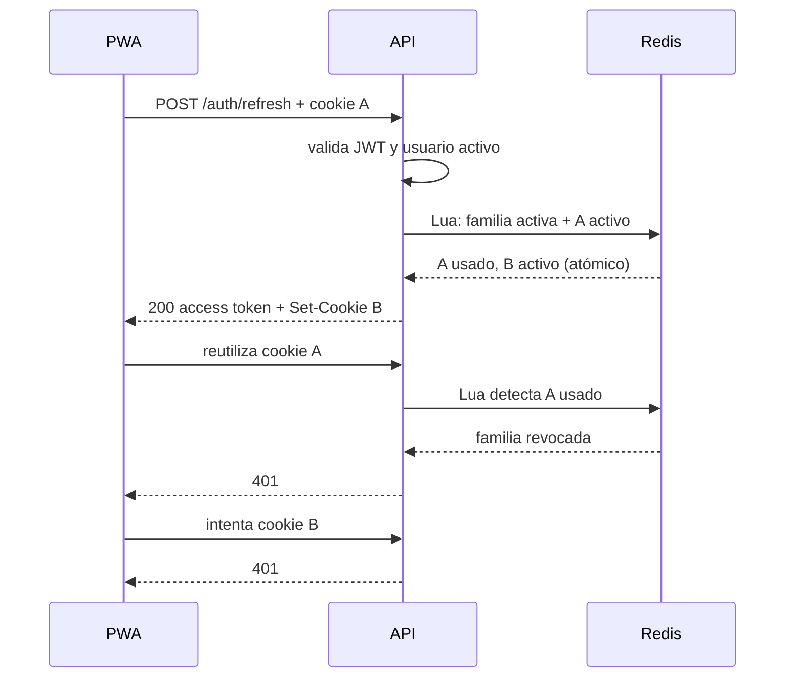

# API · Convenciones REST

Reglas para diseñar y cambiar endpoints de la API FastAPI (`backend/app/`). Para el paso a paso de un endpoint nuevo ve a [CREAR-API.md](CREAR-API.md).

Archivos clave: `app/main.py` (manejadores de error, límite de cuerpo, CORS), `app/core/security.py` (`get_usuario_actual`, `require_permiso`, `filtro_alcance`, `puede_otorgar`), `app/core/serial.py` (`a_json`), `app/core/limiter.py` (`limiter`, `clave_usuario`), `app/core/storage.py` (URLs firmadas), `app/routers/*.py`.

## Endpoints actuales (referencia)

| Método y ruta | Permiso | Respuesta OK |
|---|---|---|
| `POST /auth/login` | público (10/min por IP) | 200 `{access_token, token_type, usuario}` |
| `POST /auth/refresh` | cookie HttpOnly (10/min por IP) | 200 `{access_token, token_type}` |
| `POST /auth/logout` | cookie HttpOnly | 204 sin cuerpo |
| `GET /auth/me` | autenticado | 200 |
| `GET /health` | público | 200 `{"status":"ok"}` |
| `POST /incidencias` | `incidencias:crear` | **201** `{_id, codigo, estado}` |
| `GET /incidencias?estado&categoria&prioridad&edificio&limite` | `incidencias:ver` | 200 lista |
| `GET /incidencias/buscar?q=` | `incidencias:buscar` | 200 lista (máx. 20, por relevancia) |
| `GET /incidencias/{id}` | `incidencias:ver` | 200 |
| `PATCH /incidencias/{id}/seguimiento` | `seguimiento:registrar` | 200 `{ok, estado}` |
| `PATCH /incidencias/{id}/asignacion` | `incidencias:asignar` | 200 |
| `POST` / `DELETE /incidencias/{id}/tags` | `tags:gestionar` | 200 `{ok}` |
| `POST /incidencias/{id}/evidencias/firma` | `evidencias:subir` | 200 `{evidencia_id, url_storage, upload_url, expira_en}` |
| `POST /incidencias/{id}/evidencias` | `evidencias:subir` | **201** `{ok, evidencia_id}` |
| `GET /incidencias/{id}/evidencias/{evidencia_id}/url` | `incidencias:ver` | 200 `{url, expira_en}` |
| `POST /ia/analizar-imagen` (multipart) | `ia:usar` | 200 `AnalisisImagen`; 413 si supera 5 MB; 415 si la firma no es JPEG/PNG/WebP; 400 si está corrupta o fuera de 200–2600 px |
| `POST /ia/duplicados/adhesiones` | `ia:usar` + `incidencias:crear` | 200 `{ok, codigo, categoria, adhesiones, registrada}` |
| `GET /analitica/edificios`, `GET /analitica/tags` | `analitica:ver` | 200 lista |
| `GET /analitica/resumen` | `analitica:ver` | 200 `{abiertas, en_proceso, criticas, resueltas_periodo}` |
| `GET /analitica/aulas-cronicas` | `analitica:ver` | 200 lista `{edificio, piso?, aula, total}` |
| `GET /analitica/carga-tecnicos` | `analitica:ver` | 200 lista `{tecnico_id, incidencias_activas, horas_acumuladas}` |
| `GET /analitica/tendencia` | `analitica:ver` | 200 lista `{periodo, categoria, total}` |
| `GET /roles`, `POST /roles`, `PATCH /roles/{rol_id}`, `DELETE /roles/{rol_id}` | `roles:gestionar` | 200 / **201** / 200 / 200; 409 si el rol es del sistema o está asignado a usuarios |
| `GET /usuarios`, `POST /usuarios`, `PATCH /usuarios/{id}` | `usuarios:gestionar` | 200 / **201** / 200; `PATCH` a un usuario fuera del alcance gestionable responde **404** idéntico al de un id inexistente (no 403, para no revelar su existencia) |
| `GET /categorias` | autenticado | 200 |

El filtro `categoria` de `GET /incidencias` acepta cualquier clave con formato válido (`^[a-z][a-z0-9_]*$`, 3-30 caracteres) porque las categorías son dinámicas (T-019): una clave bien formada que no existe responde **200 `[]`**, no 400. Un formato inválido (mayúsculas, guiones, operadores) sigue respondiendo 400 `validacion`.

La documentación interactiva vive en **`/docs`** (OpenAPI de FastAPI). Es la fuente de verdad del contrato: si no aparece bien ahí, el endpoint no está terminado.

Los seis endpoints de `/analitica` aceptan `desde`, `hasta` y `categoria`. Las fechas son días calendario ISO `AAAA-MM-DD` en UTC y ambos extremos son inclusivos. El periodo filtra por `fecha_creacion` en abiertas, en proceso, críticas, etiquetas, aulas crónicas, carga de técnicos y tendencia; filtra por `fecha_resolucion` en resueltas y edificios. Una categoría incompatible con el alcance autorizado produce resultados vacíos o ceros, nunca amplía el alcance. Los resultados se guardan como JSON en Redis durante 300 segundos con claves separadas por endpoint, alcance y filtros; si Redis falla, la consulta autorizada se calcula en MongoDB sin caché.

`/analitica/aulas-cronicas` intersecta los filtros solicitados con la ventana cerrada `[ahora UTC - 30 días, ahora UTC]`; nunca cuenta fechas futuras ni permite ampliar los 30 días. La identidad del aula es `(edificio, piso, aula)` y solo se devuelve con tres o más incidencias. `/analitica/carga-tecnicos` considera activas `abierta`, `en_proceso` y `en_espera`, excluye incidencias sin asignación y suma una sola vez el campo persistido `horas_invertidas`. `/analitica/tendencia` agrupa `fecha_creacion` por `AAAA-MM` y categoría en UTC, sin rellenar meses sin datos.

---

## 1. Rutas y verbos

**API-01 · Recursos en plural y en español, kebab-case.** Un router por recurso en `app/routers/<recurso>.py` con `APIRouter(prefix="/<recurso>", tags=["<recurso>"])`. Subrecursos anidados bajo su padre. Acciones que no son CRUD van como subrecurso con sustantivo o verbo en kebab-case (`/ia/analizar-imagen`, `/evidencias/firma`).

```
✅ GET  /incidencias/{incidencia_id}/evidencias/{evidencia_id}/url
✅ POST /ia/analizar-imagen
❌ GET  /getIncidencia?id=...     ❌ POST /incidencia/crear     ❌ /Incidencias_Campus
```

**API-02 · Verbos HTTP con su significado.**

| Verbo | Uso | Ejemplo real |
|---|---|---|
| `GET` | Leer; nunca modifica nada | `GET /incidencias` |
| `POST` | Crear un recurso o ejecutar una acción | `POST /incidencias`, `POST /incidencias/{id}/tags` |
| `PATCH` | Modificar parte de un recurso | `PATCH /incidencias/{id}/seguimiento`, `PATCH /usuarios/{id}` |
| `DELETE` | Quitar | `DELETE /incidencias/{id}/tags` |
| `PUT` | No se usa en la API (solo el PUT directo al bucket con `upload_url`) | — |

**API-03 · Parámetros de ruta con nombre explícito** (`{incidencia_id}`, `{usuario_id}`), no `{id}` genérico. Filtros y paginación van en query string, validados con `Annotated[..., Query(...)]` y límites (`max_length`, `ge`, `le`).

## 2. Códigos de estado

**API-04 · Usa exactamente estos códigos** (RF-SIS-03):

| Código | Cuándo | Ejemplo en el código |
|---|---|---|
| **201** | Se creó un recurso. Declara `status_code=201` en el decorador | `@router.post("", status_code=201)` en `crear_incidencia`, `crear_rol`, `crear` (usuarios), `registrar_evidencia` |
| **200** | Lectura, actualización o acción sin recurso nuevo | seguimiento, tags, firma |
| **400** | Validación (Pydantic, `$jsonSchema`, id malformado, regla de negocio sobre los datos enviados) | `_oid()` → "Identificador inválido"; firma inexistente/expirada |
| **401** | Sin token, token inválido/expirado, usuario inactivo | `get_usuario_actual` |
| **403** | Autenticado pero **sin el permiso** (o intentando otorgar más de lo que tiene) | `require_permiso`, `puede_otorgar` |
| **404** | No existe **o está fuera de su alcance** | `_en_alcance()` |
| **409** | Conflicto con el estado actual: duplicado, transición no permitida, límite de evidencias, carrera | `DuplicateKeyError`, "Transición de estado no permitida" |
| **411** | POST/PUT/PATCH/DELETE con `Transfer-Encoding` y sin `Content-Length` | middleware `_limitar_body` |
| **413** | Cuerpo mayor al permitido | middleware `_limitar_body` |
| **415** | El contenido real del archivo usa un formato no permitido | `/ia/analizar-imagen` tras revisar *magic bytes* |
| **400** (imagen) | El formato es permitido, pero la imagen está corrupta o sus dimensiones son inválidas | `/ia/analizar-imagen` tras decodificar con Pillow |
| **429** | Límite de frecuencia o cupo diario | slowapi, cupo de IA, firmas por día, bloqueo de login |
| **503** | Dependencia externa no disponible o apagada (almacenamiento, IA) | `_requerir_cliente()`, IA deshabilitada |

**API-05 · 404 fuera de alcance, nunca 403.** Si la incidencia existe pero no está en el alcance del usuario, la respuesta es idéntica a la de una que no existe: `404 "Incidencia no encontrada"`. Así no se puede adivinar qué ids existen (BOLA, OWASP API1:2023). El 403 es solo para "tu rol no tiene ese permiso".

```python
# ✅ el filtro de alcance va en la misma consulta
doc = await get_db().incidencias_campus.find_one({"_id": _oid(incidencia_id), **filtro_alcance(usuario)})
if doc is None:
    raise HTTPException(404, "Incidencia no encontrada")

# ❌ revela que existe
doc = await get_db().incidencias_campus.find_one({"_id": oid})
if doc["reportante"]["usuario_id"] != usuario["_id"]:
    raise HTTPException(403, "No es tuya")
```

**API-06 · Orden de las comprobaciones:** 401 (token) → 403 (permiso, lo hace `require_permiso` antes de entrar a la función) → 400 (cuerpo; FastAPI lo valida) → 404 (alcance) → 409 (estado). No hagas consultas a la base antes de saber que el usuario tiene permiso.

**API-07 · Nunca 500 a propósito.** Errores esperados se convierten en `HTTPException` con código y mensaje. Errores de librerías externas (IA, almacenamiento) se capturan y se responden como 503 (ver `routers/ia.py`), sin incluir el error interno en el mensaje.

## 3. Forma de los errores

**API-08 · Una sola forma para todos los errores:**

```json
{
  "error": "codigo_estable",
  "detalle": "Mensaje claro en español"
}
```

`error` siempre es una cadena estable para que el cliente decida cómo presentar o tratar el fallo. `detalle` es una cadena, excepto en validaciones de entrada y de `$jsonSchema`, donde es una lista de objetos con `type`, `loc` y `msg`. Los manejadores comunes viven en `app/core/errores.py` y se registran en `main.py`; esto incluye las excepciones HTTP de FastAPI y Starlette, por lo que rutas inexistentes y errores generados por routers tienen el mismo contrato.

| Código | `error` | Ejemplo de `detalle` |
|---|---|---|
| 400 | `validacion` | `[{"type":"missing","loc":["body","titulo"],"msg":"Campo obligatorio"}]` o `"Identificador inválido"` |
| 401 | `no_autenticado` | `"No autenticado"` / `"Token inválido o expirado"` |
| 403 | `sin_permiso` | `"No tienes permiso para realizar esta acción"` |
| 404 | `no_encontrado` | `"Incidencia no encontrada"` |
| 409 | `conflicto` | `"Transición de estado no permitida"` |
| 409 por `DuplicateKeyError` | `duplicado` | `"Registro duplicado"` |
| 411 | `longitud_requerida` | `"Se requiere la cabecera Content-Length"` |
| 413 | `cuerpo_demasiado_grande` | `"El cuerpo de la solicitud es demasiado grande"` |
| 415 | `tipo_no_soportado` | `"Tipo de contenido no soportado"` |
| 429 | `limite` | `"Demasiadas solicitudes. Intenta de nuevo más tarde."` |
| 503 | `no_disponible` | `"El servicio no está disponible temporalmente"` |

FastAPI genera internamente HTTP 422 cuando Pydantic rechaza el body, los parámetros o la ruta. El manejador lo transforma en HTTP 400 y conserva la ubicación necesaria para asociar el error a un campo:

```json
{
  "error": "validacion",
  "detalle": [
    {
      "type": "missing",
      "loc": ["body", "titulo"],
      "msg": "Campo obligatorio"
    }
  ]
}
```

La lista nunca incluye `input`, `ctx`, `url` ni valores enviados por el cliente. Un `WriteError` de MongoDB con código 121 también produce HTTP 400 y un detalle general de validación. Un `DuplicateKeyError` produce HTTP 409 sin nombres de índices, campos internos, consultas ni valores duplicados. Otros errores de escritura devuelven un mensaje interno genérico.

Los 429 de SlowAPI, el límite global, el bloqueo de login y el límite de firmas incluyen `Retry-After` cuando el mecanismo que aplicó el límite proporciona un tiempo fiable. SlowAPI y el límite global consultan `get_window_stats()` y convierten su marca temporal absoluta de reinicio en segundos restantes. El bloqueo de login usa el TTL de las claves de IP y cuenta que hayan excedido su cuota; si ambas bloquean, usa el mayor TTL porque la petición solo será admisible cuando las dos hayan vencido. El límite diario de firmas calcula los segundos hasta la siguiente medianoche UTC, que es cuando cambia la fecha de la clave; el TTL de 48 horas solo conserva el contador y no define la ventana diaria.

Redis devuelve `-1` si una clave no tiene expiración y `-2` si ya no existe. Nunca se convierten esos valores en una espera ficticia: un bloqueo de login sin expiración se conserva pero omite `Retry-After`, mientras que una clave de login ya expirada deja de bloquear. Si falla una consulta auxiliar después de detectar el exceso, se conserva el 429, se registra la causa y se omite la cabecera no fiable. Por ello, los clientes validan `Retry-After` como segundos enteros cuando está presente, pero toleran su ausencia. Si Redis o el almacenamiento de `limits` falla antes de poder decidir el límite, el manejador de dependencia devuelve 503 con detalle genérico y registra la excepción para diagnóstico.

Los `HTTPException` conservan cabeceras relevantes como `WWW-Authenticate` y cualquier `Retry-After` definido por el endpoint. Las respuestas de error mantienen CORS, las cabeceras de seguridad y `Cache-Control: no-store`.

Regla para código nuevo: usa `raise HTTPException(código, "Mensaje en español para el usuario")`. No construyas respuestas de error ad hoc, no devuelvas errores con HTTP 200 y no incluyas mensajes técnicos o valores de la solicitud. Si agregas un código nuevo, define primero su `error` estable en el manejador común y documenta el contrato.

```python
# ✅ raise HTTPException(409, "La incidencia está cerrada")
# ❌ raise HTTPException(409, "matched_count == 0")          # técnico
# ❌ return JSONResponse({"ok": False, "msg": "..."}, 200)    # error con 200
```

**API-09 · Los errores no reflejan lo que mandó el cliente.** `manejar_validacion` elimina `input`, `ctx` y `url` del detalle para no devolver contraseñas u otros valores. No pongas valores enviados en los mensajes (`f"El correo {correo} no existe"` ❌); usa textos constantes como `"El rol indicado no existe"`. Login responde igual "Credenciales inválidas" exista o no el correo.

## 4. JSON

**API-10 · Nombres en `snake_case` y en español**, igual que en MongoDB: `fecha_creacion`, `tecnico_asignado`, `peso_bytes`. Nada de `camelCase`.

**API-11 · Ids como string.** Todo `ObjectId` sale como string de 24 hex; la clave del documento es `_id` (así lo devuelven `a_json` y `crear_incidencia`). Los ids de evidencia son UUID v4 en string. Un id que llega en la ruta se valida con `_oid()` (400 si está malformado).

**API-12 · Serializar siempre con `a_json()`** (`app/core/serial.py`): convierte `ObjectId` anidados a string, convierte fechas con zona a UTC terminado en `Z` y **elimina `password_hash` a cualquier profundidad**. Además, proyecta para no leer de más (`PROYECCION = {"password_hash": 0}` en `usuarios.py`, `PROYECCION_LISTA` en `incidencias.py`).

```python
# ✅ return [a_json(d) async for d in cursor]
# ❌ d["_id"] = str(d["_id"]); return d     # ObjectId anidados rompen, no filtra password_hash
```

**API-13 · Nunca devolver secretos:** `password_hash`, tokens de otros usuarios, claves del bucket, `ANTHROPIC_API_KEY`, URLs firmadas de subida de otro usuario, contenido de `.env`. La suite e2e usa `ClienteSeguro`, que falla si cualquier respuesta contiene `password_hash`.

**API-14 · Fechas en ISO 8601 UTC.** En MongoDB se guardan como `date` BSON con `datetime.now(timezone.utc)` (nunca hora local ni string). `a_json()` convierte cualquier offset explícito a UTC y el JSON siempre termina en `Z` (`2026-10-19T14:02:00Z` o con su fracción de segundo). Una fecha sin zona horaria se rechaza para evitar interpretar un instante ambiguo. La PWA convierte a `America/Mexico_City` solo al mostrar (UX-28). El único cálculo con zona local en el backend es el día del folio (`generar_codigo` usa `ZONA`).

**API-15 · Sin `null` en las respuestas de documentos.** Un campo que no aplica no se envía (p. ej. `fecha_resolucion` y `tecnico_asignado` no existen hasta que aplican). Los schemas de entrada usan `model_dump(exclude_none=True)`.

## 5. Límites, paginación y frecuencia

**API-16 · Todo listado tiene tope.** `GET /incidencias` acepta `limite` (1–100, por defecto 100) y ordena por `fecha_creacion` descendente; `/incidencias/buscar` devuelve máximo 20. Un endpoint nuevo de lista declara `limite: Annotated[int, Query(ge=1, le=100)]`. Prohibido devolver colecciones completas sin `limit` (excepto catálogos pequeños: roles, categorías). Si se necesita paginar más allá de 100, se usa cursor por `fecha_creacion`/`_id` (`?antes_de=`), no `skip` grande.

**API-17 · Límites de tamaño.**

| Qué | Límite | Dónde |
|---|---|---|
| Cuerpo JSON de cualquier POST/PUT/PATCH/DELETE | 64 KB | `MAX_BODY_DEFECTO` en `main.py` |
| `POST /ia/analizar-imagen` (cuerpo) | 6 MB; imagen ≤ 5 MB, JPEG/PNG/WebP | `MAX_BODY`, `routers/ia.py` |
| Evidencia (va directo al bucket, no pasa por la API) | 10 MB; JPEG, PNG, WebP o PDF | `EvidenciaFirmaIn` |
| Evidencias por incidencia | 10 (guardadas + firmas pendientes); 5 pendientes por usuario | `MAX_EVIDENCIAS` |
| Historial de seguimiento | últimas 200 entradas (`$slice`) | `MAX_HISTORIAL` |
| Horas acumuladas por incidencia | 1000 | `MAX_HORAS` |
| Horas por entrada de seguimiento | 0–24, en incrementos de 0.25 | `SeguimientoIn` |
| Tags por incidencia | 15 | `IncidenciaIn`, `TagsIn`, `$jsonSchema` |

Un endpoint que necesite más de 64 KB se agrega a `MAX_BODY` en `main.py` con justificación en el PR.

`POST /ia/analizar-imagen` no confía en el nombre, la extensión ni el `Content-Type` declarado. Lee como máximo 5 MB,
detecta JPEG/PNG/WebP por *magic bytes* y usa Pillow para comprobar la decodificación y dimensiones reales. Un archivo mayor
devuelve 413; una firma no permitida, 415; y una imagen corrupta o con ancho/alto fuera de 200–2600 px, 400.

**API-18 · Límites de frecuencia existentes** (no los quites; los nuevos se agregan aquí):

| Límite | Valor | Clave |
|---|---|---|
| Login | 10/minuto | IP (`limiter` por defecto) |
| Refresh | 10/minuto | IP (`limiter`; el refresh no viaja como Bearer) |
| Login fallido | 10 en 15 min por (correo, IP); 50 en 15 min por correo | Redis `login:fallos:*` |
| Escrituras (`POST /incidencias`, `PATCH .../seguimiento`) | `LIMITE_ESCRITURA` = 60/minuto | usuario (`clave_usuario`) |
| Firmas de evidencia | 50 por usuario al día | Redis `firmas:usuario:*` |
| IA | 20 por usuario al día (`IA_LIMITE_DIARIO`); 300 global al día (503) | Redis `ia:uso:*` |

Todo endpoint nuevo **que escribe** lleva `@limiter.limit(lambda: settings.limite_escritura, key_func=clave_usuario)` y recibe `request: Request` como primer parámetro (slowapi lo exige).

## 6. Idempotencia y atomicidad

**API-19 · Una escritura = una operación atómica de MongoDB.** Las condiciones de negocio van en el **filtro** del `update_one`, no en un `find` previo, para que no haya carreras. Si `matched_count == 0`, se distingue 404 (con `_en_alcance`) de 409.

```python
# ✅ (registrar_seguimiento) la transición se valida en el mismo update
res = await col.update_one({"$and": [{"_id": oid, "estado": {"$in": origenes}}, filtro_alcance(usuario)]}, update)
if res.matched_count == 0:
    await _en_alcance(incidencia_id, usuario)   # 404 si no existe o fuera de alcance
    raise HTTPException(409, "Transición de estado no permitida")

# ❌ leer, decidir en Python y luego escribir: dos peticiones simultáneas pasan ambas
doc = await col.find_one({"_id": oid}); if doc["estado"] == "abierta": await col.update_one(...)
```

**API-20 · Operadores atómicos:** `$set`, `$inc`, `$push` con `$each` + `$slice`, `$addToSet` con `$each`, `$pull`, `$unset`. Prohibido reescribir el documento completo (`replace_one`) o arreglos completos con `$set`.

**API-21 · Idempotencia donde el cliente puede repetir.** Agregar/quitar tags es idempotente (`$addToSet`/`$pull`). Registrar evidencia consume la firma con `GETDEL` (un solo uso) y el filtro `evidencias_adjuntas.evidencia_id: {"$ne": ...}` evita duplicados. `POST /incidencias` **no** es idempotente: la PWA deshabilita el botón al enviar (UX-17). Un endpoint nuevo que el usuario pueda reintentar debe diseñarse para que repetirlo no duplique datos.

## 7. Contrato y documentación

**API-22 · Versionado del contrato.** La API no tiene prefijo `/v1`. Por eso:
- Agregar un campo opcional a una respuesta o un parámetro opcional: permitido.
- Quitar, renombrar o cambiar el tipo de un campo, o volver obligatorio algo opcional: **cambio que rompe**. Se hace solo en un PR que actualice también la PWA (FRONT-BACK.md FB-12), Postman y estas reglas, y sube `version` en `FastAPI(title="UTM Desk API", version=...)` de `main.py`.
- Cambios en la forma del documento en MongoDB suben `schema_version` (ver BASE-DE-DATOS.md).

**API-23 · OpenAPI en `/docs` completo.** Cada endpoint tiene `tags` (del router), nombre de función descriptivo en español (`registrar_seguimiento`, no `post2`), y schemas Pydantic de entrada. Si la respuesta tiene forma fija, declara `response_model` (como `/ia/analizar-imagen`).

**API-24 · Todo endpoint nuevo o modificado actualiza Postman** (`postman/UTM-Desk.postman_collection.json`) en el mismo PR: una petición del caso feliz en su carpeta y, en "Pruebas negativas", al menos los casos 400, 403 y 404 (fuera de alcance). Usa variables del entorno `UTM-Desk.local` (`{{base_url}}`, `{{token}}`, `{{token_reportante}}`, `{{incidencia_id}}`…), nunca valores pegados. Postman CLI está disponible para correr la colección.

**API-25 · Entradas siempre con schema Pydantic**, `extra="forbid"` y límites en todo campo (ver CREAR-API.md). Nunca `dict` o `Request.json()` crudos: un body crudo permite inyectar operadores de MongoDB (`{"$ne": ""}`) — RNF-13.

## 8. Acciones de fase 2 sobre incidencias (T-021)

`POST /incidencias/{id}/confirmacion` permite exclusivamente al reportante propietario actuar sobre una incidencia
`resuelta`. La acción `confirmar` cambia el estado a `cerrada` y conserva `fecha_resolucion`; la acción `reabrir`
realiza la transición especial `resuelta -> abierta` solo si `fecha_resolucion` se encuentra entre el instante UTC
actual menos siete días y el instante actual, ambos límites incluidos. La reapertura elimina `fecha_resolucion` con
`$unset`. Esta excepción no forma parte de la tabla general de transiciones: la reapertura técnica
`resuelta -> en_proceso` permanece sin cambios.

`POST /incidencias/{id}/comentarios` permite al reportante propietario agregar información solo cuando el estado es
`en_espera`. No cambia estado, asignación ni `horas_invertidas`. `POST /incidencias/{id}/tomar` no recibe identidad
de técnico: usa al técnico autenticado y solo admite incidencias sin asignar de su área en `abierta`, `en_proceso` o
`en_espera`; `resuelta` y `cerrada` no son elegibles.

Las tres rutas incluyen alcance, propiedad cuando aplica, estado esperado y condiciones de concurrencia en el filtro
atómico de MongoDB. Cada escritura agrega exactamente una entrada de `historial_seguimiento` con horas cero y conserva
el límite de 200 mediante `$slice`. Un estado incompatible, plazo vencido, incidencia ya tomada o carrera perdida
responde 409. La falta del permiso o la inelegibilidad del actor responde 403. Un recurso inexistente o fuera de
alcance responde siempre 404 para no revelar su existencia; por ello el caso históricamente llamado
`test_tomar_otra_area_403` comprueba 404 conforme a la política BOLA vigente.

## 9. Bitácora administrativa (T-022)

`GET /auditoria` permite exclusivamente al rol `admin` consultar los cambios administrativos ya aplicados sobre
usuarios, roles y categorías. Requiere autenticación y el permiso vigente `usuarios:gestionar`; además comprueba el
rol real para impedir que un gestor delegado consulte la bitácora. No se agregó un permiso ni un rol nuevo.

La consulta acepta `pagina` (desde 1), `limite` (1 a 100, por defecto 20) y el filtro opcional `recurso`, limitado a
`usuarios`, `roles` o `categorias`. Responde `{pagina, limite, total, resultados}` y ordena de forma estable por
`fecha` descendente y `_id` descendente. La API construye el filtro desde valores tipados, aplica una proyección
explícita y serializa fechas e identificadores con `a_json()`; no admite filtros MongoDB arbitrarios.

Los eventos contienen solo resúmenes de campos permitidos. Nunca incluyen contraseñas, hashes, tokens, cookies,
cabeceras, cuerpos HTTP completos ni datos personales innecesarios. Las creaciones omiten `antes`; las ediciones
incluyen resúmenes `antes` y `despues`. Si la persistencia de la auditoría falla, se emite una advertencia segura con
el recurso, la acción y la clase del error, pero la operación administrativa principal conserva su respuesta exitosa.

## 10. Sesión con refresh token (T-014)

`POST /auth/login` conserva el access token en el JSON y emite un JWT de refresh independiente exclusivamente en la cookie `refresh_token`. La cookie es `HttpOnly`, usa `Path=/auth`, `SameSite=Lax` por defecto y `Secure=true` en producción. Su expiración coincide con `JWT_REFRESH_DAYS`. El entorno e2e local declara `REFRESH_COOKIE_SECURE=false` porque usa HTTP; esa configuración no se debe reutilizar en producción.

`POST /auth/refresh` no acepta body ni una cabecera alternativa: lee la cookie, valida firma, `iss`, `aud`, `iat`, `exp`, `type=refresh`, `jti` y `family_id`, comprueba que el usuario siga activo y rota el token en Redis. Devuelve solo `{access_token, token_type}` y reemplaza la cookie. Ausencia, alteración, expiración, revocación o tipo incorrecto responden 401 con el contrato `{error, detalle}`.

`POST /auth/logout` revoca la familia cuando la cookie representa una sesión conocida, expira la cookie y devuelve exactamente 204 sin cuerpo. Sin cookie o con una cookie ya inválida también es idempotente y devuelve 204. Si Redis no está disponible para revocar una sesión válida, el endpoint falla de forma segura con 503 en vez de aparentar que la revocación ocurrió.

Cada familia y cada `jti` se conserva en Redis hasta el vencimiento absoluto de la familia. La rotación es un script Lua indivisible: exige familia activa y token activo, marca el `jti` anterior como usado y registra el nuevo. Si reaparece un `jti` usado o revocado, el mismo script marca la familia como revocada; todos sus descendientes dejan de funcionar. Un JWT falsificado o un `jti` desconocido no puede revocar una familia.



La protección CSRF combina `SameSite=Lax` con validación estricta de `Origin` en refresh y logout. Los clientes no navegador pueden omitir `Origin`; si un navegador lo envía, debe coincidir exactamente con `CORS_ORIGINS`. Si un despliegue realmente necesita `SameSite=None`, debe conservar `Secure=true`, HTTPS y la validación de `Origin`. CORS permite credenciales solo a la lista explícita de orígenes, nunca a `*`.

La integración posterior del frontend debe usar `credentials: "include"` en login, refresh y logout. Hasta que esa coordinación se implemente, el access token continúa en memoria y no debe persistirse en `localStorage`, `sessionStorage` ni cookies accesibles desde JavaScript.

---

## 11. Auditoría y métricas de IA (T-035)

`POST /ia/eventos` requiere `ia:usar` y acepta únicamente `analisis_id`, `evento` y un motivo controlado opcional.
El navegador solo puede declarar `editado`, `deshecho` o `fallback`; nunca puede informar un envío exitoso,
tokens, costo o latencia. La API comprueba que la oferta exista, no haya vencido y pertenezca al usuario
autenticado mediante una clave HMAC seudónima. Una oferta ajena se trata como inexistente (404).

Cada oferta ocupa un único documento de `ia_eventos`. `editado` es una marca intermedia; `deshecho`, `enviado`,
`duplicado_sumado` y `fallback` son resultados finales. El resultado se escribe con un filtro atómico que exige la
ausencia de `resultado_final`: repetir el mismo resultado es idempotente y un resultado incompatible responde 409.
La colección no guarda nombres, correos, fotos, prompts, respuestas completas ni identificadores directos del actor.

`GET /analitica/ia` requiere el permiso `analitica:ver` y, adicionalmente, el rol real `admin`. Admite `desde`,
`hasta`, `categoria`, `proveedor` y `modelo`; el periodo máximo es de 180 días y el predeterminado son los últimos
30 días. La respuesta contiene únicamente agregados. Los porcentajes sin denominador y los costos que el proveedor
no informó se expresan como `null`, nunca como cero inventado. La alerta diaria compara costo estimado confiable con
`IA_UMBRAL_COSTO_DIARIO_USD`; es informativa y no bloquea la IA.

La corrección técnica en 72 horas se devuelve explícitamente como no disponible mientras el historial de incidencias
no registre cambios de categoría/prioridad y el rol que los efectuó. T-035 no amplía T-021 ni fabrica esa información.

## Checklist de revisión API

- [ ] Ruta en plural, español, kebab-case; verbo HTTP correcto.
- [ ] 201 al crear (`status_code=201`); 200 en el resto de éxitos.
- [ ] 403 solo por permiso; **404** si no existe o está fuera de alcance.
- [ ] Errores con `HTTPException(código, "mensaje en español")`; sin valores enviados en el mensaje.
- [ ] Respuesta serializada con `a_json`; ids como string; sin `password_hash` ni secretos; sin `null`.
- [ ] Fechas en UTC (`datetime.now(timezone.utc)`), sin strings de fecha.
- [ ] Listas con `limite` acotado; cuerpo ≤ 64 KB o agregado a `MAX_BODY` con justificación.
- [ ] Escritura atómica (condiciones en el filtro) y con rate limit por usuario.
- [ ] No rompe el contrato, o actualiza PWA + Postman + versión en el mismo PR.
- [ ] Aparece correctamente en `/docs`.
- [ ] Colección de Postman actualizada (caso feliz + 400/403/404).

### Autor de la bitácora

`GET /incidencias/{id}` agrega `autor_nombre?: string` a cada entrada de `historial_seguimiento` cuando el usuario aún existe. Es el nombre actual, consultado después de comprobar el alcance; no se persiste en MongoDB. No incluye correo ni otros campos del usuario. Si el usuario ya no existe, se omite y la interfaz muestra la referencia disponible o «Usuario no disponible».
